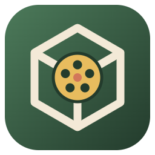

# MyModellerReel brand

**MyModellerReel** = _My_ (the family prefix) + _Modeller_ (3D modelling) + _Reel_ (animation, sequences, video).
One word, capital M, M and R. Lower-case `mymodellerreel` only for technical ids. App ID `com.mymodellerreel.app`.

Tagline: **Model it. Reel it. Ship it.**

## Logo

A cream **isometric cube** (the model) with the family's mustard **film reel** at its heart and the rust **hub**, on
the family tile (rounded square, `rx 56` on a 256 artboard). The geometry is a nod to Bauhaus: primary solids and the
family's softened primaries (mustard, rust, arctic, ink).

- Source: [`resources/icon.svg`](../resources/icon.svg). Regenerate the PNG with
  `npx electron scripts/make-icon.cjs`.
- Wordmark: "My" regular, **Modeller** bold cream, **Reel** bold mustard, at `--my-text-lg`.

## Fern: the MyModellerReel colour

Each family app keeps the tile shape and changes only its colour, so they stay apart in the taskbar:

| App | Tile gradient |
| --- | --- |
| MySnipReel Capture | Arctic `#2F6F86` → Ink `#1E3A4C` |
| MySnipReel Editor | Rust `#D2775A` → `#8A4330` |
| MyVoiceReel | Plum `#7A4F7E` → `#3E2742` |
| **MyModellerReel** | **Fern `#4C7A5A` → deep fern `#233B2C`** |

As in MyVoiceReel, the identity colour is also the chrome: `src/renderer/styles.css` sets `--my-chrome` to deep fern
and adds `--mmr-fern`/`--mmr-fern-deep`. Fern is not a shared Darkroom token; the accent stays Arctic and the
playhead/attention colour stays Mustard.

## Design system

Darkroom, the family system: [`src/renderer/tokens.css`](../src/renderer/tokens.css) is copied unchanged from
MySnipReel. Phosphor icons (regular; fill only for "on" states), Open Sans 400/600/700, the 4 px grid, three
elevations. Viewport-only colours (axis red/green/blue, snap markers) are content, not chrome.
