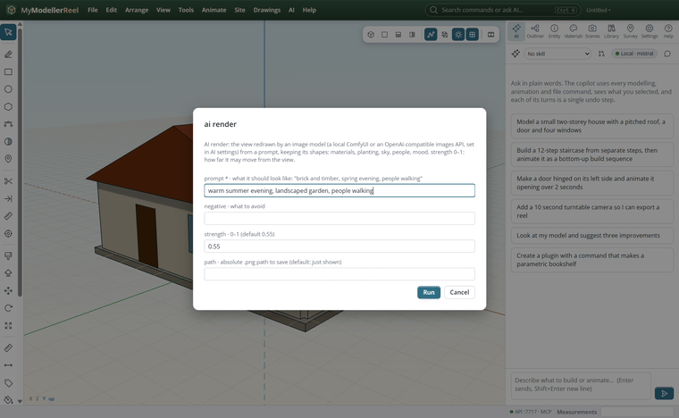
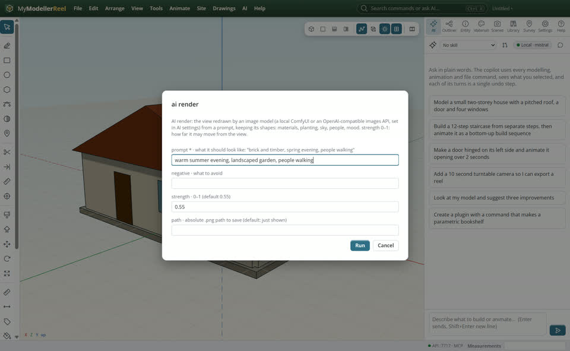

# AI render: the view redrawn by an image model

You want a quick mood picture of the design: materials, planting, people and light painted onto the view, keeping its shapes.



## In the app

1. **Settings › Image model**: ComfyUI on this PC (with a checkpoint such as SDXL) or an OpenAI-compatible images API with its key.
2. Frame the view, **View › AI render…** [AI render](action:aiRender): describe the look; strength says how far it may move from the view.
   

## Ask the copilot

> Render this view as a warm summer evening with a landscaped garden and people walking, keeping the building as it is.

The copilot runs the same commands as the steps above; with **AI › Propose AI changes for review** on, you accept or reject its changes first.

## From a script, the HTTP API or MCP

```js
const r = await api.ai_render({ prompt: 'summer evening, landscaped garden, people walking', strength: 0.5, path: 'C:/out/mood.png' });
```

## Good to know

- The view is sent to the image model you chose; with ComfyUI it never leaves this PC.
- Lower strength keeps the geometry closer; higher strength lets the model invent more.

## Related

- [Present a design](howto:present-a-design)
