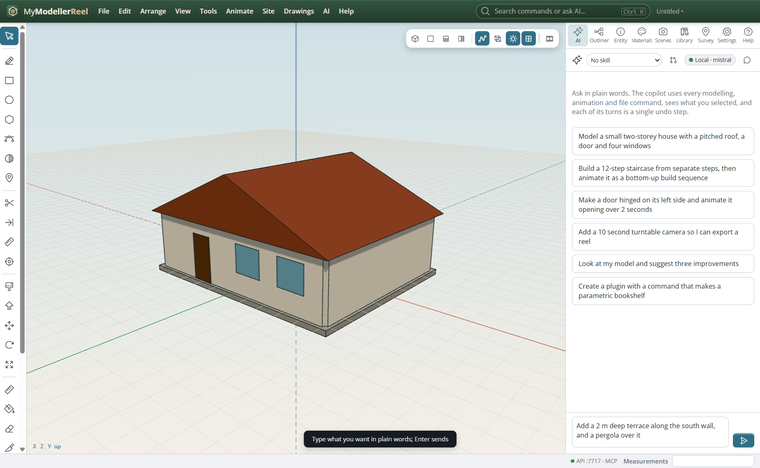
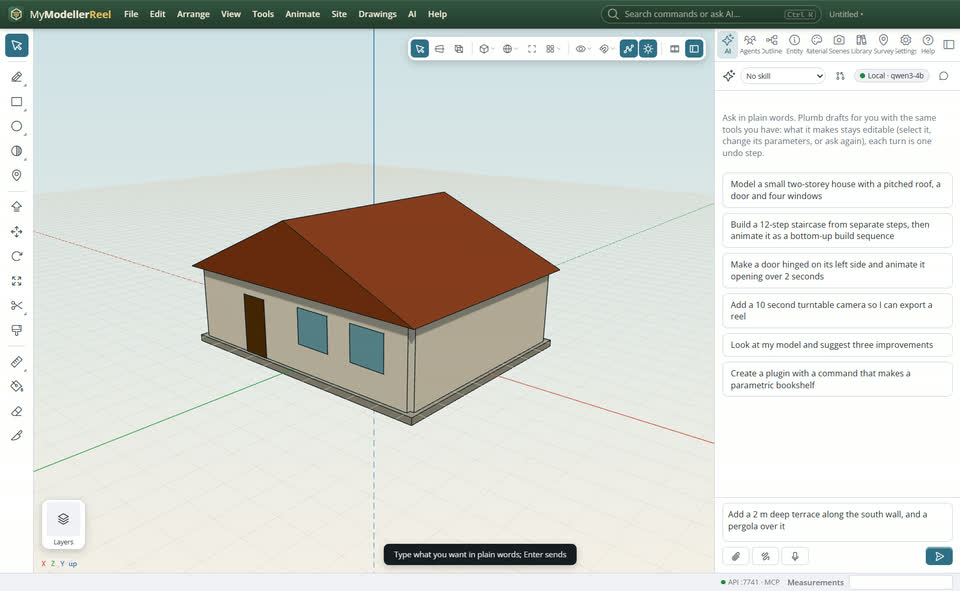
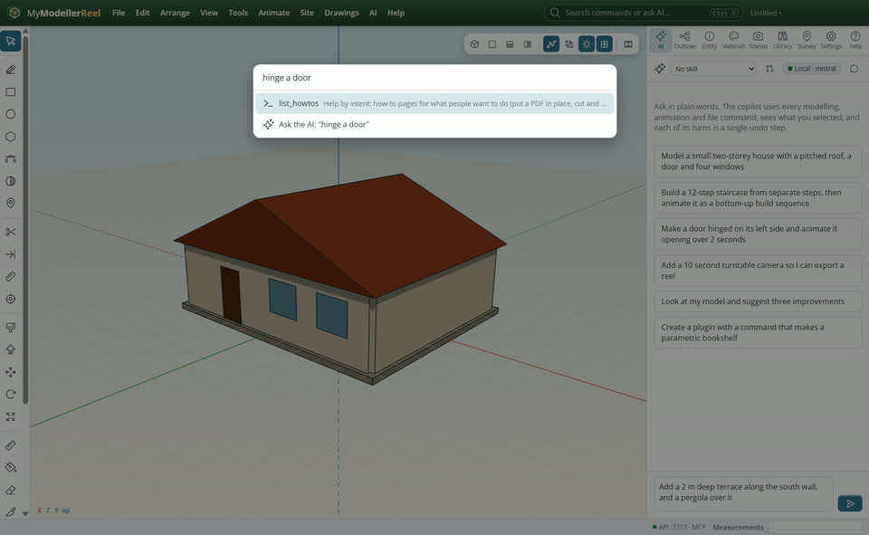

# Ask Plumb to build or change something

You would rather say what you want than click it: Plumb (Claude, or a local model) drives the same commands as the menus.



## In the app

1. The AI panel: type what you want in plain words and press Enter. It sees your selection; each of its turns is one undo step; the stop button stops it.
   
2. **Ctrl+K** searches every command by what you want to do ("hinge a door") and can ask the AI from there.
   

## Ask Plumb

> Add a 2 m deep terrace along the south wall, and a pergola over it.

Plumb runs the same commands as the steps above; with **AI › Propose AI changes for review** on, you accept or reject its changes first.

## From a script, the HTTP API or MCP

```js
// Any AI can drive the app through MCP (src/mcp/server.js) or the HTTP API on 127.0.0.1:7717:
await fetch('http://127.0.0.1:7717/api/run', { method: 'POST', headers: { authorization: 'Bearer <token from api.json>' }, body: JSON.stringify({ command: 'list_commands', args: { query: 'hinge a door' } }) });
```

## Good to know

- **AI › Propose AI changes for review** shows the changes as a preview to accept or reject.
- Skills (Architecture, Landscape, Jobsite…) give Plumb domain know-how.

## Related

- [Check a model and count what is in it](howto:review-and-quantities)
