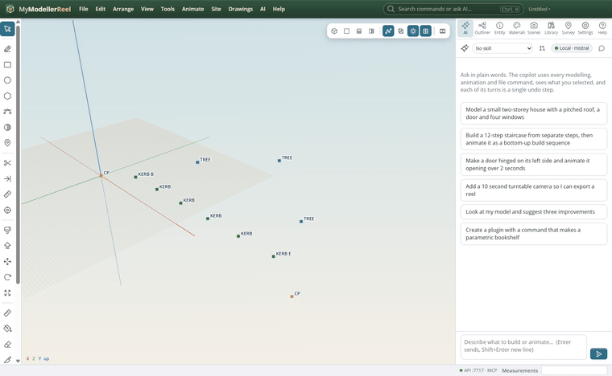
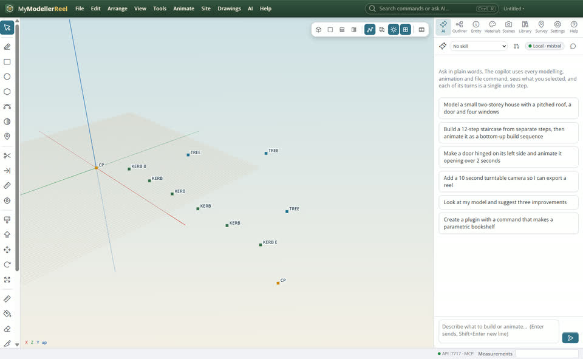
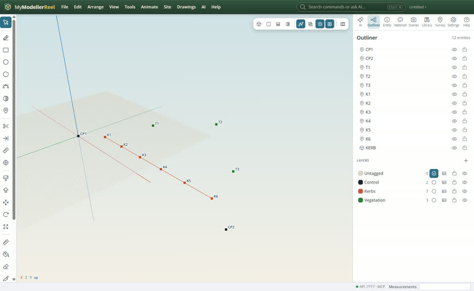
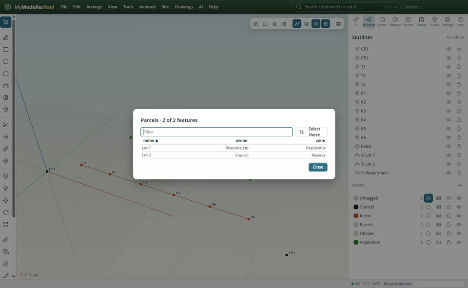
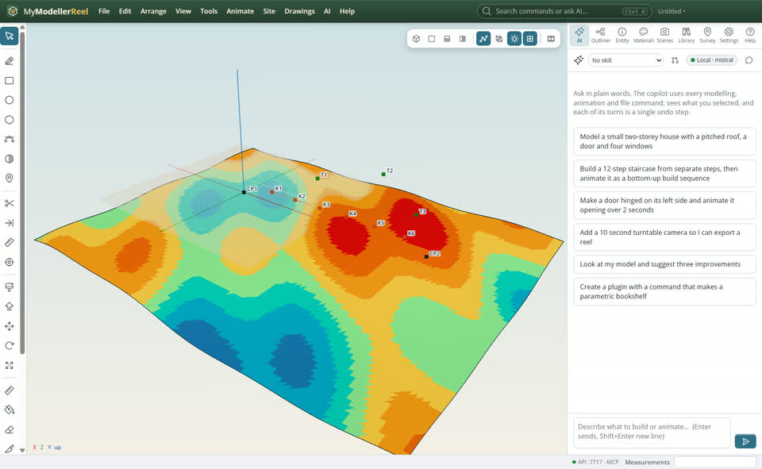

# Bring in field and GIS data: JobXML, FXL, GeoJSON, Shapefile, DEM

You have data from the field (a controller job, its feature library), from GIS (parcels, utilities) or an elevation model, and want it in the model with its codes and attributes.



## In the app

1. **File › Import…** [Import](action:import) a Trimble JobXML (.jxl): points with codes and feature attributes; deleted points stay out.
   
2. Import the job's feature library (.fxl): codes get their layers, colours and attributes, and the points are processed again.
   
3. Import GeoJSON or a Shapefile: parcels and lines with their attributes, on their layers (the table icon on a layer shows them).
   
4. **Site › Import terrain (GeoTIFF, ASCII grid)…** [Import terrain](action:importTerrain): a real elevation model as a surface; big grids are thinned.
   

## Ask the copilot

> Import C:\field\topo.jxl with its feature library library.fxl, then the parcels from parcels.geojson, and list the lots with their owners.

The copilot runs the same commands as the steps above; with **AI › Propose AI changes for review** on, you accept or reject its changes first.

## From a script, the HTTP API or MCP

```js
await api.import({ path: 'C:/field/topo.jxl' });
await api.import({ path: 'C:/field/library.fxl' });
await api.import({ path: 'C:/gis/parcels.geojson' });
await api.query_features({ layer: 'Parcels' });
await api.import_terrain({ path: 'C:/gis/terrain.asc' });
await api.export({ format: 'shp', path: 'C:/out/site.shp' });
```

## Good to know

- Coordinates are used as they are, in project units: a file in another coordinate system is flagged, not converted. Longitude / latitude GeoJSON needs reprojecting first.
- Shapefile export writes one .shp / .shx / .dbf set per kind: points, lines, polygons.
- `drape_image` lays an aerial photo (an underlay) onto a surface.

## Related

- [Bring in a LandXML, IFC or DXF file](howto:bring-in-landxml-ifc-dxf)
