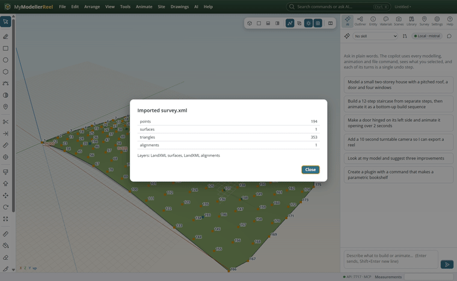
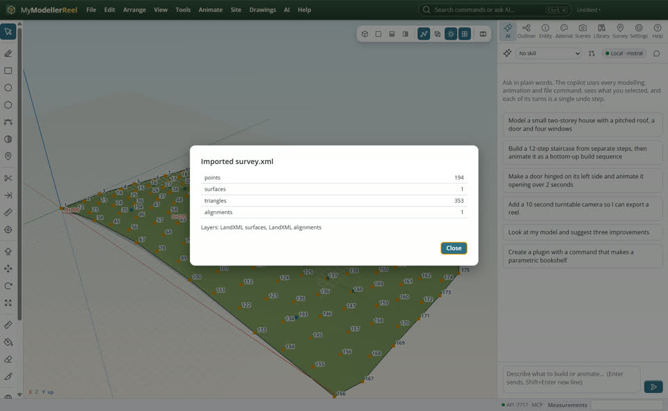
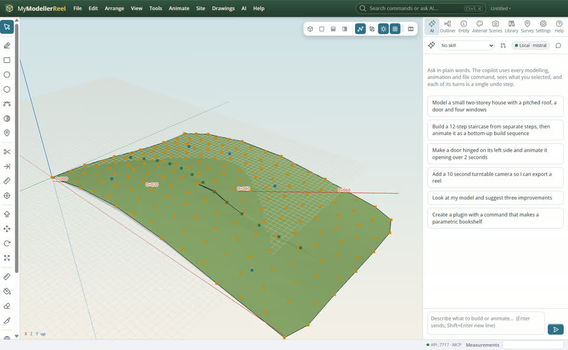
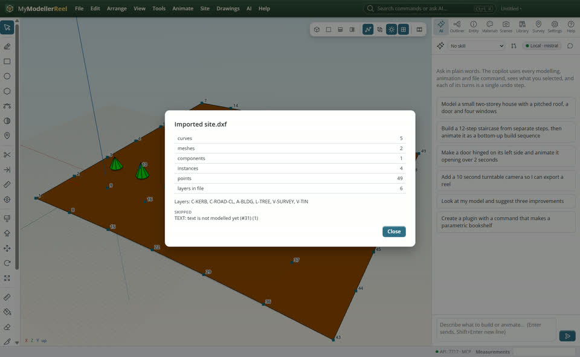
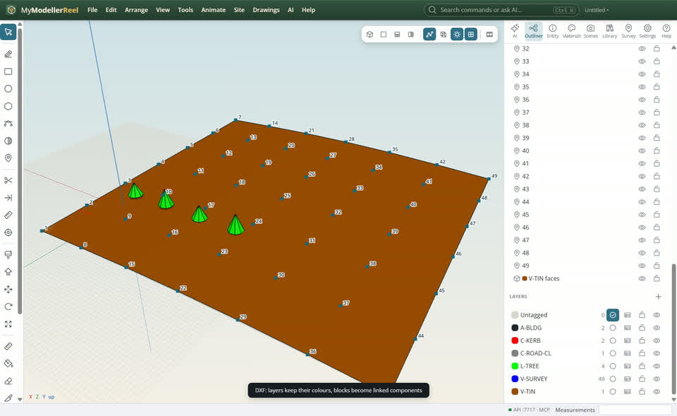

# Bring in a LandXML, IFC or DXF file

Someone sent you survey data (LandXML), a BIM model (IFC) or a CAD drawing (DXF) and you want it in the model, with its structure.



## In the app

1. **File › Import (LandXML, IFC, DXF, models)…** [Import](action:import). The report says what came in and what was skipped, and why.
   
2. LandXML: points with codes, TIN surfaces, alignments with their profiles, plan features. They are live: build a corridor on the imported road.
   
3. DXF: layers with their colours, line types and states; blocks become linked components; 3D faces, points and polylines (arcs too).
   
4. IFC: the site / building / storey tree, IFC classes, property sets as data, layers and the georeferencing.
   

## Ask Plumb

> Import C:\exchange\survey.xml and tell me what came in.

Plumb runs the same commands as the steps above; with **AI › Propose AI changes for review** on, you accept or reject its changes first.

## From a script, the HTTP API or MCP

```js
const r = await api.import({ path: 'C:/exchange/survey.xml' });
// r.created, r.skipped, r.warnings
await api.import({ path: 'C:/exchange/plan.dxf', coordinates: 'project' });
await api.import({ path: 'C:/exchange/house.ifc' });
await api.query_features({ layer: 'A-WALL' });
```

## Good to know

- DXF without units: pass `units` (m, ft, usft). Big numbers are read as project coordinates around a base point.
- DWG: save it as DXF first. SketchUp: go through IFC, DXF or glTF for now.

## Related

- [Export to IFC, DXF or LandXML for BIM and CAD tools](howto:share-with-bim-tools)
- [Organise a model with layers and attributes](howto:organise-with-layers)
