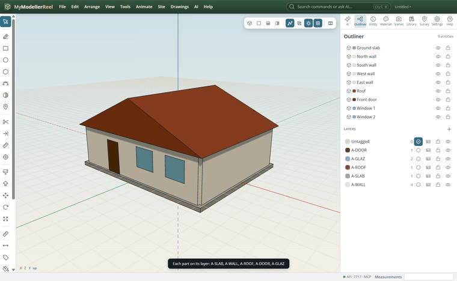
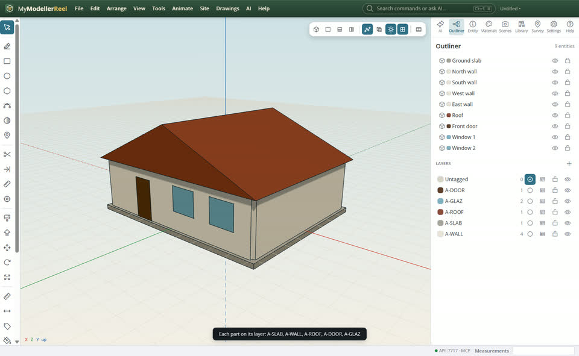
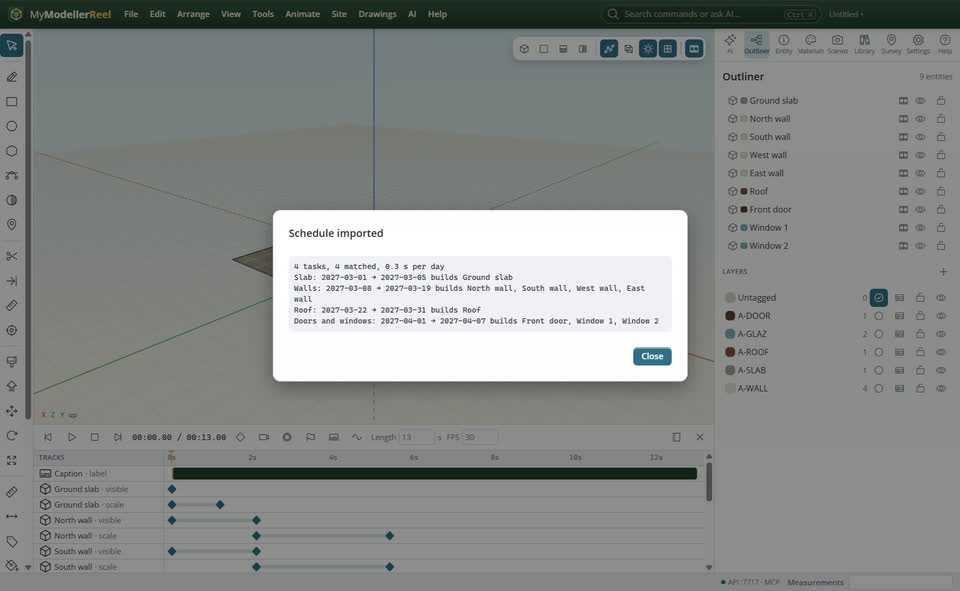
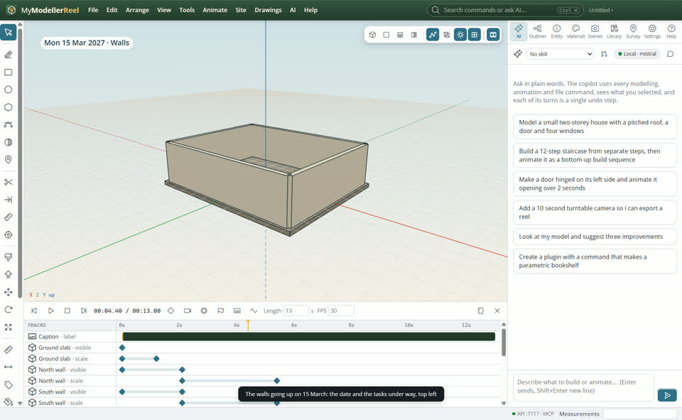

# Build a 4D sequence from a project schedule

You have the construction programme (Excel, MS Project or Primavera) and want the model to build itself in that order, with the dates on screen.




## In the app

1. Put each part on a layer (or give the schedule an Element column with layer or shape names).
   
2. **Animate › Import a schedule…** [Schedule](action:schedule): CSV (Task, Start, Finish, Element), MS Project XML or P6 XER. Each task builds what it matches between its dates.
   
3. Play it: the date and the tasks under way show at the top left. Render it as a video.
   

## Ask Plumb

> Import C:\plans\programme.xml and build the model from it, two seconds per week, with the parts rising into place.

Plumb runs the same commands as the steps above; with **AI › Propose AI changes for review** on, you accept or reject its changes first.

## From a script, the HTTP API or MCP

```js
const r = await api.import_schedule({ path: 'C:/plans/house-schedule.csv', seconds_per_day: 0.4, effect: 'grow' });
// r.unmatched: tasks that found nothing to build
await api.render_video({ path: 'C:/out/4d.mp4' });
```

## Good to know

- Matching: the Element column first (layers or names, | between several), then the task name against layers and names, or field: a metadata key that holds the task id.
- Dates read as YYYY-MM-DD or day first (01/03/2027); us_dates: true for month first.

## Related

- [Make a construction sequence video](howto:construction-sequence-video)
- [Organise a model with layers](howto:organise-with-layers)
