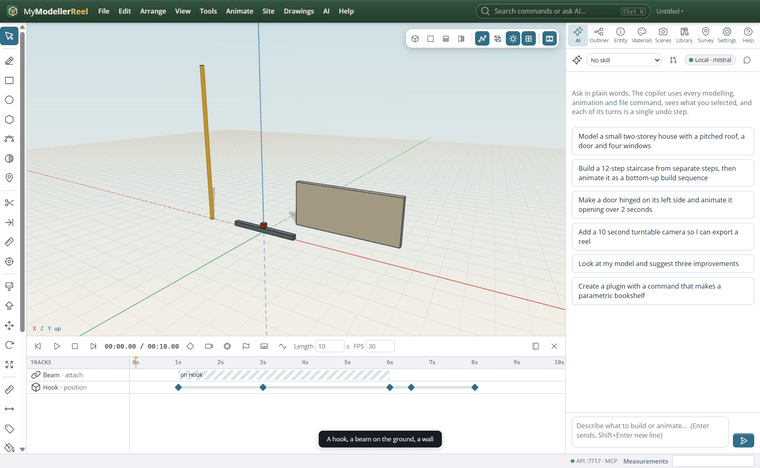
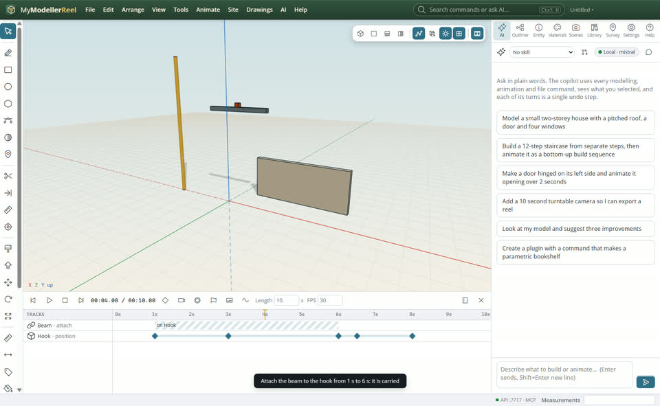
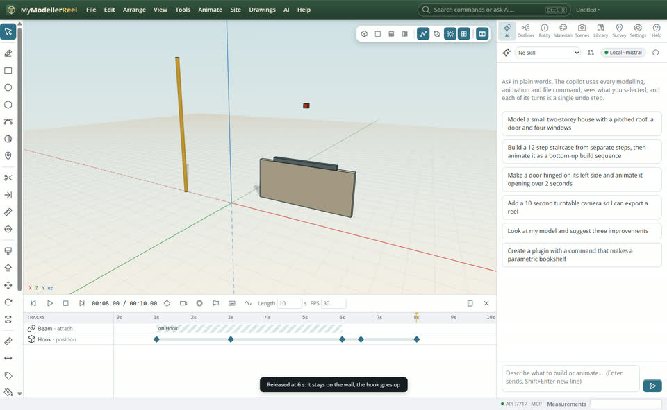
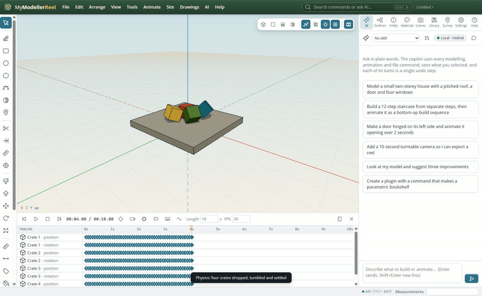

# Carry, follow and fall: attach, look at and physics

A crane picks a beam and sets it down, a camera dolly or a person keeps facing the action, and loose things fall and settle.



## In the app

1. Animate the crane hook. Select the beam then the hook, **Animate › Attach to…** [Attach](action:attach): from the pick-up time to the release time it moves with the hook.
   
2. After the release it stays where it was set down.
   
3. **Animate › Look at…** [Look at](action:lookAt): it keeps turning to face another thing or a point.
4. Select loose shapes, **Animate › Physics: drop and settle** [Physics](action:physics): they fall, bounce and come to rest on the ground and on the rest of the model, baked to keyframes.
   

## Ask the copilot

> Make the hook lift the beam from the ground at 2 s, swing it onto the wall top by 6 s and release it; then drop the three crates onto the slab.

The copilot runs the same commands as the steps above; with **AI › Propose AI changes for review** on, you accept or reject its changes first.

## From a script, the HTTP API or MCP

```js
await api.animate({ target: 'Hook', property: 'position', from: [0, 6, 0], to: [6, 9, 0], start: 2, end: 6 });
await api.attach({ id: 'Beam', parent: 'Hook', start: 2, end: 6 });
await api.look_at({ id: 'Operator', at: 'Beam' });
await api.simulate_physics({ ids: ['Crate 1', 'Crate 2', 'Crate 3'], duration: 4, bounce: 0.2 });
```

## Good to know

- Physics uses boxes, spheres and cylinders for the shapes (their bounding boxes for the rest).
- push [x, y, z] gives the falling shapes a starting speed: a collapse.

## Related

- [Edit timing: clips, the dope sheet and easing curves](howto:edit-timing-and-reuse-clips)
