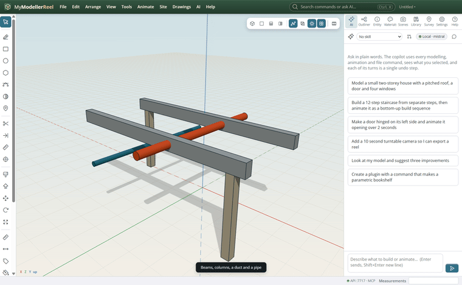
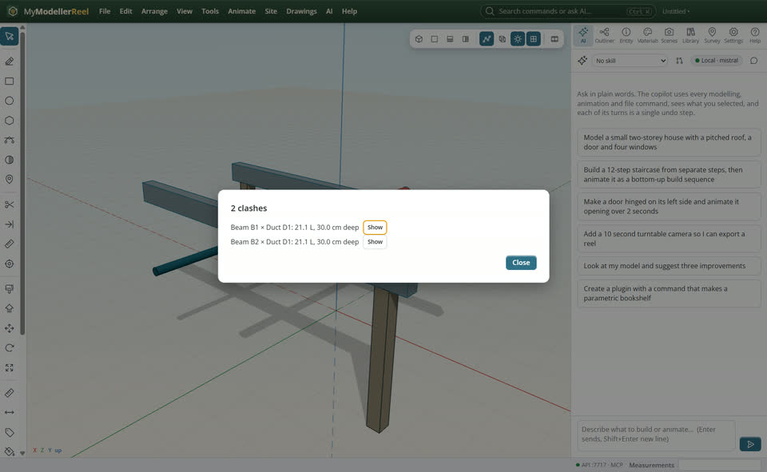
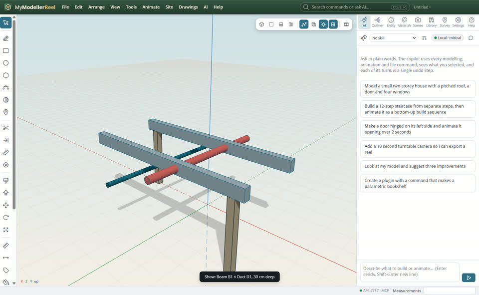

# Check a design for clashes

You want to know where parts run into each other: a pipe through a beam, a door into a wall, two buildings on the same spot.



## In the app

1. **Tools › Clash check** [Clash check](action:clashes): every pair of solids that really overlap, biggest first, with how much and how deep; they are selected.
   
2. **Show** on a row: the view goes to that clash.
   

## Ask Plumb

> Check the model for clashes deeper than 1 cm and tell me which ones to fix first.

Plumb runs the same commands as the steps above; with **AI › Propose AI changes for review** on, you accept or reject its changes first.

## From a script, the HTTP API or MCP

```js
const r = await api.check_clashes({ tolerance: 0.01 });
// r.clashes: [{ names: ['Pipe', 'Beam 3'], volume, depth, center }]
await api.check_clashes({ ids: ['Pipe run'], select: true });
```

## Good to know

- Parts of the same group (a wall and its windows) are not reported against each other.
- Touching is not clashing: the overlap must be deeper than the tolerance (1 mm by default).
- The measured result is the real shape overlap, not the boxes around the shapes.

## Related

- [Review the model and count quantities](howto:review-and-quantities)
