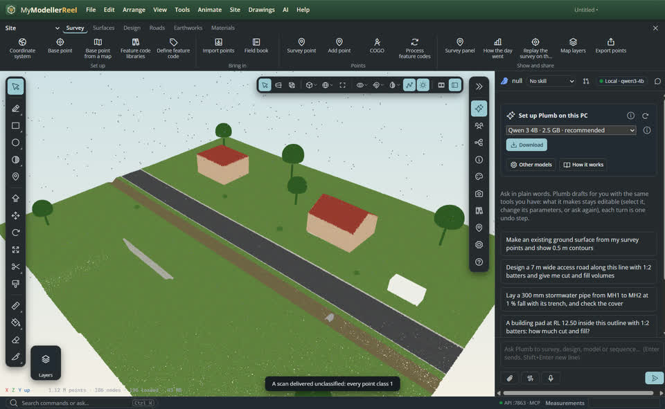
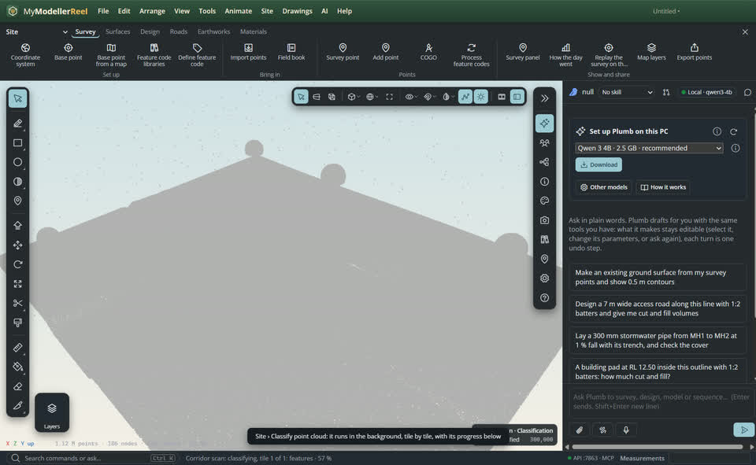
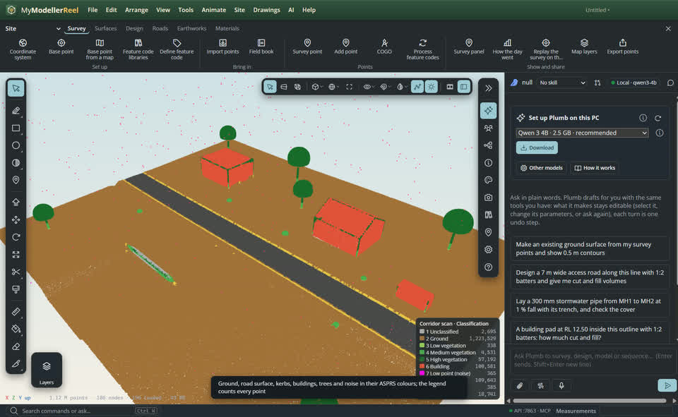
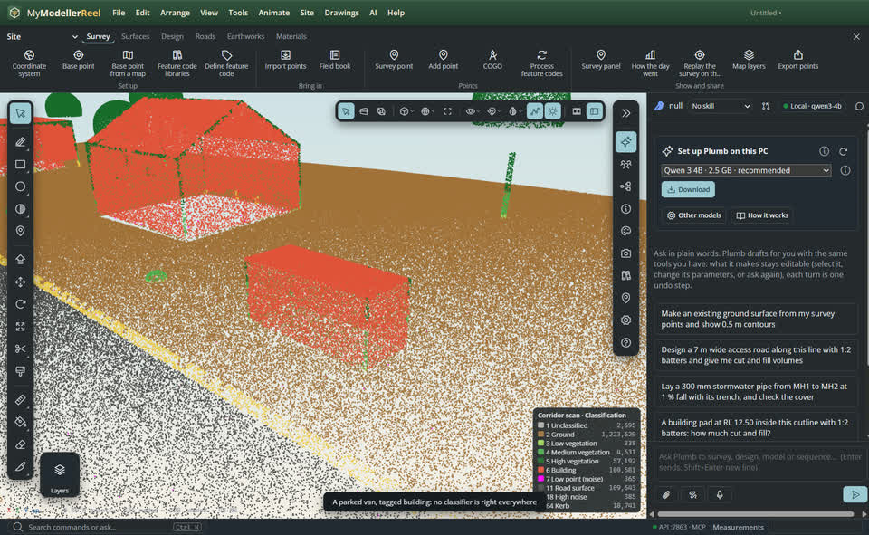
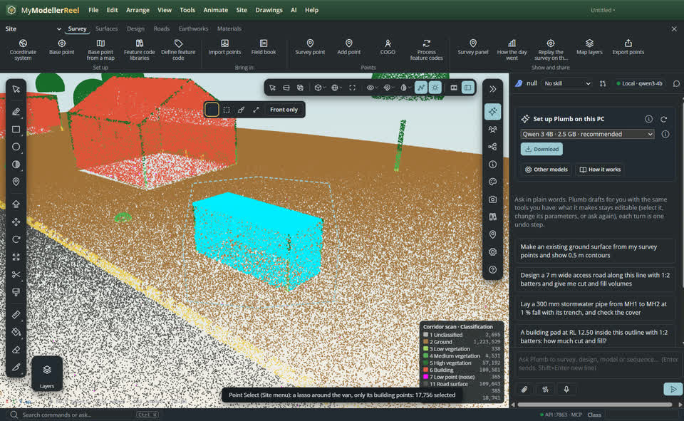
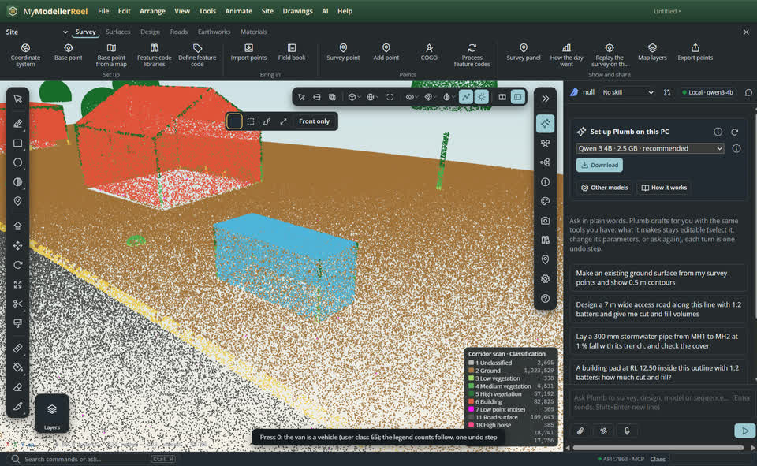
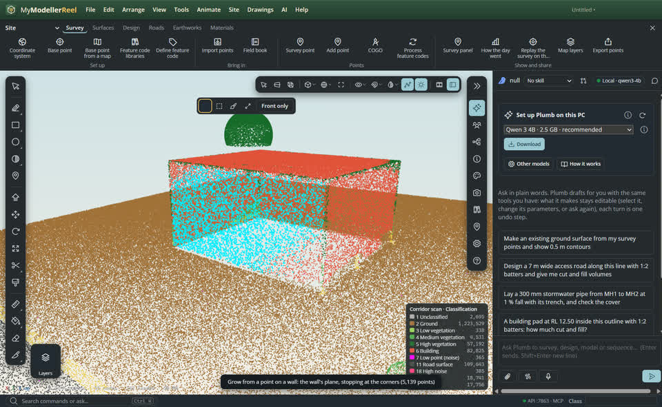
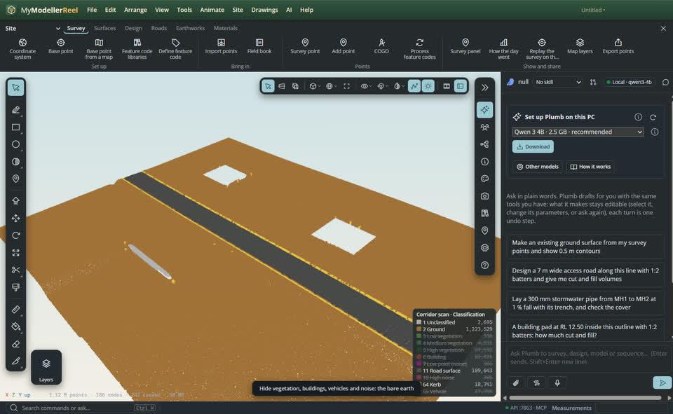
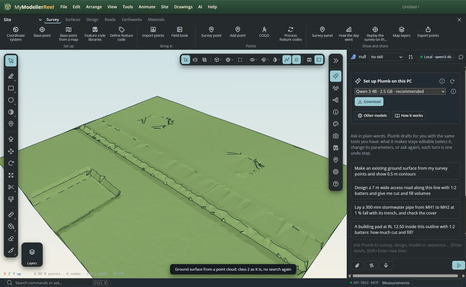

# Classify a point cloud and fix its classes by hand

Classes make a scan usable: ground for the terrain, buildings for footprints, vegetation and noise out of the way. **Classify point cloud** sorts every point into the ASPRS LAS 1.4 classes in the background (noise, ground, vegetation, buildings, road surface and kerbs, wires); the **Point Select** tool then fixes what it got wrong (a parked van tagged building, a hedge tagged ground) with a lasso, a box, a brush or by growing over a plane, and a class key. Every pass and every edit is one undo step, and the result exports to LAS 1.4 with its classes.


## In the app

1. Import the scan ([Import point cloud](do:import_point_cloud)). Here: a road corridor delivered unclassified, every point class 1, with a box van parked on the north verge.
   
2. [Site › Classify point cloud…](action:classifyCloud) and choose the passes. On a streamed cloud (an octree, LAZ or COPC) it runs in the background, tile by tile with a margin around each tile so nothing changes at their borders; the status bar shows the progress and the view recolours as tiles finish. [Cancel](do:cancel_point_cloud_job) leaves the cloud as it was.
   
3. When it finishes, it comes in as one undo step with a report: points per class before and after, the time and the parameters used. Colour by classification ([set_cloud_style](do:set_cloud_style) `color_by: classification`): the legend counts every point of the cloud.
   

### The passes

- **Noise** (7 low, 18 high): points with almost nothing around them (a bird, a multipath echo, a speck under the ground).
- **Ground** (2): a progressive morphological filter. It follows slopes, embankments, cuts and ditches and takes away buildings, trees and vehicles. `params.ground.method: 'cell'` keeps the older lowest-point-per-cell method.
- **Vegetation** (3 low, 4 medium, 5 high): points above the ground that do not lie on planes, by height above ground (bands of 0.5 and 2 m by default).
- **Buildings** (6): large planes (roofs and walls) that touch each other and stand at least 2.5 m above the ground.
- **Road** (11 road surface, 64 kerb): smooth ground of the asphalt's intensity, and kerb steps (7–30 cm at once, level on both sides).
- **Wires** (14 wire, 15 pole): linear points high above ground. Off by default (tree trunks look like poles).

`within: 'Box 1'` changes only the points inside a [clip volume](howto:clip-volumes); `only_unclassified` only points still 0 or 1. Points locked by hand stay as they are unless `overwrite: true`.

## Fix the classes by hand

4. No classifier is right everywhere: the van has a flat roof 2.9 m up, so it came out as a building.
   
5. [Point Select](tool:pointselect) (Site menu): drag a lasso around it. The bar over the view switches between **lasso**, **box**, **brush** (paints the front-most points under a circle) and **grow**; **Front only** (or F) keeps only the points facing you, not the façade behind. **Shift** adds, **Ctrl** takes away, **I** inverts, **Esc** clears. [select_points](do:select_points) can also keep only some classes (here the building points) and reports what it took.
   
6. Press a class key: **0** vehicle (user class 65), **1** unclassified, **2** ground, **3**–**5** vegetation, **6** building, **7** noise, **8** road surface, **9** kerb; or type any code in the box below the view. **K** locks the points (automatic passes leave them alone), **Delete** deletes them (class 7, hidden, and left out on export). Each key press is one undo step; the legend counts follow. Name your own classes 64–255 with [define_point_class](do:define_point_class).
   
7. **Grow**: click a point on a wall (or [select_points](do:select_points) with `grow_from`): the selection spreads over the points on that plane and stops at the corners. Good for a wall, a roof, a road.
   
8. Hide what is not ground ([set_cloud_filter](do:set_cloud_filter)) to check the bare earth, then [make the ground surface](do:classify_ground): on a classified cloud it uses class 2 as it is.
   
   

## Export

[Site › Export point cloud…](action:exportCloud) ([export_point_cloud](do:export_point_cloud)) writes **LAS 1.4** (ASPRS point format 6, or 7 with colour; the coordinate system as WKT, taken from the source file or the project) or **PLY**, with the edited classes: the whole cloud, the point selection, or what lies inside a clip volume, in world coordinates (as the source) or project coordinates (minus the base point). A streamed cloud is written in the background at full detail. **LAZ and COPC cannot be written yet**: the bundled laz-perf library only decompresses. Write LAS and compress it with PDAL or LAStools.

## Ask Plumb

> Classify this scan: noise, ground, vegetation, buildings and the road.

> Only reclassify the points inside Box 1, and leave the ones I locked.

> Select the points of that wall and make them class 6.

> How many points are buildings now? Export the cloud to LAS with the new classes.

## From a script, the HTTP API or MCP

```js
await api.classify_cloud({ id: 'Corridor scan', steps: ['noise', 'ground', 'vegetation', 'buildings', 'road'] });
await api.point_cloud_job({ id: 'Corridor scan' });                       // progress of a background run
await api.attach_point_cloud_classes({ id: 'Corridor scan' });            // the report once done (the app does this)
await api.list_cloud_classes({ id: 'Corridor scan' });                    // counts per class
await api.select_points({ id: 'Corridor scan', polygon: [[0.4, 0.3], [0.6, 0.3], [0.6, 0.5], [0.4, 0.5]], front_only: true });
await api.select_points({ id: 'Corridor scan', within: 'Box 1', classes: [6] });
await api.select_points({ id: 'Corridor scan', grow_from: [650021, 5400055, 103.5], tolerance: 12 });
await api.point_selection({});                                            // counts, bounds, mean intensity
await api.set_point_class({ class: 65, lock: true });                     // one undo step
await api.define_point_class({ code: 66, name: 'Manhole', color: '#aa5500' });
await api.clear_point_selection({});
await api.classify_ground({ id: 'Corridor scan', cell: 1 });              // reuses class 2
await api.export_point_cloud({ id: 'Corridor scan', path: 'C:/out/corridor.las', what: 'all', coordinates: 'world' });
```

Selections are counts, never the points: read `selected`, `classes`, `bounds` and `mean_intensity` from the reply.

## Related

- [See a scan clearly: colours, depth and which points show](howto:point-cloud-display)
- [Work in a large point cloud (LAZ, COPC, octree)](howto:large-point-clouds)
- [Model over a scan and make the ground from it](howto:scan-to-ground)
- [See only part of the model: clip boxes, slabs and planes](howto:clip-volumes)
