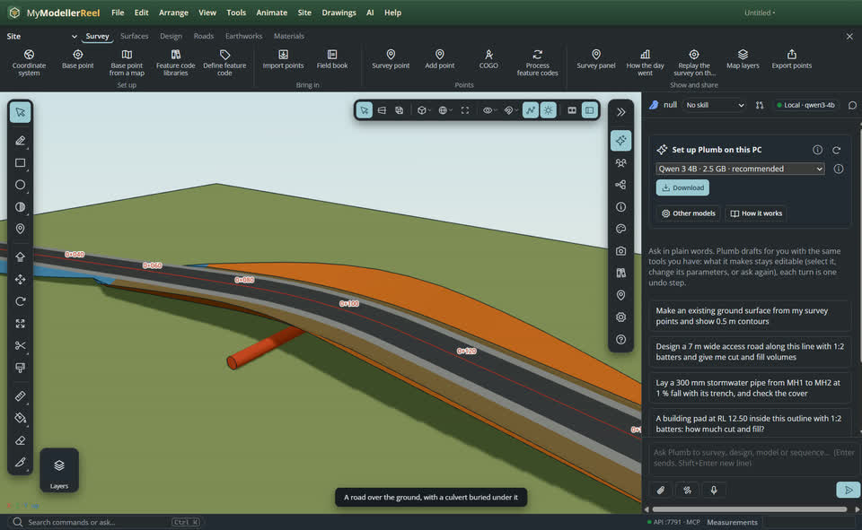
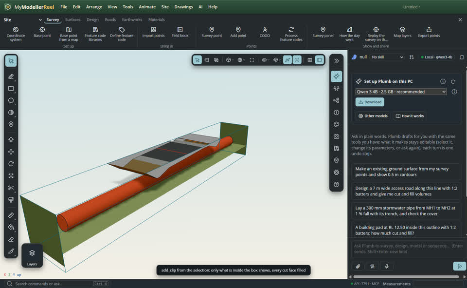
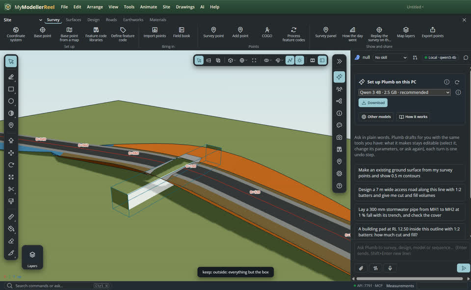
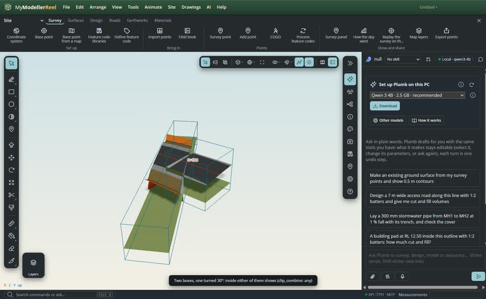
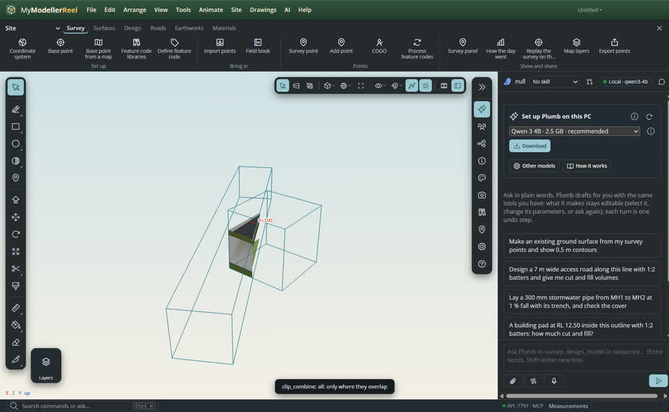
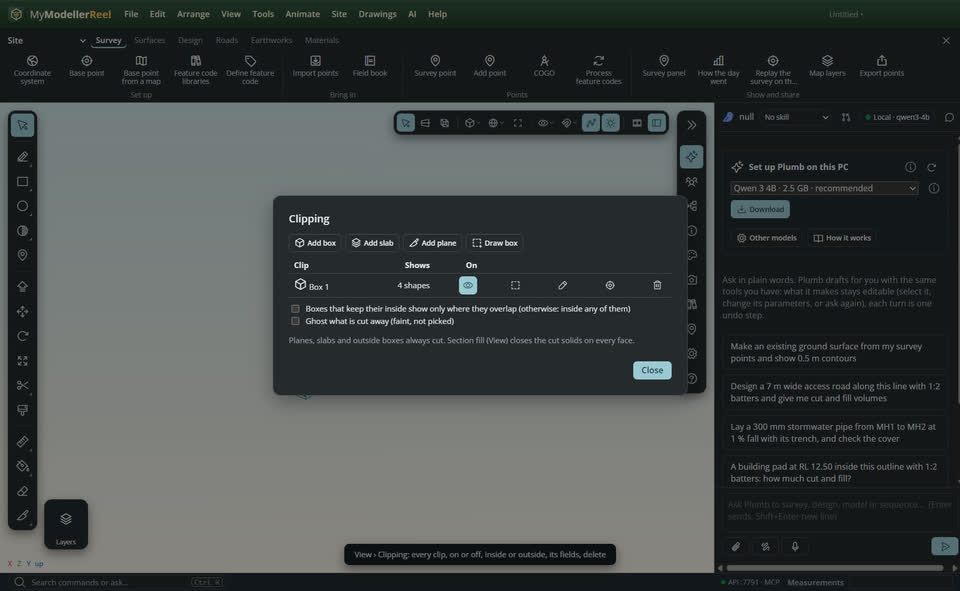
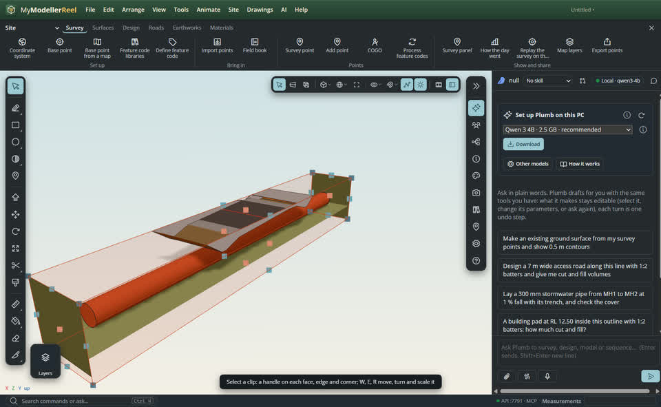
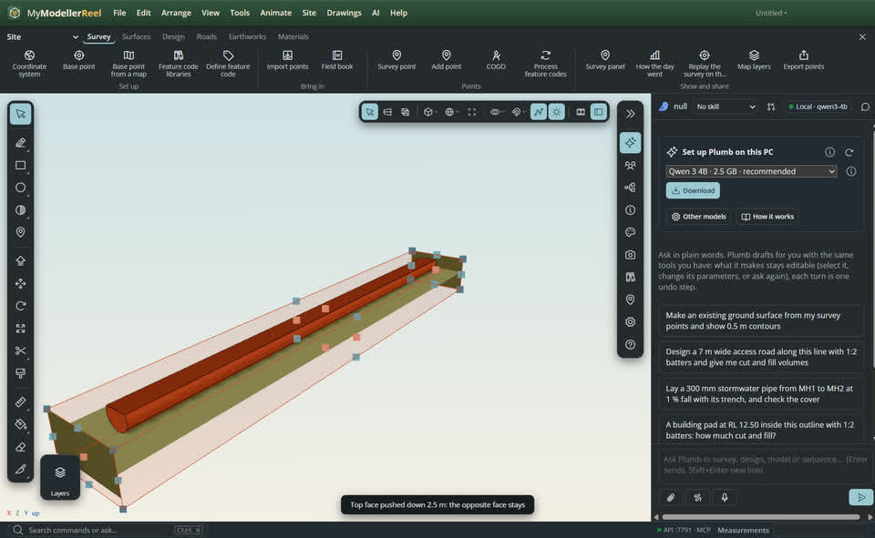
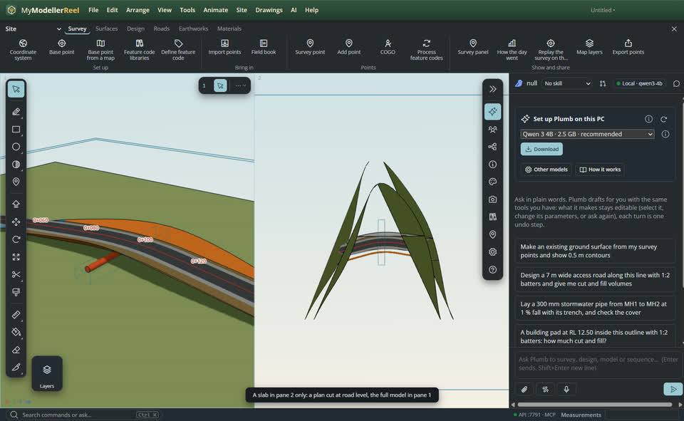

# See only part of the model: clip boxes, slabs and planes

A road model, a scan or a dense site hides what you want to look at: the culvert under the fill, the abutment behind the deck, the kerb line at road level. A **clip volume** hides everything else in the view, without changing the model: a **box** around one structure (or everything but it), a **slab** that keeps a band between two parallel planes for a plan or a strip of a scan, and **planes** that cut away one side. They combine, they can cut only some panes or some layers, each cut face is filled, and they animate.


## In the app

1. Select what you want to see (a culvert, say) and press **Shift+X** for the [Clip Box](tool:clipbox) tool, then **Enter**: a box fits the selection with a margin. Or click two corners of a rectangle on a face, the ground or the cloud, move up for the height and click (three clicks, one undo step). Type `12, 8, 3` for an exact size.
   
2. Only what lies inside the box shows, in every pane, and every face of the box that cuts a solid is filled ([Section fill](action:sectionFill) on).
   
3. Turn it inside out to see everything **but** the box: `keep: outside`.
   
4. Add a second box. Boxes that keep their inside show what is in **any** of them; tick *only where they overlap* in the Clipping panel (`clip_combine: all`). A plane or a slab added on top cuts them all.
   
   
5. [View › Clipping…](action:sectionPlanes) lists every clip, section planes included: turn one on or off, flip it, keep inside or outside, edit its centre, size and rotation, delete it.
   

## Handles

Click a clip's edge (with Select or Clip Box) to select it. The selected clip gets translucent faces and handles:

- **Click a face** of the box (anywhere on it, or its red handle) to pick it, then **type a value** and Enter (`2.5` pushes it out, `-2.5` pulls it in) or **drag** it.
- **Face handles** (red) push and pull one face along its normal; the opposite face stays. **Ctrl** moves both faces. Drag towards a point, a cloud point or a vertex to snap to it, or type a distance while dragging (`2.5`).
- **Edge handles** move two faces, **corner handles** three; **Shift** keeps the proportions.
- **W**, **E**, **R** show the move, rotate and scale handles in the box's own axes (**L** switches local / world; hold **Shift** to turn in 15° steps).
- **Tab** picks the next face, the **arrow keys** nudge it by the grid step, **Delete** removes the clip, **Esc** lets it go.

Each drag is one undo step. Handles work in every pane, in perspective and parallel views.




To square a box to what is in the scan, [align_clip](do:align_clip): to two points of a wall or kerb (the box sides follow them, Y stays up), to a face, to the view, or level.

## Panes and layers

A clip can cut only some panes (`panes: [2]`: a plan slab in pane 2 while pane 1 shows the whole model) or only some entities (`ids`) or layers (`layers`).



## Ask Plumb

> Show me only the culvert and what is around it.

> Hide the culvert box and show everything else.

> Give me a 1 m plan slab at road level in the second view.

> Line the clip box up with the wall between W1 and W2.

## From a script, the HTTP API or MCP

```js
await api.add_clip({ kind: 'box', from: 'selection', margin: 2 });         // Box 1 around the selection
await api.set_clip({ name: 'Box 1', keep: 'outside' });                     // everything but it
await api.set_clip({ name: 'Box 1', face: '+y', push: -2.5 });              // the top face down 2.5 m
await api.add_clip({ kind: 'slab', point: [0, 4, 0], normal: [0, 1, 0], thickness: 1, panes: [2] });
await api.align_clip({ name: 'Box 1', to: 'points', points: ['W1', 'W2'] });
await api.set_style({ clip_combine: 'all', show_clipped: 'ghost' });
await api.animate({ target: 'clip:Box 1', property: 'size', to: [40, 8, 12], start: 0, end: 3 });
await api.list_clips({});
await api.clear_clips({});
```

Section planes (`section`, `set_section_plane`, `list_section_planes`) are clips of kind plane, so older files open with the same cut.

## Related

- [Make a drawing sheet and a section](howto:drawing-sheets-and-sections)
- [Work with several views](howto:multiple-views)
- [Classify a scan to ground](howto:scan-to-ground)
