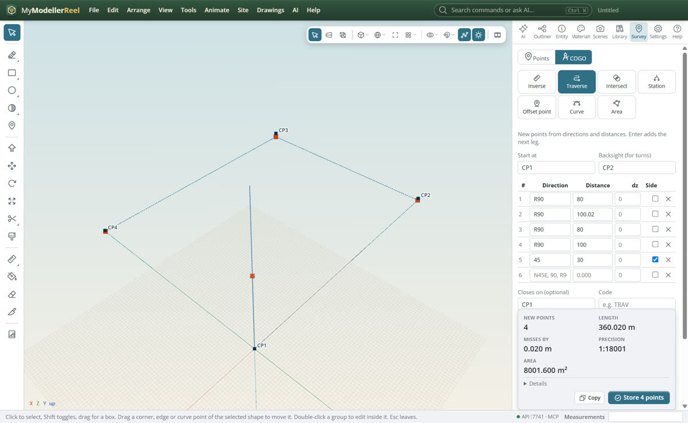
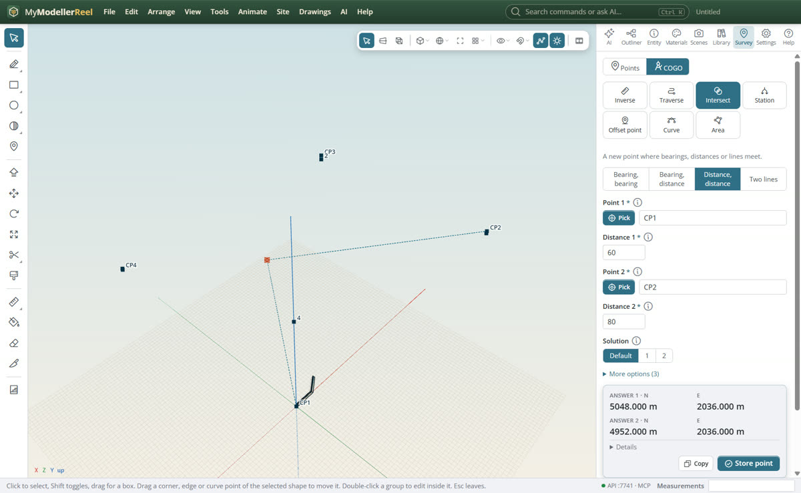

# Work out points with COGO

You have survey points and field book or deed figures: a bearing and a distance, a traverse to close, a corner found
from two distances, a station and offset along a road. COGO works them out and stores the new points.

## In the app

1. Open **Survey › COGO** [COGO](action:cogo) (or the **COGO** switch at the top of the Survey tab), and choose a
   calculation: Inverse, Traverse, Intersect, Station, Offset point, Curve or Area.
2. Choose the points from the list, type a name, or **Pick** them in the view. The answer and a dashed preview in the
   view update as you type; new points show in orange.
   
3. **Store** (Ctrl+Enter) adds the new points in one undo step. Each answer goes into the report, ready to copy.
   

Directions can be typed the way a field book writes them:

| You type | It means |
| --- | --- |
| `45.5`, `45°30'`, `45 30 00` | an azimuth, clockwise from north |
| `N45°30'E`, `S 12 30 W` | a quadrant bearing |
| `R90`, `L45` | turn right or left from the last leg (deflection) |
| `AR270` | angle right, clockwise from the backsight |

In a traverse, press **Enter** after a distance to start the next leg; tick **Side** for a sideshot, which is measured
from the current station without moving on. Give **Closes on** a point to see how far the traverse misses it, the
precision (1:N) and the area, and tick the compass rule to spread the misclosure.

## Ask the copilot

> Here is the deed: from the point of beginning N 45°30' E 120 feet, S 44°30' E 80 feet, S 45°30' W 120 feet,
> N 44°30' W 80 feet. Does it close, and what is the area?

> Where is a point 25 m along CP1 to CP2 and 3 m to the left? Store it as P10.

Choose the **Survey and COGO** skill in the chat for more survey know-how.

## From a script, the HTTP API or MCP

```js
await api.cogo_inverse({ from: 'CP1', to: 'CP2' });
await api.cogo_traverse({ from: 'CP1', backsight: 'CP2', legs: [{ direction: 'R90', distance: 50 }, { direction: 'R90', distance: 100 }, { direction: 'R90', distance: 50 }], close_to: 'CP2' });
await api.cogo_intersect({ point1: 'CP1', distance1: 60, point2: 'CP2', distance2: 80, solution: '2', name: 'X' });
await api.cogo_offset_point({ line: ['CP1', 'CP2'], station: 25, offset: -3 });
await api.cogo_station_offset({ line: 'Centre line', points: ['P10', 'P11'] });
await api.cogo_curve({ radius: 100, delta: '60°' });
await api.cogo_area({ points: ['CP1', 'CP2', 'CP3', 'CP4'] });
```

## Good to know

- Distances are horizontal and in the project's units (**Site › Units**); heights go in `dz`.
- An offset is + to the right and − to the left, looking along the line.
- A line can be two or more point names, or a curve, alignment or linework by name; its stations start at the
  alignment's start station.
- The curve solver takes any two of radius, delta, arc, tangent, chord, external and middle ordinate.

## Related

- [Turn survey points into a surface](howto:survey-points-to-surface)
- [Design an access road on the ground](howto:design-an-access-road)
