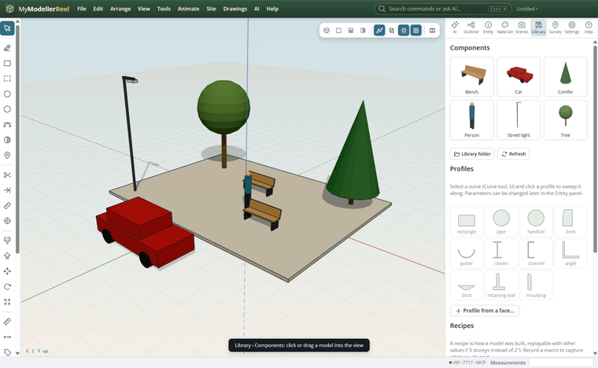
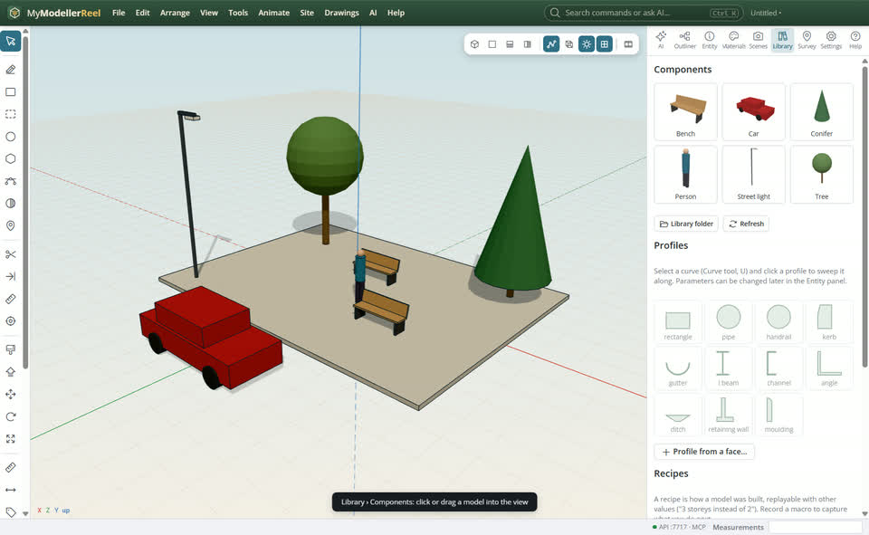
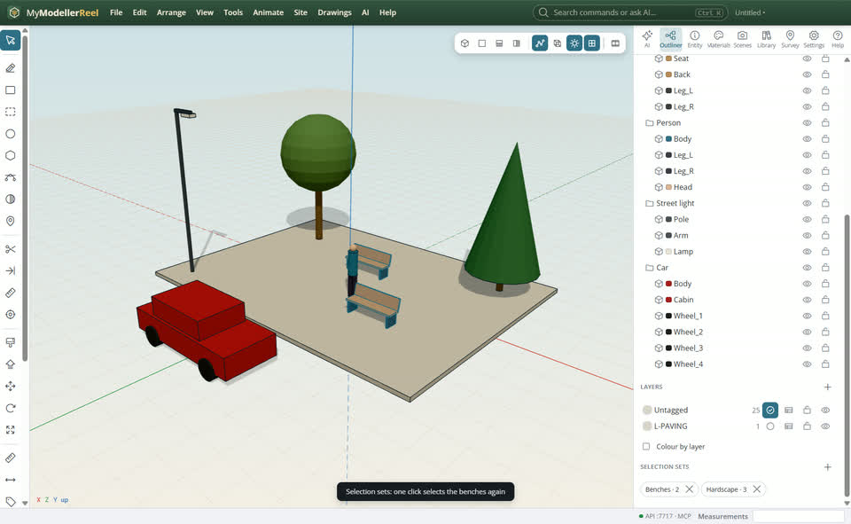
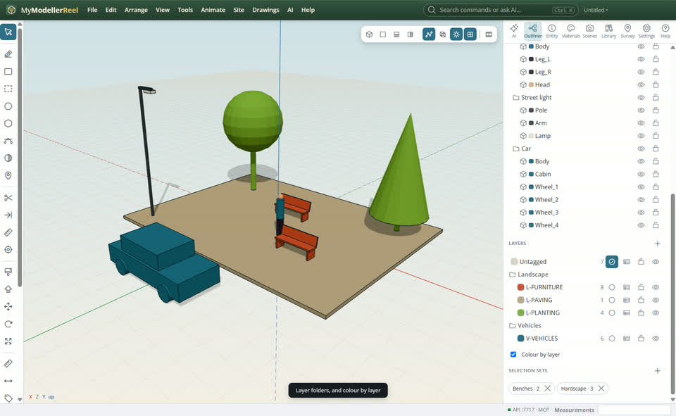

# The component library, selection sets and layer folders

You want to dress the model with ready-made things, find groups of parts again quickly, and keep a long layer list tidy.



## In the app

1. **Library › Components**: click a model to put it at the centre of the view, or drag it onto the spot. **Library folder** opens the folder: drop your own GLB / glTF files in.
   
2. Select some parts, **Outliner › Selection sets +** [Save set](action:saveSelection): one click selects them again.
   
3. Give layers a folder (`set_layer` folder) to group them; **Colour by layer** shows every shape in its layer colour.
   

## Ask the copilot

> Put two trees, a bench and a person on the plaza, save the paving and the benches as the selection set "Hardscape", and colour the model by layer.

The copilot runs the same commands as the steps above; with **AI › Propose AI changes for review** on, you accept or reject its changes first.

## From a script, the HTTP API or MCP

```js
await api.insert_asset({ name: 'Tree.glb', position: [-3, 0, -2] });
await api.list_assets({});
await api.save_selection({ name: 'Hardscape', ids: ['Plaza', 'Bench'] });
await api.select_set({ name: 'Hardscape' });
await api.set_layer({ name: 'L-PAVING', folder: 'Landscape' });
await api.set_style({ color_by: 'layer' });
```

## Good to know

- The starter models (tree, conifer, bench, person, car, street light) are copied into the library folder the first time; delete or replace them freely.

## Related

- [Organise a model with layers](howto:organise-with-layers)
- [A floor plan to 3D](howto:floor-plan-to-3d)
