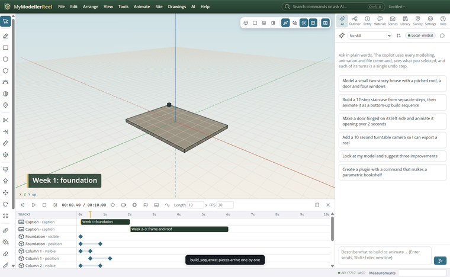
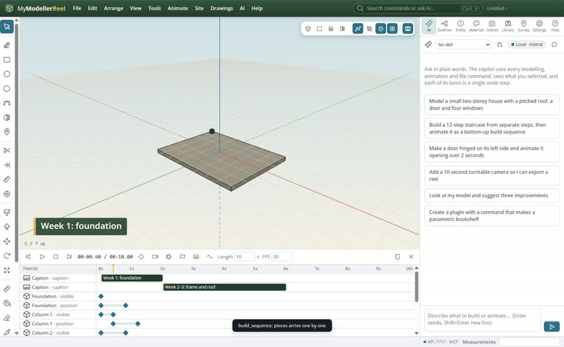
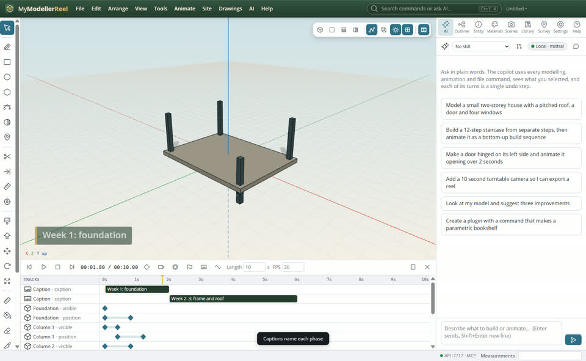
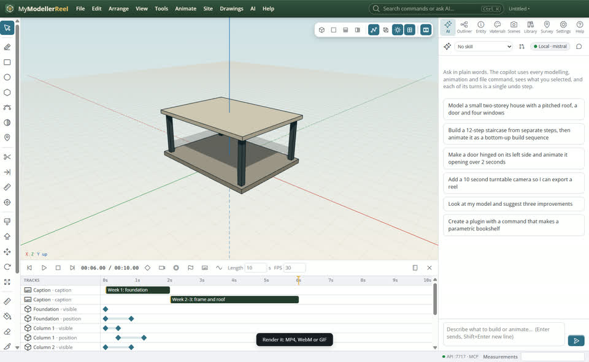

# Make a construction sequence video

You want to show how a building or a site goes up, phase by phase, with captions: a 4D-style reel.




## In the app

1. Start from **File › New from template… › Construction sequence** [Templates](action:startScreen), or select your own parts.
   
2. **Animate › Build sequence**: parts arrive one after another (rise, drop, grow, fade or slide), in the order you pick or bottom-up.
   
3. **Animate › Caption** names each phase; **Animate › Marker** names moments to line things up.
   
4. **File › Export video** [Export video](action:exportVideo): MP4, WebM or GIF, rendered frame by frame at any size.
   

## Ask Plumb

> Make a bottom-up build sequence of the whole model with a caption per level, then render a 1080p MP4.

Plumb runs the same commands as the steps above; with **AI › Propose AI changes for review** on, you accept or reject its changes first.

## From a script, the HTTP API or MCP

```js
await api.build_sequence({ order: 'bottom-up', effect: 'rise' });
await api.add_caption({ text: 'Week 1: foundation', style: 'caption', start: 0, end: 2 });
await api.render_video({ path: 'C:/videos/sequence.mp4', width: 1920, height: 1080 });
```

## Good to know

- `stagger`, `explode` and `animate_along_path` help with choreography; `turntable` adds a camera orbit.

## Related

- [Hinge a door and animate it opening](howto:hinge-a-door)
