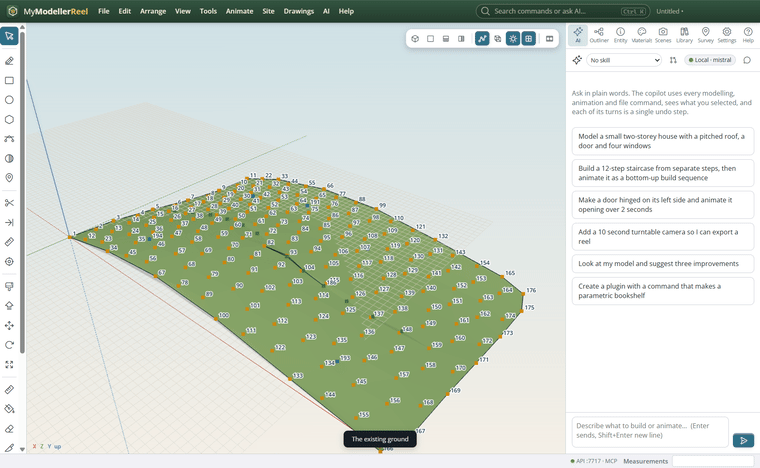
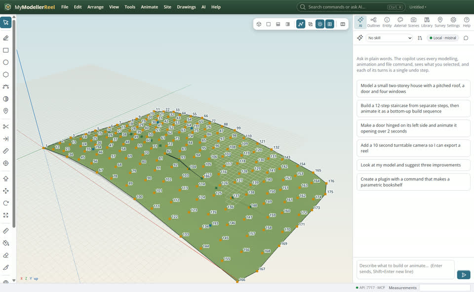
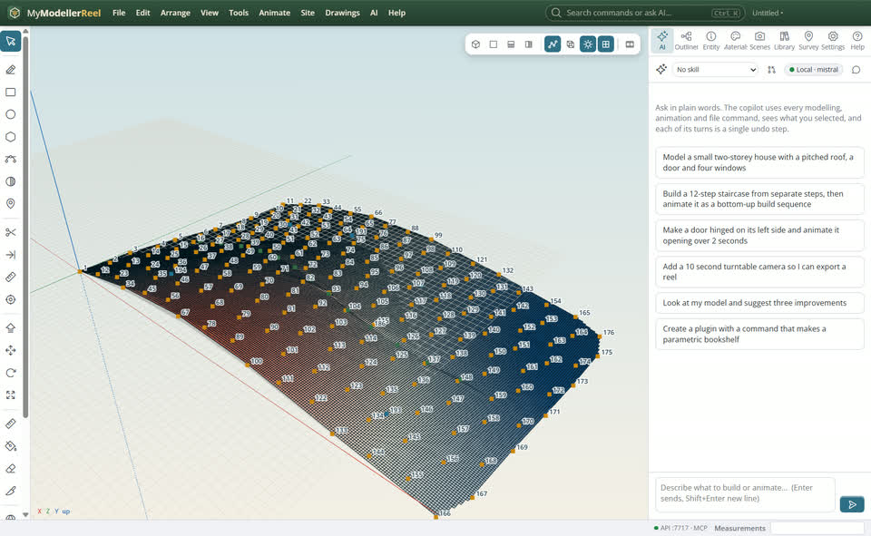
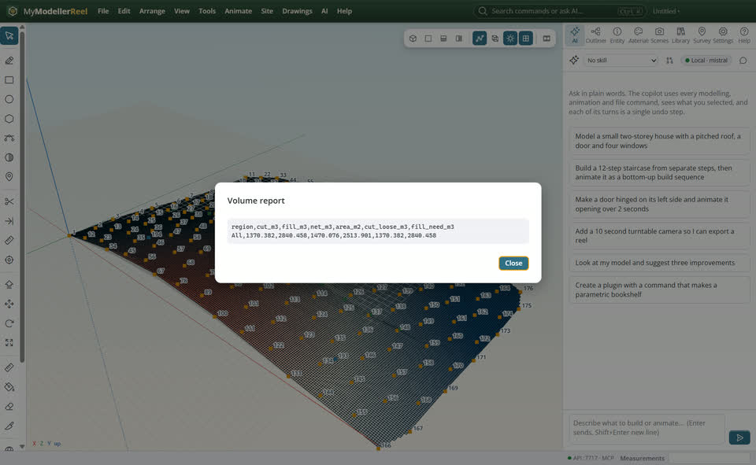

# Work out cut and fill for a building pad

You want to know how much earth to move to bring a pad to a level, and see where it is cut and where it is filled.



## In the app

1. Have the existing ground as a surface.
   
2. **Site › Cut / fill…** [Cut / fill](action:cutFill): the surface and the pad level (or a second surface). The map shows cut in red, fill in blue.
   
3. **Site › Volume report…** [Volume report](action:volumeReport): cut, fill and net, per region if you give boundaries, as a table you can save as CSV.
   

## Ask the copilot

> How much cut and fill to bring the existing ground to 102.5 over the whole site? Show me the map.

The copilot runs the same commands as the steps above; with **AI › Propose AI changes for review** on, you accept or reject its changes first.

## From a script, the HTTP API or MCP

```js
const r = await api.cut_fill({ existing: 'Existing ground', elevation: 102.5 });
// r.cut, r.fill, r.net in m³
await api.volume_report({ existing: 'Existing ground', elevation: 102.5, path: 'C:/reports/volumes.csv' });
```

## Good to know

- Bulking and shrinkage factors are options of `cut_fill`.
- `cut_fill_at` gives the cut or fill depth at a single spot.

## Related

- [Design an access road on the ground](howto:design-an-access-road)
