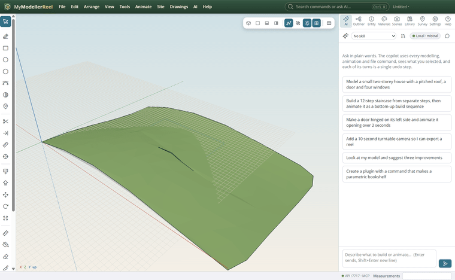
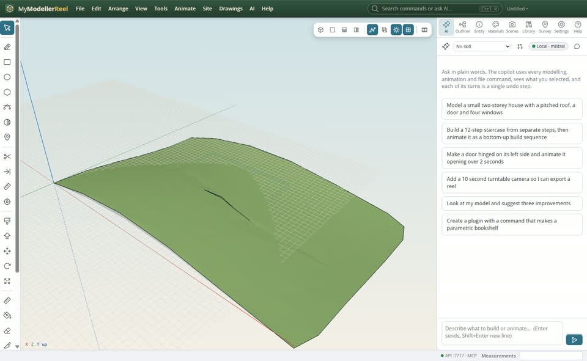
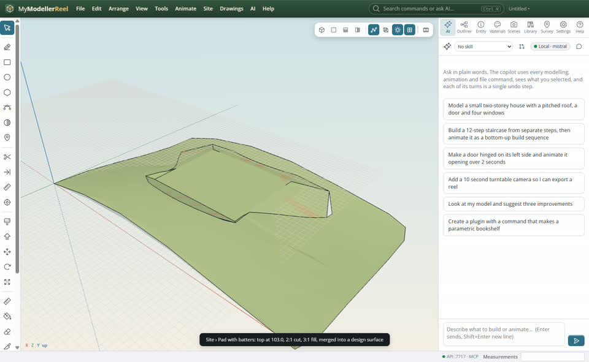
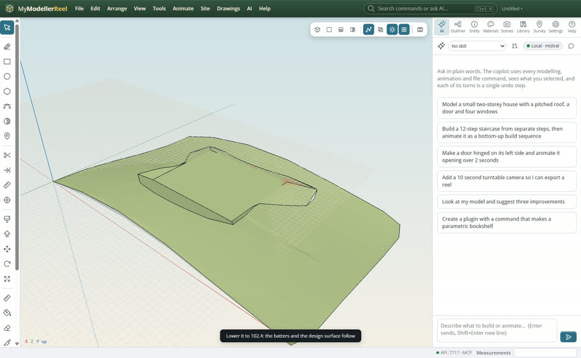
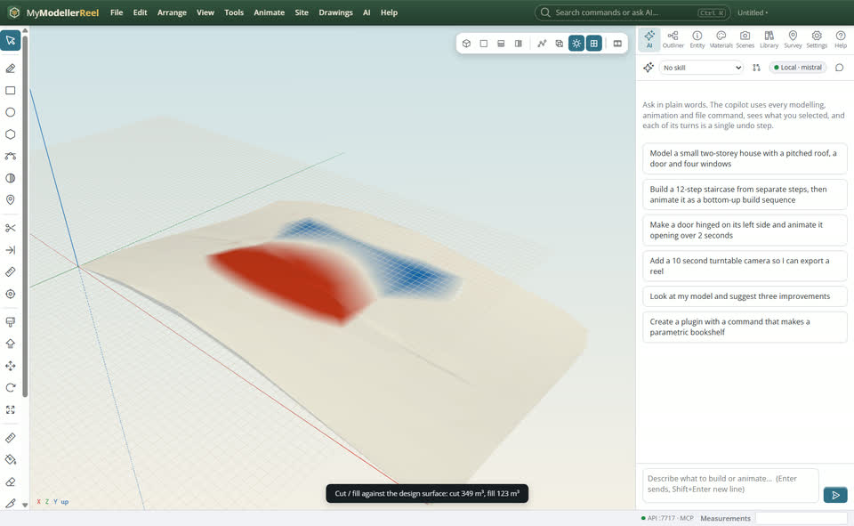

# Design a building pad with batter slopes

You want a flat platform for a building at a set level, with cut and fill slopes running out until they meet the existing ground, and the volumes it takes.



## In the app

1. Draw the outline of the pad as a closed curve (Line or Curve tool), on the ground.
   
2. **Site › Pad with batters…** [Pad](action:pad): its level (or a grade), the cut and fill slopes (2 means 2 across for 1 up), the ground surface, and **merge** for one design surface.
   
3. Change the level or the slopes (`set_batter`) or move the outline: the pad and the design surface follow.
   
4. **Site › Cut / fill…** with the design surface: cut, fill and the map.
   

## Ask Plumb

> Make a building pad at 103.0 inside the outline "Pad outline", with 2:1 cut and 3:1 fill slopes to the existing ground, then tell me the cut and fill.

Plumb runs the same commands as the steps above; with **AI › Propose AI changes for review** on, you accept or reject its changes first.

## From a script, the HTTP API or MCP

```js
await api.create_pad({ outline: 'Pad outline', elevation: 103, surface: 'Existing ground', cut_slope: 2, fill_slope: 3, merge: true });
await api.set_batter({ id: 'Pad', elevation: 102.5 });
const v = await api.cut_fill({ existing: 'Existing ground', design: 'Design surface' });
```

## Good to know

- `grade` and `bearing` tilt the pad (a car park falling 1 % to the drain).
- Several pads merge into the same design surface.

## Related

- [Work out cut and fill for a building pad](howto:cut-and-fill-for-a-pad)
- [Read the terrain: contours, slopes, profiles and sections](howto:read-the-terrain)
