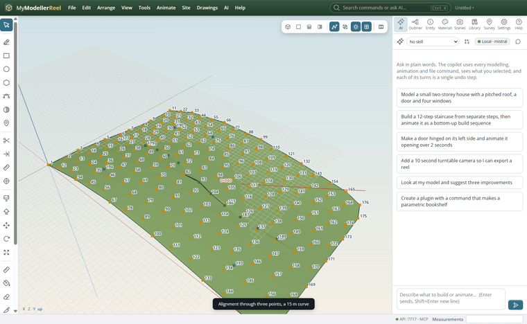
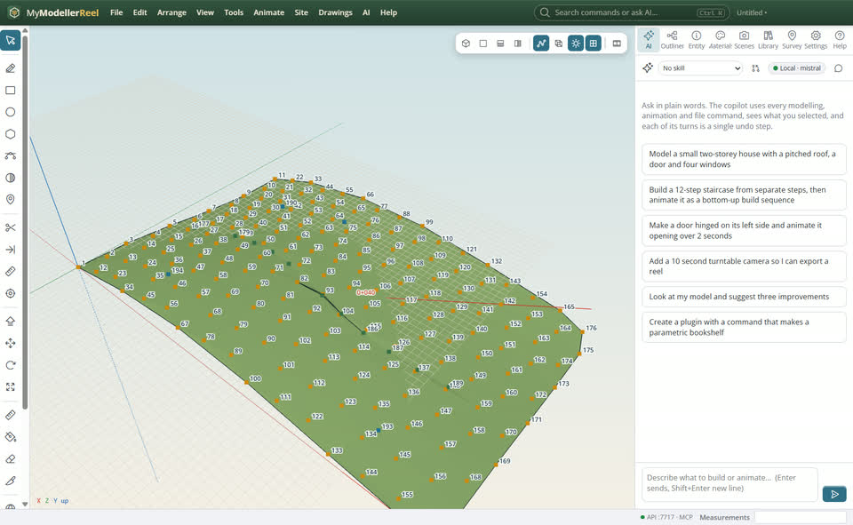
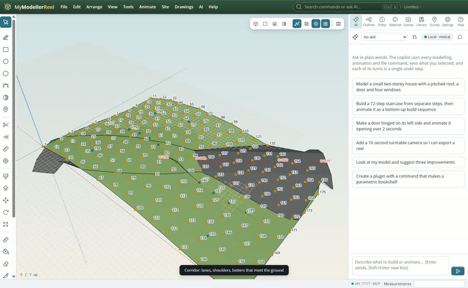

# Design an access road on the ground

You want a road that follows the ground sensibly: an alignment with curves, a vertical profile, and a corridor whose side slopes meet the existing ground.



## In the app

1. **Site › Alignment…** [Alignment](action:alignment): through points (survey point names or model points), with a radius at each bend.
   
2. Give it a vertical profile: stations and elevations, with parabolic curves; station labels show along it.
   
3. **Site › Corridor…** [Corridor](action:corridor): lanes with crossfall, shoulders, and cut and fill batter slopes that daylight to the surface.
   

## Ask Plumb

> Run an access road from point 1 to point 176 through 82 with a 15 m curve, rising from 101 to 104, and make a corridor with two 3 m lanes.

Plumb runs the same commands as the steps above; with **AI › Propose AI changes for review** on, you accept or reject its changes first.

## From a script, the HTTP API or MCP

```js
await api.create_alignment({ name: 'Access road', points: ['1', '82', '176'], radii: [15] });
await api.set_alignment({ id: 'Access road', pvis: [[0, 101], [35, 102.5, 20], [70, 104]] });
await api.create_corridor({ alignment: 'Access road', surface: 'Existing ground', template: { lanes: [{ width: 3, crossfall: -2.5 }], cut_slope: 1.5, fill_slope: 2 } });
```

## Good to know

- The corridor stays live: change the alignment or the ground and it rebuilds.

## Related

- [Turn survey points into a surface](howto:survey-points-to-surface)
