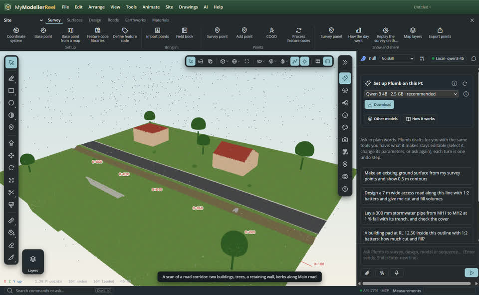
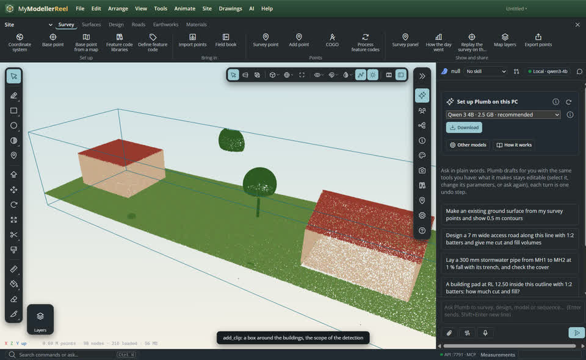
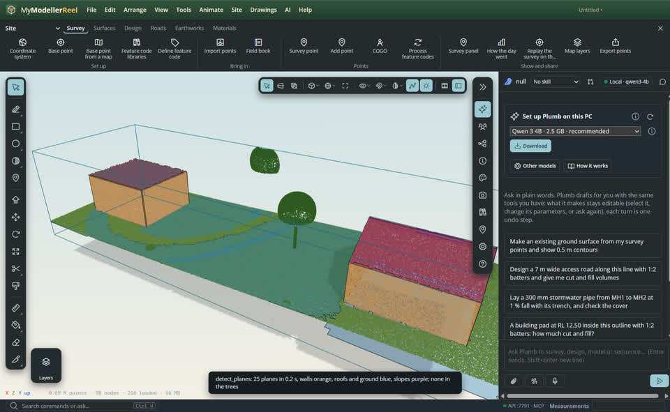
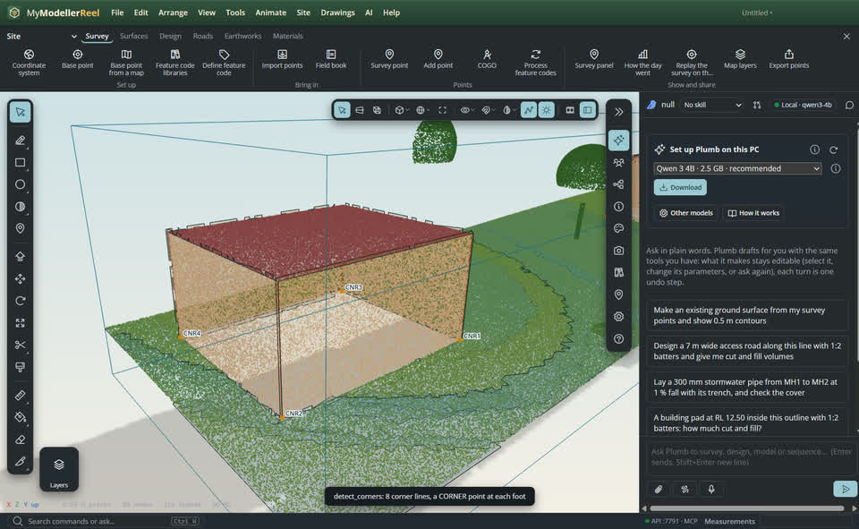
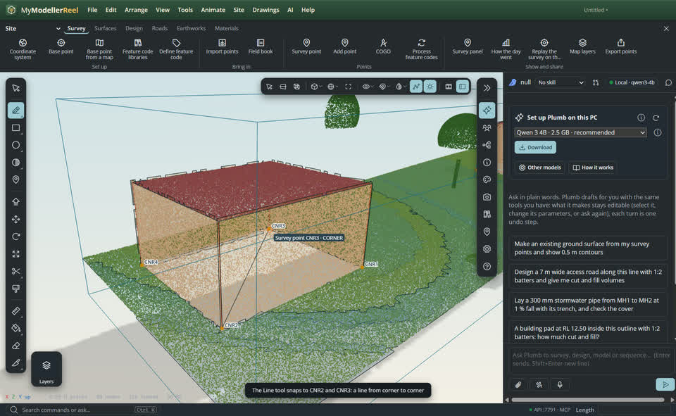
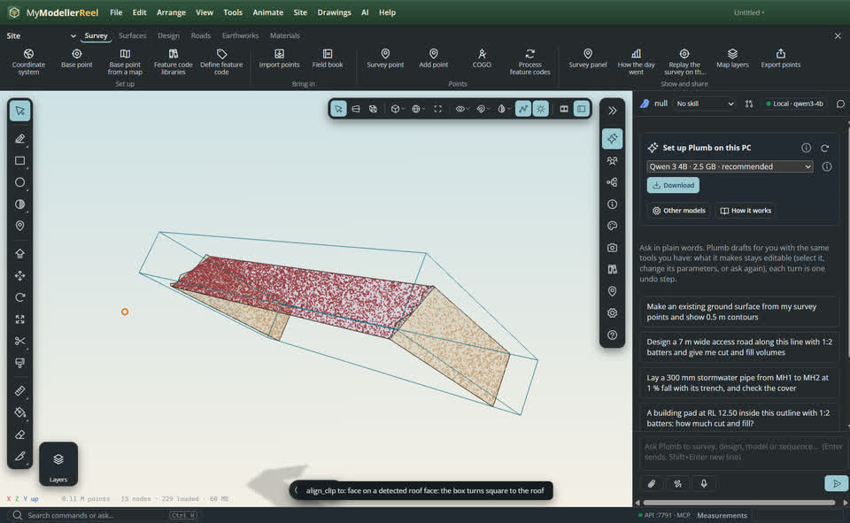
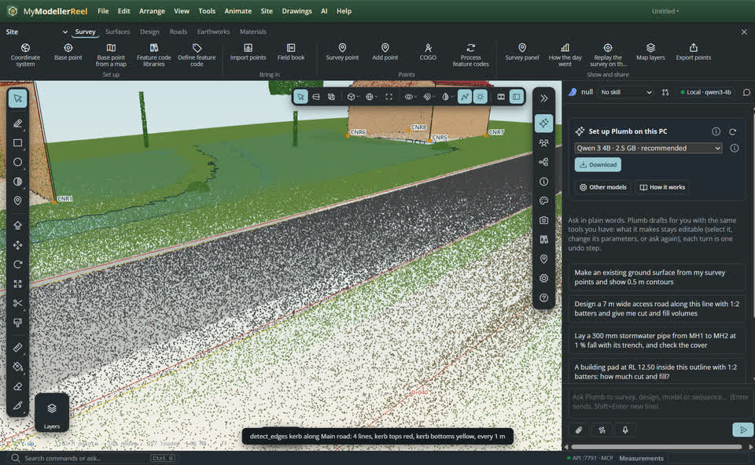
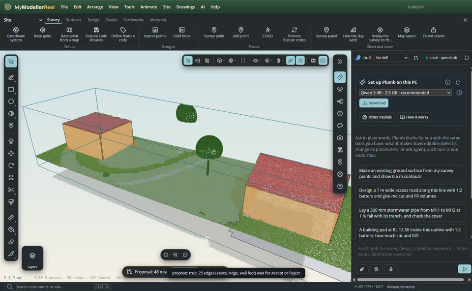

# Detect planes, corners and kerbs in a scan

A scan is millions of dots; drafting over it needs the surfaces and lines hiding in them. **Detect planes** finds the walls, façades and abutments (vertical), the floors, flat roofs, slabs and ground (horizontal) and the roof faces and embankments (sloped). **Detect corners** puts a vertical line where two walls meet and a survey point coded `CORNER` at its foot. **Detect edges** finds where planes meet (eaves, ridges, wall feet), the top of each wall, and, along an alignment, the kerb top and bottom lines. Everything lands on the **Detected** layer as ordinary entities: snap to them, select them, align a clip box to a plane, extrude from one.

## In the app

1. Import the scan ([Import point cloud](do:import_point_cloud)). Here: a road corridor with two buildings, trees and a retaining wall, and the road's centreline as an alignment, *Main road* ([create_alignment](do:create_alignment)).
   
2. Put a clip box around the buildings ([Add a clip](do:add_clip)): detection reads only the points inside it, every one of them on a streamed cloud, not just what the view has loaded.
   
3. [Detect planes](action:detectPlanes) (Site menu): each plane becomes a thin translucent face clipped to its extent, orange for walls, blue for level planes, purple for slopes. The trees give none. Each face keeps its fit in `meta.plane`: normal, offset, RMS error, points and area.
   
4. [Detect wall corners](action:detectCorners): a red line up each corner over the height both walls reach, and a `CORNER` point at its foot.
   
5. Draw over them with the [Line](tool:line) tool: it snaps to the `CORNER` points and to the ends of the corner lines, so a line from one corner to the next lands exactly on both.
   
6. [Align a clip box](do:align_clip) to a detected roof face (`to: 'face'`): the box turns square to the roof, ready to isolate it.
   
7. [Detect kerbs along an alignment](action:detectKerbs): a cross profile every metre along *Main road* finds the height jump of each kerb; the yellow lines are the kerb bottoms (the channel), the red ones the kerb tops.
   
8. With `propose: true` (Plumb does this), what was found stays a proposal: look at it, then [accept or reject](do:propose) it. Reject removes every detected entity of that run.
   

## What it finds, and the settings

- **Planes**: `min_area` (2 m²), `min_points` (500), `distance` (0.03 m: how far a point may lie from its plane), `regularise` (near-vertical planes made vertical, walls squared to the main direction of the building).
- **Corners**: two walls meeting at `min_angle`° or more (30). `level`: corners in a horizontal slice at that elevation, the points placed at that height.
- **Edges**: `kind: 'intersections'` (eaves, ridges, verges, wall feet, clipped to where both planes have points), `'wall_top'`, `'kerb'` (steps from `min_height`, 0.05 m, up to 0.4 m) and `'step'` (any height jump: retaining walls, terraces), with `alignment` (or two `points`), `spacing` (1 m) and `width` (10 m each side).
- **Scope**: `within` a clip, `classes` (ASPRS classes: 6 buildings, 2 ground, 1 unclassified), `id` of one cloud. A building-sized scope of 5 million points takes about 6 s, in the background with its progress in the status bar.

## Ask Plumb

> Find the walls and roofs of the buildings inside Box 1, and propose them.

> Put a CORNER point on every building corner.

> Trace the kerbs along Main road.

## From a script, the HTTP API or MCP

```js
await api.add_clip({ kind: 'box', name: 'Buildings', center: [44, 5, -59], size: [64, 16, 20] });
await api.detect_planes({ within: 'Buildings', min_area: 2, regularise: true });   // → { count, by_type, planes: [{ id, type, normal, area, rms }] }
await api.detect_corners({ within: 'Buildings' });                                  // → { corners: [{ id, point: 'CNR1', at: [e, n, z], angle, height }] }
await api.detect_edges({ kind: 'intersections', within: 'Buildings' });              // eaves, ridges, wall feet
await api.detect_edges({ kind: 'kerb', alignment: 'Main road', spacing: 1 });        // kerb top and bottom, both sides
await api.align_clip({ name: 'Box 1', to: 'face', id: 'Sloped plane 1', face: 0 });
await api.detect_planes({ within: 'Buildings', propose: true });                     // a proposal …
await api.propose({ action: 'reject' });                                            // … thrown away
```

The replies stay short: counts, and the 50 largest features with their type, normal or length, area and RMS. Read the entities' `meta` for the rest.

## Related

- [See only part of the model: clip boxes, slabs and planes](howto:clip-volumes)
- [Slice a scan: plans at a level, cross-sections at stations, square-on views](howto:slice-a-scan)
- [Model over a scan and make the ground from it](howto:scan-to-ground)
