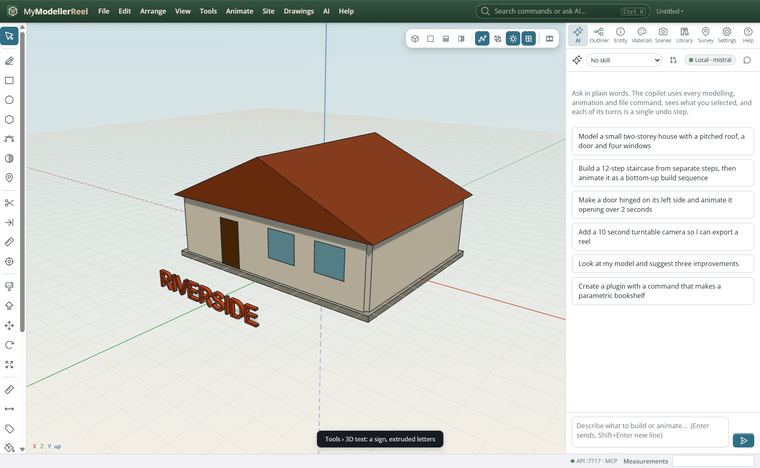
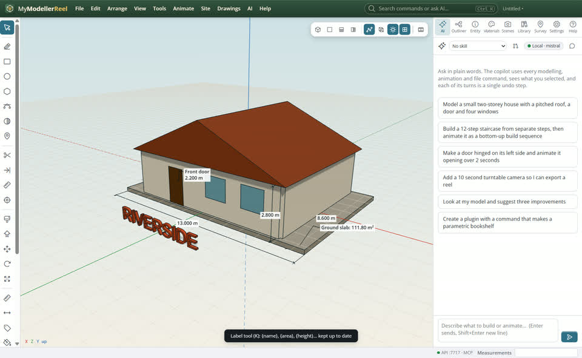
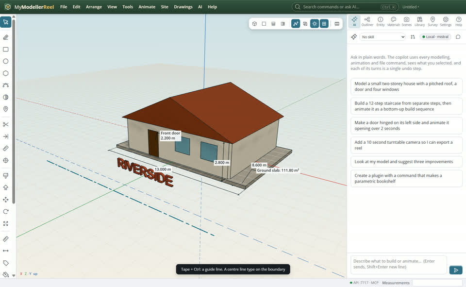

# Dimension, label and sign a design

You want sizes and names on the model that stay right when it changes, construction guides to draw to, and real 3D lettering for signs and titles.



## In the app

1. Select a shape, **Tools › Dimension the selected shape** [Dimension](action:dimensionShape): its width, height and depth. Or the Dimension tool [Dimension](tool:dimension) (D): click two points; arrow keys lock an axis.
   
2. Resize or move the shape: its dimensions follow.
   
3. The Label tool [Label](tool:label) (K): type the text first ({name}, {area}, {footprint}, {volume}, {height}, {elevation}, {meta.key}), then click a shape. The text keeps itself up to date.
   
4. Tape Measure (T): Ctrl on the second click leaves a dashed guide line; Alt-click drops a guide point. **Tools › Delete all guides** [Clear](action:clearGuides).
   
5. **Tools › 3D text…** [3D text](action:text3d): letters extruded, standing or flat on the ground.
   

## Ask Plumb

> Dimension the width and depth of the house, label each room with its name and floor area, and put a 0.6 m sign saying RIVERSIDE in front of it.

Plumb runs the same commands as the steps above; with **AI › Propose AI changes for review** on, you accept or reject its changes first.

## From a script, the HTTP API or MCP

```js
await api.add_dimension({ id: 'Ground slab', axis: 'x', offset: 0.8 });
await api.add_dimension({ from: [0, 0, 0], to: { id: 'Shed', corner: 'max' } });
await api.add_label({ id: 'Kitchen', text: '{name}\n{footprint}' });
await api.add_guide({ point: [0, 0, 5], direction: [1, 0, 0] });
await api.create_text({ text: 'RIVERSIDE', size: 0.6, depth: 0.1, position: [0, 0, 6] });
await api.set_properties({ ids: ['Fence'], line_type: 'center', line_weight: 0.5 });
```

## Good to know

- Dimensions, labels and guides are curves on the Dimensions and Guides layers: hide, lock or colour them there.
- Line types (dashed, dotted, center, hidden, or your own with `define_line_type`) and weights (mm) work on any curve and ByLayer.
- `list_annotations` gives every dimension's current value.

## Related

- [Make a drawing sheet and a section](howto:drawing-sheets-and-sections)
- [Organise a model with layers](howto:organise-with-layers)
