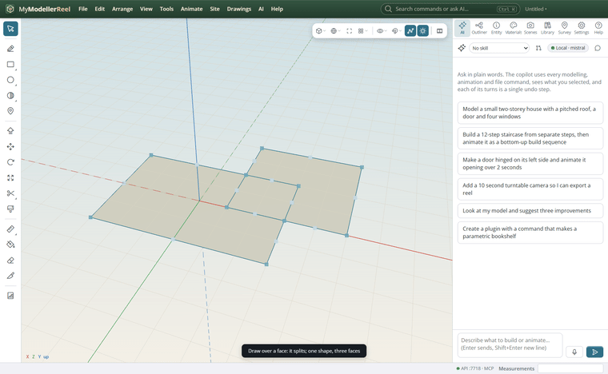
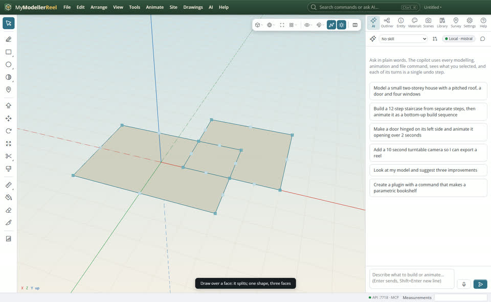
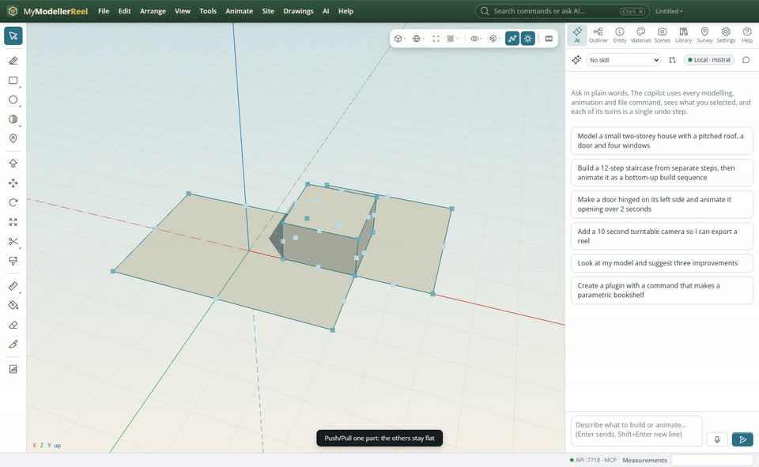
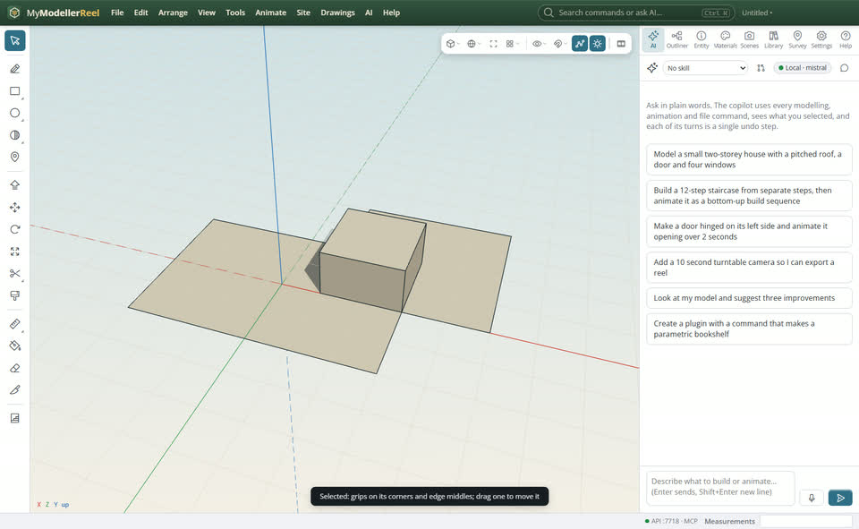
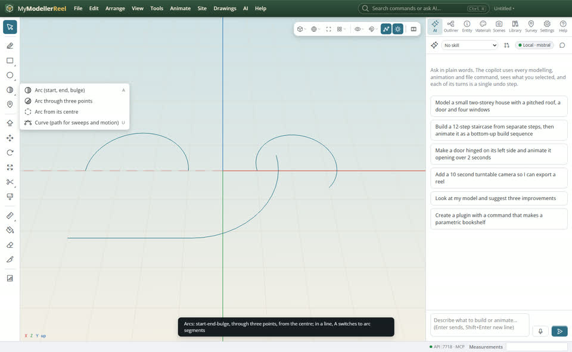
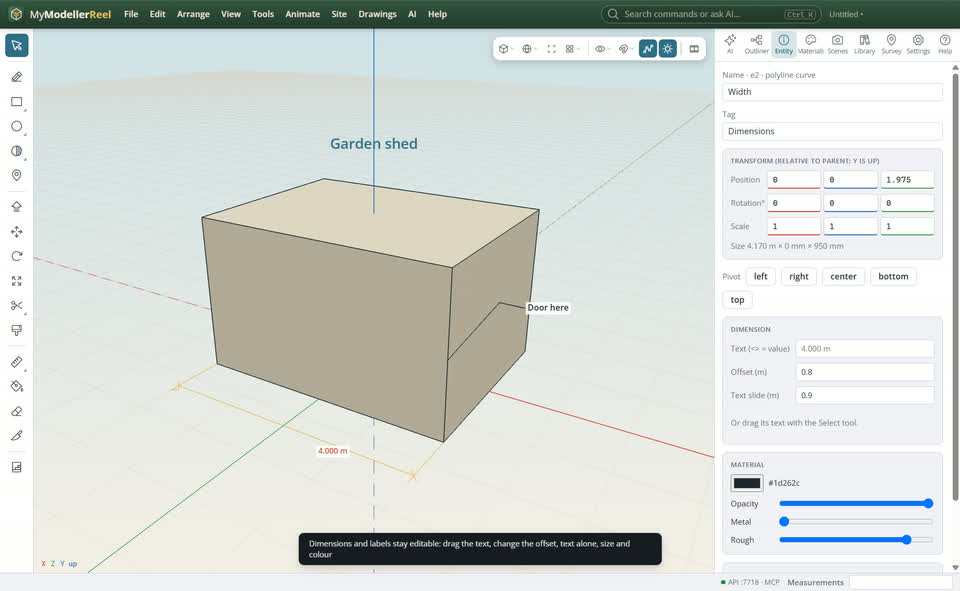
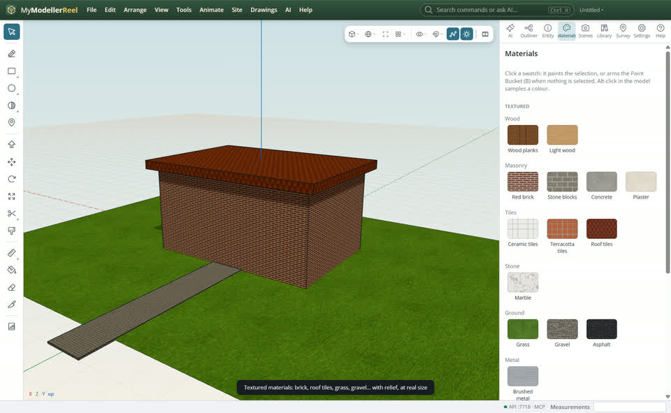

# Draw and edit like on paper: split faces, grips, arcs, dimensions, text and real materials

You want shapes that behave: a rectangle drawn on another splits it, corners and edges you can drag, arcs drawn the way you think of them, dimensions and labels you can still move, plain text, and materials that look like brick, wood or grass.



## In the app

1. Draw a [Rectangle](tool:rectangle), [Circle](tool:circle) or [Polygon](tool:polygon) over a flat shape on the same plane: it splits that shape where they overlap. It stays one shape with several faces, and you can push/pull each part on its own. Shapes in a group keep apart.
   
   
2. Select a shape (or a line or curve) with [Select](tool:select): grips appear on its corners and edge middles (or curve points). Drag one to move it; it snaps like the drawing tools.
   
3. Arcs (right-click the arc button): [start, end, bulge](tool:arc), [through three points](tool:arc3), or [from the centre](tool:arcc) (type the angle). In the [Line](tool:line) tool, press **A** to switch the next segments to arcs that follow on smoothly, and **A** again for straight.
   
4. Lines come apart and go together where you click: [Split](tool:split) cuts a line in two at the point you click; [Join](tool:join) takes the first line (click near the end to join) and the second (click near its end) and makes one line: touching ends merge, a gap is bridged by a straight piece.
5. Dimensions and labels stay editable: select one and drag its text (a dimension slides along its line and moves off it), or change the offset, the text, the size, the plate and the colour in the Entity panel. The [Text](tool:text) tool places text without a leader.
   
6. **Materials › Textured**: wood, brick, stone, concrete, plaster, tiles, roof tiles, marble, grass, gravel, asphalt and brushed metal, each with its relief and roughness and at real size. Click one to give it to the selection, or to paint with the [Paint Bucket](tool:paint).
   

## Ask Plumb

> Put red brick on the house, roof tiles on the roof and grass on the yard, then label the house "Garden shed" in big blue text without a leader.

## From a script, the HTTP API or MCP

```js
await api.create_face({ points: [[-3, 0, 2], [3, 0, 2], [3, 0, -2], [-3, 0, -2]], name: 'Slab' });
await api.create_face({ points: [[1, 0, 0], [5, 0, 0], [5, 0, -4], [1, 0, -4]], split: true }); // splits Slab
await api.move_elements({ id: 'Slab', vertices: [3], by: [0, 0, -1] });
await api.break_curve({ id: 'Kerb', at: [2, 0, 0] });                   // split where you click
await api.connect_curves({ ids: ['Kerb', 'Kerb 2'], at: [2, 0, 0] });   // join the nearest ends
await api.create_arc({ kind: 'three_point', start: [-4, 0, 0], through: [-2.5, 0, -1.5], end: [-1, 0, 0] });
await api.edit_annotation({ id: 'Width', offset: 0.8, text_shift: 0.9 });
await api.add_label({ id: 'Shed', text: 'Garden shed', leader: false, size: 22, color: '#2f6f86', plate: 'none' });
await api.list_material_library();
await api.apply_material({ ids: ['House'], material: 'Red brick', scale: 1 });
```

## Good to know

- A shape drawn fully inside a face is imprinted into it (as before); one that overlaps its edge splits it.
- Grips show on shapes of up to 400 corners; bigger meshes (terrains, scans) do not get them.
- The textured materials are made by the app, offline, and saved inside the model file.

## Related

- [Find your tools fast: the toolbar, the view bar, right-click, snaps and export](howto:work-faster)
- [Model a shape with push / pull, then copy it as a component](howto:push-pull-and-components)
