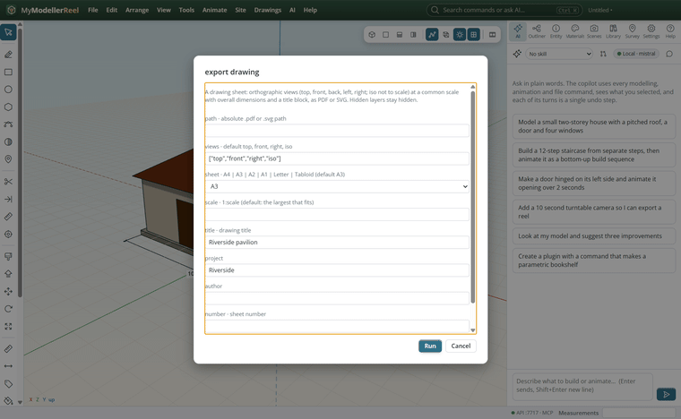
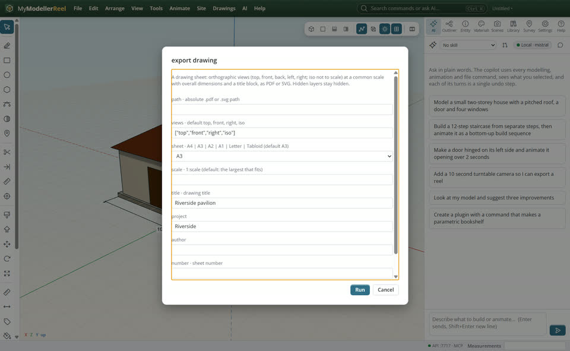
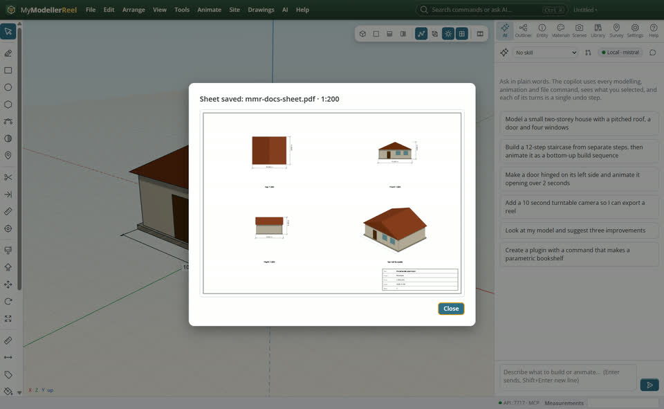
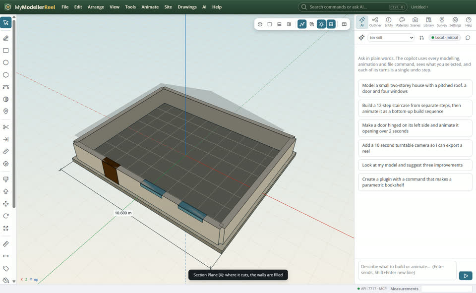
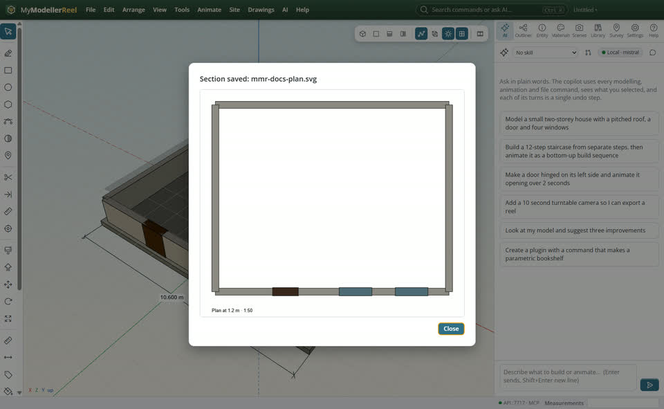

# Make a drawing sheet and a section

You want to hand someone a drawing: plan and elevations to scale on a sheet with a title block, or a cut through the model.



## In the app

1. **File › Export drawing sheet (PDF, SVG)…** [Sheet](action:exportDrawing): the views you want, the sheet size, a title. The scale is the largest standard one that fits.
   
2. The sheet: each view at the same scale with its overall dimensions, the iso view not to scale, and the title block.
   
3. Cut the model: the Section Plane tool [Section](tool:section) (X) on a face. Where it cuts solids it is filled in a darker tone (**View › Section fill** [Fill](action:sectionFill)).
   
4. **File › Export section (SVG, DXF)…** [Section](action:exportSection): the cut, filled and to scale in SVG, or as closed polylines in DXF.
   

## Ask Plumb

> Make an A3 PDF sheet of the house with the top, front and right views and the title "Riverside pavilion", then export a plan section at 1.2 m as SVG.

Plumb runs the same commands as the steps above; with **AI › Propose AI changes for review** on, you accept or reject its changes first.

## From a script, the HTTP API or MCP

```js
await api.export_drawing({ path: 'C:/out/house.pdf', views: ['top', 'front', 'right', 'iso'], sheet: 'A3', title: 'Riverside pavilion' });
await api.section({ normal: [0, 1, 0], point: [0, 1.2, 0] });
await api.export_section({ path: 'C:/out/plan.svg', scale: 50, title: 'Plan at 1.2 m' });
const cut = await api.section_cut({}); // per shape: the cut area
```

## Good to know

- Hidden layers stay off the sheet; guides never size the views.
- The pictures in the sheet are rendered views; the frame, dimensions and title block are vector.

## Related

- [Dimension, label and sign a design](howto:dimension-and-label)
- [Check a design for clashes](howto:check-for-clashes)
