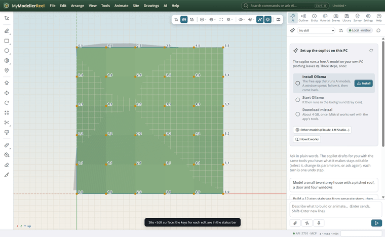
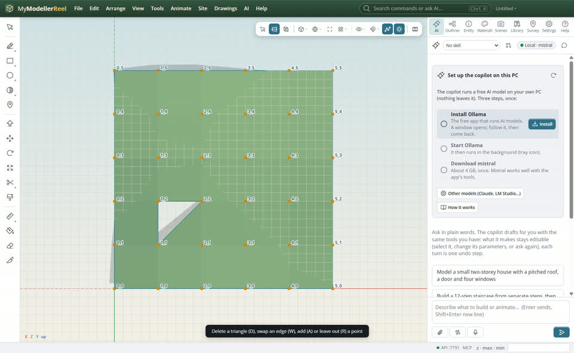
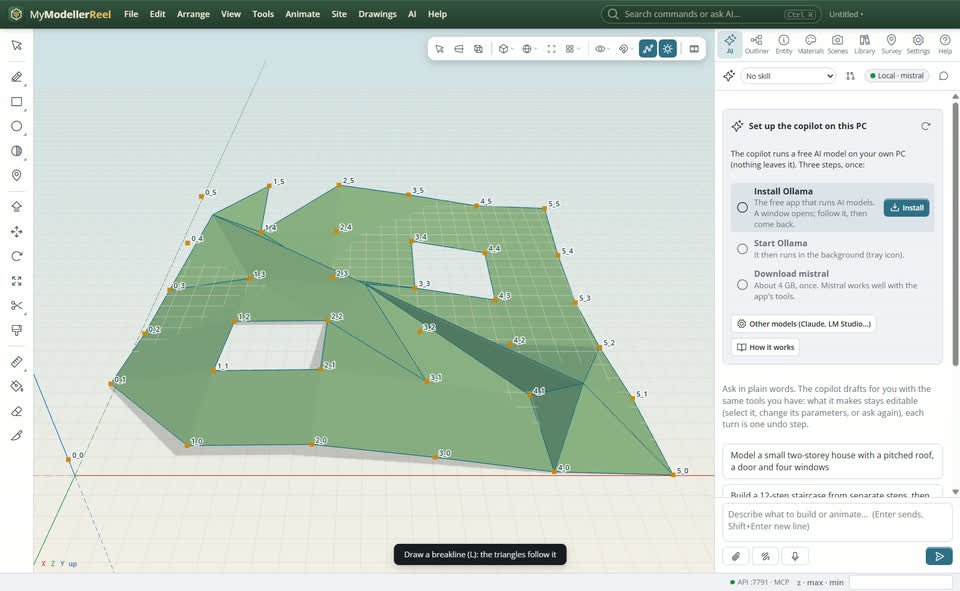
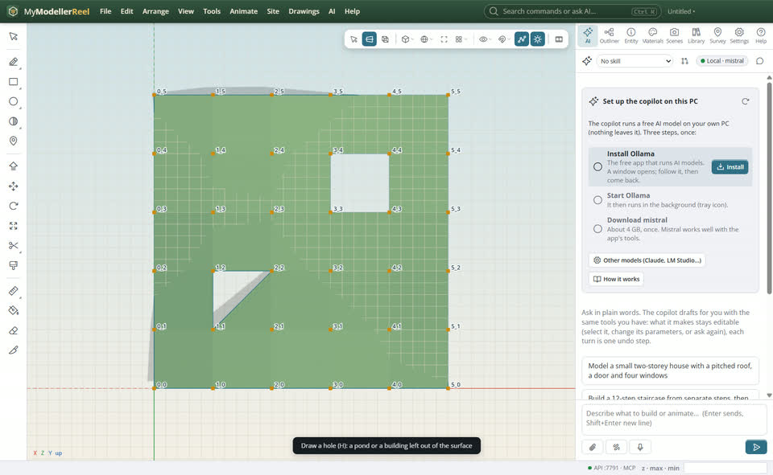
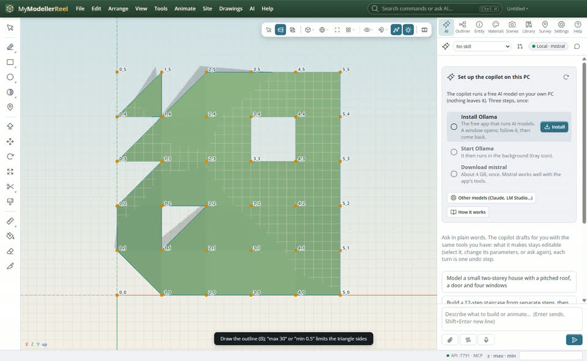
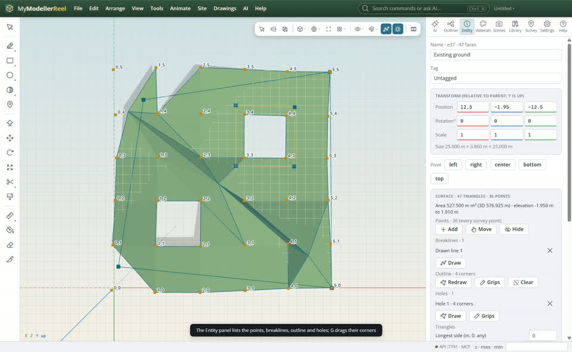

# Edit a surface by hand: points, breaklines, outline and holes, swapped and deleted triangles

Your surface from survey points is nearly right: a point is a few centimetres off, a ridge needs a breakline, a few triangles cross it the wrong way, a pond should be left out, or the edge should stop at the site boundary. A surface keeps what it is made of (its points, breaklines, outline and holes), so every edit rebuilds it, and each one undoes on its own.



## In the app

1. Select the surface and pick **Site › [Edit surface](action:editSurface)** (or right-click the surface). The status bar lists the keys.
   
2. Points: **A** add one where you click (type `z 102.5` first to give it that elevation, else it sits on the surface); **M** move: drag a point in plan, Shift-drag it up or down, or click it and type `z 101`; **X** deletes a point; **R** leaves it out of this surface only.
3. Triangles: **D** delete: click a triangle to remove it. **W** swap: click near an edge to turn it the other way between its two points. **U** restores them.
   
4. **L** breakline: click along a ridge or a kerb, Enter to finish; or Shift+click a line or curve already drawn to use it (it stays live).
   
5. **H** hole: click the corners of an area to leave out (a pond, a building), Enter to finish.
   
6. **B** outline: click the corners of the boundary the surface stays inside, Enter to finish. **G** grips: drag a corner of the outline or a hole, click an edge to add a corner, Alt+click a corner to remove it. Type `max 30` to drop triangles with a side longer than 30 m, or `min 0.5` to drop slivers.
   
7. With the surface selected, the **Entity** panel lists what the surface is made of: points (and those left out, to bring back), breaklines, outline and holes with a button to remove each, show or hide the points and lines, the longest triangle side, contours and analysis colours, area and elevations.
   

## Ask Plumb

> On Existing ground, leave out point 2_2, add a breakline along the ditch, drop triangles longer than 30 m, and cut a hole around the pond.

## From a script, the HTTP API or MCP

```js
await api.surface_definition({ id: 'Existing ground' });
await api.surface_points({ id: 'Existing ground', action: 'add', at: [12, -9], z: 1.8 });
await api.surface_points({ id: 'Existing ground', action: 'move', points: ['2_2'], z: 2.5 });
await api.surface_points({ id: 'Existing ground', action: 'exclude', points: ['3_3'] });
await api.surface_breaklines({ id: 'Existing ground', action: 'add', points: [[2, 1, -20], [20, 1, -3]] });
await api.surface_boundary({ id: 'Existing ground', action: 'set', points: [[0, -2], [25, 0], [25, -25], [3, -22]] });
await api.surface_boundary({ id: 'Existing ground', action: 'move_vertex', index: 2, to: [24, -24] });
await api.surface_boundary({ id: 'Existing ground', action: 'add_void', points: [[14, -14], [21, -14], [21, -21], [14, -21]] });
await api.edit_triangles({ id: 'Existing ground', action: 'swap', a: '2_2', b: '3_3' });
await api.set_surface_sources({ id: 'Existing ground', max_edge: 30, min_edge: 0.5 });
```

## Good to know

- Swap works on an edge between two survey points.
- Moving or deleting a survey point changes every surface made from it; leaving it out (R, `exclude`) changes only this one.
- An outline or a hole made of survey points (Site › Boundary) works too and moves with its points.
- Files from before keep working: their surfaces open as editable definitions.

## Related

- [Turn survey points into a surface](howto:survey-points-to-surface)
- [Read the terrain: contours, slopes and checks](howto:read-the-terrain)
