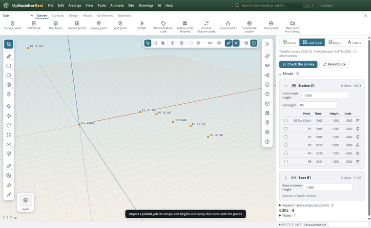
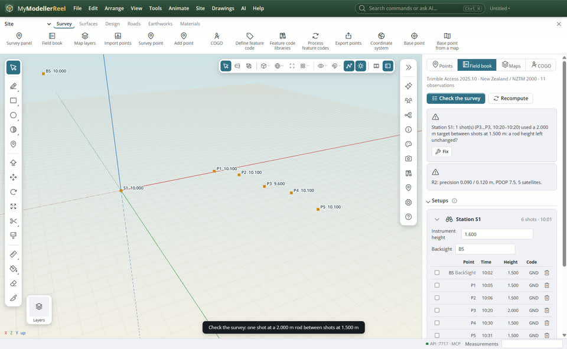
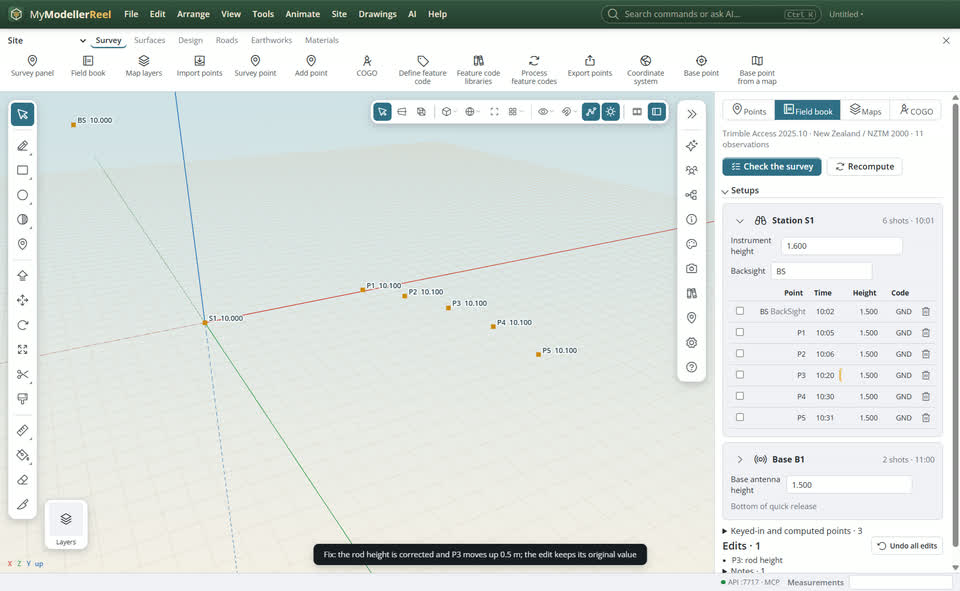

# Fix field mistakes in a survey: rod, instrument and antenna heights

A rod left at 2.000 m for half an hour, a typo in the instrument height, the wrong antenna measuring method or a bad backsight: fix it in the office and every point it touched moves, with the surface and linework built on them. The job keeps its station setups and every shot when you import it, so nothing has to be measured again.



## In the app

1. [Import](action:import) a Trimble JobXML (.jxl) job from Trimble Access or General Survey. The points come in with their **field book**: station setups, backsights, targets, GNSS bases and every observation. Photos in the job's `Files` folder are attached to their points.
   
2. Open the [Field book](action:fieldbook) (Survey tab). Click **Check the survey**: it lists what looks wrong, like a run of shots at another rod height than the shots around them, backsight residuals, odd prism constants, GNSS points with poor precision, and the same name at two places.
   
3. Click **Fix** on a finding, or type the right value in a cell: the instrument height of a setup, the rod height of a shot, a GNSS antenna height. To fix many shots at once, tick them and type the rod height in the bar at the top. The points move by exactly what the edit changes. Edited values are marked, and each edit keeps its original value.
   
4. **As measured** puts the picked shots back; **Undo all edits** puts the whole job back. Delete a shot with its bin: its point hides, and restoring the shot brings it back.
5. Write it out: [Export](action:exportAll) LandXML (the setups and raw observations go in its Survey section), or OGC InfraGML Part 6. `survey_report` writes an HTML report of the setups, the edits and the points they moved.

## How the points are recomputed

Each point starts from the coordinates the field software computed, then moves by the difference the edit makes to the reduction: angles and slope distance to a grid position, with curvature and refraction, the instrument and target heights and the setup's backsight; for GNSS, the base position and the antenna heights. Points you did not touch stay exactly as the controller stored them.

## Ask Plumb

> The rod was at 1.8 m, not 2.0 m, from 10:05 to 10:40. Fix it.

> Check my survey for busts and tell me what you would change.

## From a script, the HTTP API or MCP

```js
await api.import({ path: 'C:/jobs/kerb pickup.jxl' });
const review = await api.review_survey({});                 // findings, each with its fix
await api.edit_survey_observations({ from: '10:05', to: '10:40', target_height: 1.8 });
await api.edit_survey_observations({ setup: 'STN1', instrument_height: 1.552 });
await api.edit_survey_observations({ base: 'BASE1', base_antenna_height: 1.52 });
await api.compare_survey({ tolerance: 0.005 });             // the points that moved
await api.survey_report({ path: 'C:/jobs/survey-report.html' });
await api.export({ format: 'landxml', path: 'C:/jobs/kerb pickup corrected.xml' });
```

## Related

- [Import a points file and keep its attributes](howto:import-survey-points)
- [Turn survey points into a surface](howto:survey-points-to-surface)
- [Web map and feature layers](howto:web-map-layers)
