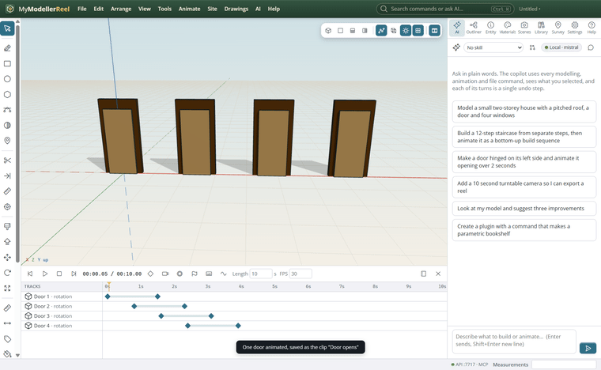
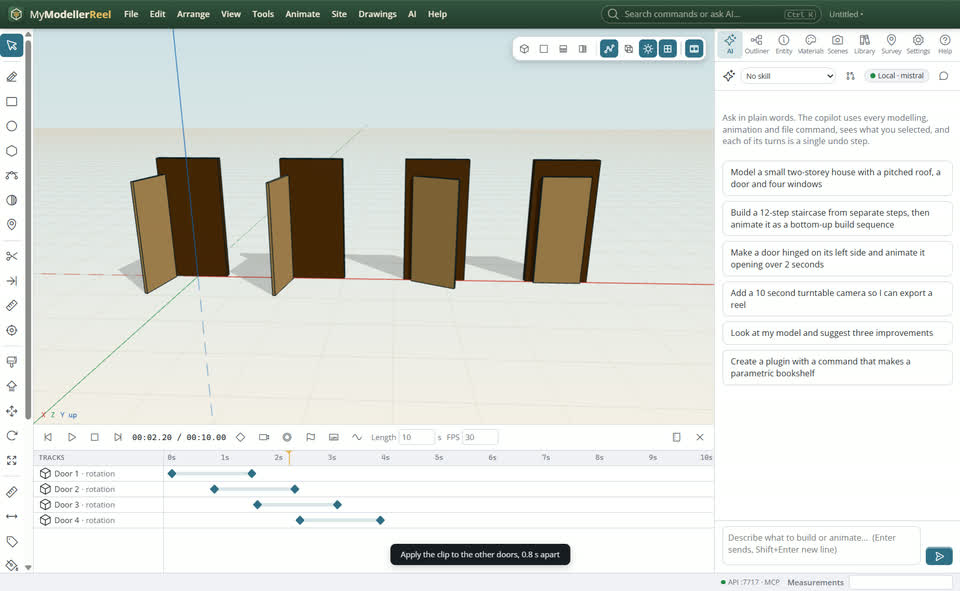
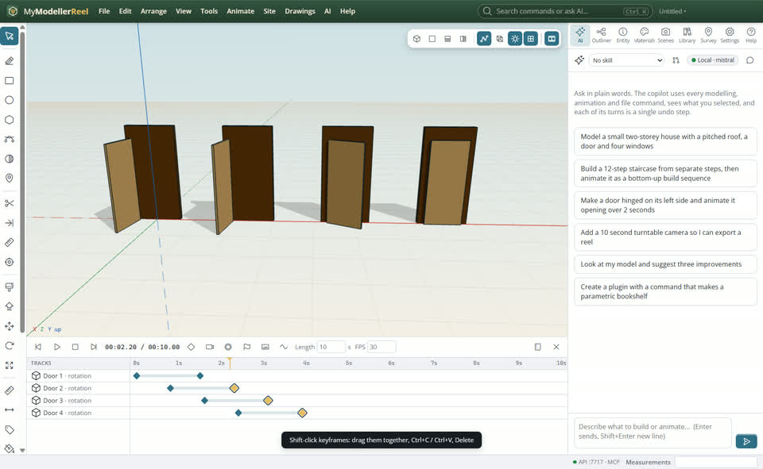
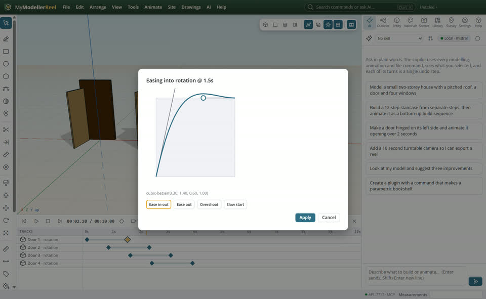

# Edit timing: clips, the dope sheet and easing curves

You animated one door and want every door to do it, the whole thing a bit slower, and a livelier ease.



## In the app

1. Animate one thing, then **Animate › Save as a clip…** [Save clip](action:saveClip). Select the others, **Apply a clip to the selection…** [Apply](action:applyClip): each plays it where it is (stagger them).
   
2. In the timeline: shift-click or shift-drag to select several keyframes, drag them together; Ctrl+C, move the playhead, Ctrl+V; Delete. **Retime keyframes…** [Retime](action:retime) stretches a span.
   
3. Select a keyframe, the curve button: drag the two handles of its easing (or pick Overshoot, Slow start…).
   

## Ask Plumb

> Save the front door opening as a clip, play it on the other three doors one second apart, then make the whole animation 50 % slower.

Plumb runs the same commands as the steps above; with **AI › Propose AI changes for review** on, you accept or reject its changes first.

## From a script, the HTTP API or MCP

```js
await api.save_clip({ name: 'Door opens', ids: ['Front door'], from: 0, to: 2 });
await api.apply_clip({ name: 'Door opens', ids: ['Door 2', 'Door 3', 'Door 4'], start: 2, stagger: 1 });
await api.retime({ scale: 1.5 });
await api.set_ease({ id: 'Door 2', property: 'rotation', time: 4, bezier: [0.3, 1.4, 0.6, 1] });
await api.copy_keys({ from_id: 'Door 2', to: ['Gate'], offset: 3 });
```

## Good to know

- Clips keep moves and turns relative to where each thing is, and scale as a factor.
- Easing curves use the CSS cubic-bezier numbers: [0.42, 0, 0.58, 1] is ease-in-out.

## Related

- [Hinge a door and animate it opening](howto:hinge-a-door)
- [Carry, follow and fall](howto:carry-follow-and-fall)
