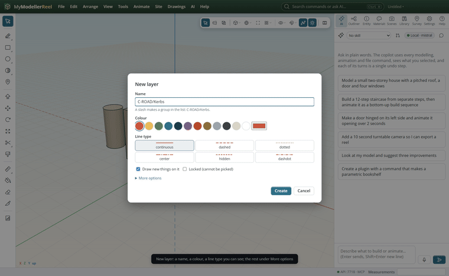
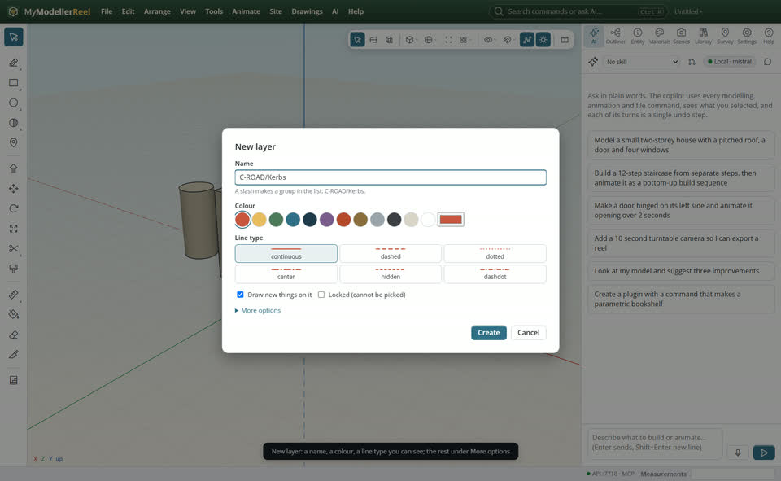
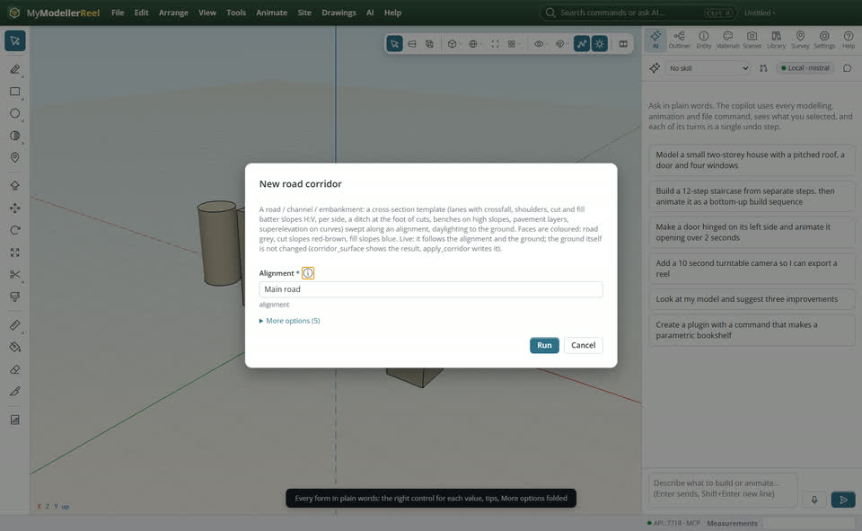
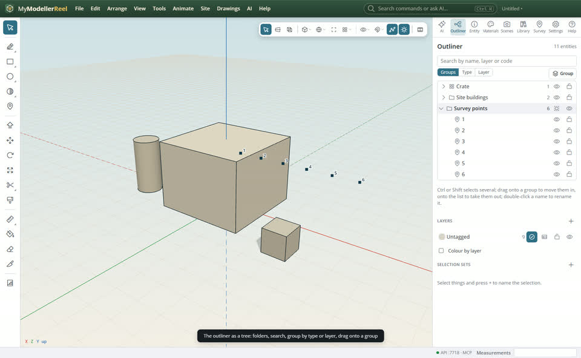
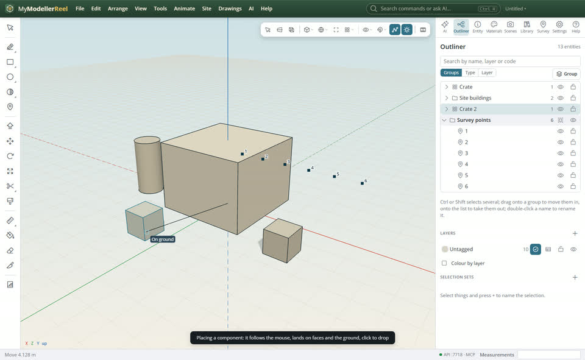
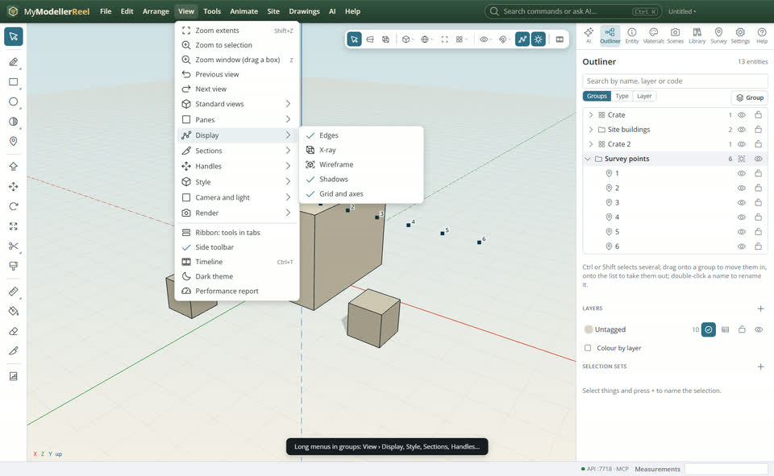
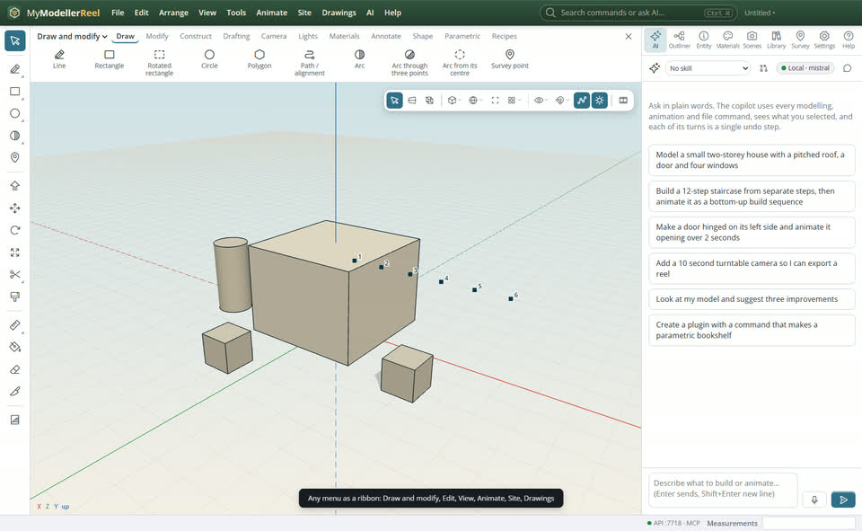

# Everyday work made easy: friendly forms, layers, the outliner tree, placing, ribbons and paths

You want to fill in a dialog without knowing the scripting names, keep a growing model organised, drop a component exactly where you want it, find tools in a ribbon, and draw a path or road alignment with curves.



## In the app

1. **New layer** (Outliner › Layers +): a name, a colour from the swatches, a line type you can see, "draw new things on it" and "locked" as ticks; folder, line weight and description under **More options**.
   
2. Every other form reads the same way: plain names, a tip (i) on each field, colours with swatches, choices as buttons, numbers with their unit, points you can **Pick in the view**, names of what is in the model offered as you type, and the rarely used fields folded away. A mistake is shown next to the field and the form stays open.
   
3. **The outliner is a tree**: groups fold, points, lines, drawings and surfaces sit in folders, the search box filters by name, layer or code, and **Groups / Type / Layer** regroups the list. Ctrl or Shift selects several; drag them onto a group to move them in, or onto the list to take them out; double-click a name to rename it. The panel keeps its scroll position.
   
4. **Placing a component** (Library panel, or Edit › Place component): it follows the mouse, lands on faces and the ground with snapping, and a click drops it. Esc takes it away.
   
5. Long menus come in groups: hover **View › Display**, **Style**, **Sections**, **Handles**… Toggles keep the menu open.
   
6. **View › [Ribbon](action:ribbon)**: any menu as a ribbon of big buttons in tabs (Draw and modify, Edit, Arrange, View, Animate, Site, Drawings); pick which in its list. **View › [Side toolbar](action:sideToolbar)** hides the side toolbar when the ribbon has the tools.
   

The view bar stays at the top right whatever the layout; its **Views** menu has the standard views, **parallel projection** and **wireframe** for the pane you work in. Grips on a selected shape appear one at a time as the pointer comes near a corner or edge, never through a face.

**[Path / alignment](tool:curve)** (with the Line tool): click points; **A** switches to arc segments, **S** smooths the path into a spline, `r 5` rounds every corner to 5 m. Enter keeps it as a path for sweeps and motion; **Ctrl+Enter** makes it a road alignment, whose radii you change corner by corner in the Entity panel. Sweeps have civil sections too: road crown, barrier and mountable kerbs, footpath with kerb, V-ditch, lined channel, U-drain, hollow pipe, pipe trench, guard rail, L-wall.

## Ask the copilot

> Make a layer C-ROAD/Kerbs in red, dashed, and put the kerbs on it; then sweep a barrier kerb along the Path.

## From a script, the HTTP API or MCP

```js
await api.create_layer({ name: 'C-ROAD/Kerbs', color: '#c8553d', line_type: 'dashed', current: true });
await api.set_parent({ ids: ['Shed', 'Tank'], parent: 'Site buildings' });
await api.create_alignment({ points: [[-12, 0, 6], [0, 0, 6], [0, 0, -6], [12, 0, -6]], radii: [4, 4] });
await api.set_alignment({ id: 'Alignment', radii: [8, 4] });
await api.sweep({ path: 'Path', profile: 'barrier_kerb' });
```

## Good to know

- Forms still accept the exact values a script would use, under **More options** where a field takes a list or an object.
- Grips show on shapes of up to 400 corners.

## Related

- [Find your tools fast: the toolbar, the view bar, right-click, snaps and export](howto:work-faster)
- [Draw and edit like on paper](howto:draw-and-edit)
