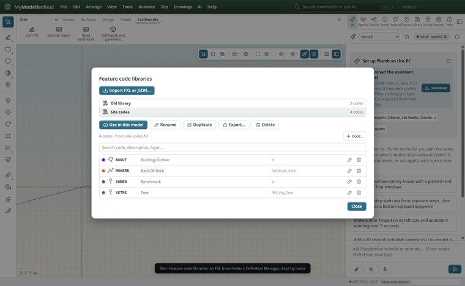
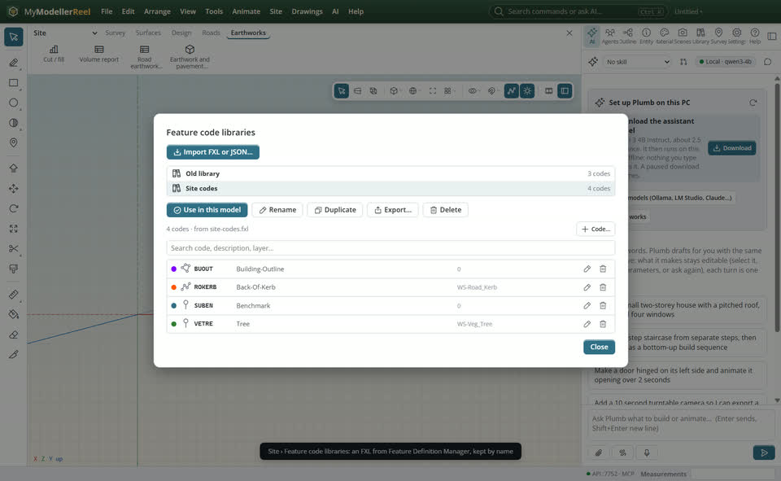
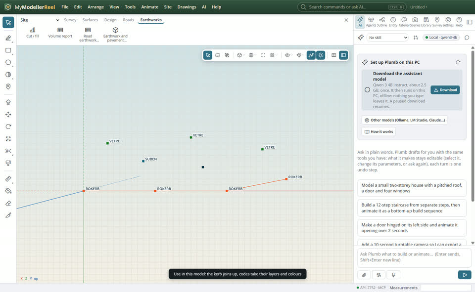
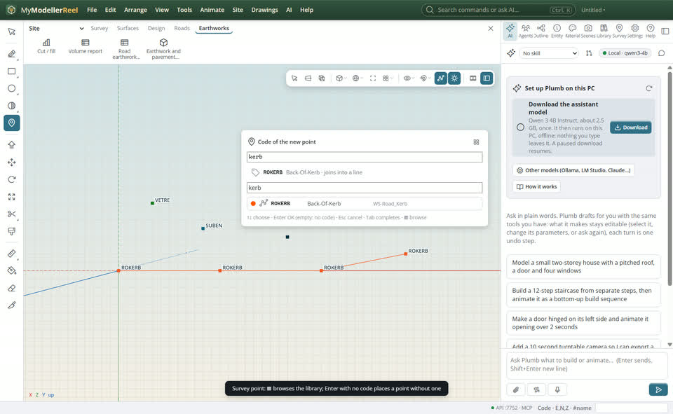
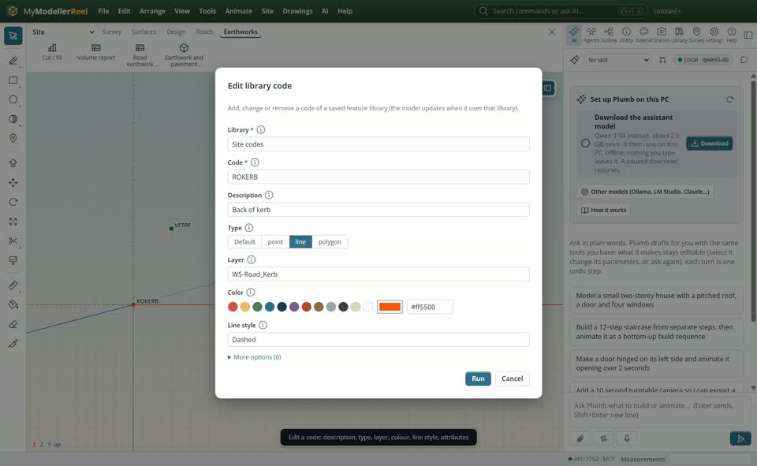

# Keep feature code libraries and pick the one a model uses

Your survey team codes points with a Trimble feature library (an .fxl from Feature Definition Manager). You want it on this computer once, under a name, next to your other libraries, and each model to say which one it uses.



## In the app

1. **Site › Feature code libraries…** [Feature code libraries](action:loadLibrary), then **Import FXL or JSON…**: every code comes in with its description, point / line / polygon, layer, colour, line style and attributes (types, pick lists, required). The library is kept on this computer under its file name.
   
2. Choose a library and **Use in this model**: its codes, layers and colours apply to the points, lines join up. Switch to another library the same way; the model keeps a copy of the codes, so the file opens on any machine.
   
3. With the [Survey point](tool:point) tool, click to place a point. The code card asks for its code: type it, or press ▦ to browse the whole library (colour, type, code, description, layer) and search it. Enter with nothing typed places a point without a code.
   
4. In the libraries window, the pencil edits a code (description, type, layer, colour, line style, attributes), the bin removes it, **Code…** adds one. **Rename**, **Duplicate**, **Export…** (FXL, JSON or CSV) and **Delete** act on the whole library.
   

## Ask Plumb

> Import C:\codes\BecaFeature_2016.fxl as "Beca 2016", use it in this model, and list its tree codes.

Plumb runs the same commands as the steps above; with **AI › Propose AI changes for review** on, you accept or reject its changes first.

## From a script, the HTTP API or MCP

```js
await api.import_feature_library({ path: 'C:/codes/BecaFeature_2016.fxl', name: 'Beca 2016' });
await api.feature_libraries({});
await api.use_feature_library({ name: 'Beca 2016' });
await api.feature_library({ name: 'Beca 2016', search: 'tree' });
await api.edit_library_code({ library: 'Beca 2016', code: 'GND', description: 'Ground shot', type: 'point' });
await api.manage_feature_library({ name: 'Beca 2016', action: 'duplicate', to: 'Beca 2016 (site)' });
await api.export_feature_library({ library: 'Beca 2016', path: 'C:/codes/beca.csv' });
```

## Good to know

- The libraries live in one SQLite file in the app's data folder (`featurecodes.sqlite`), not in the model: every model on this computer can use them.
- A model opened on another computer still has its codes. **Keep this model's codes** in the libraries window (or `import_feature_library` with no file) saves them there as a library.
- Editing a code of the library a model uses updates that model at once; other models keep their copy until you use the library again.
- In FXL files, a colour "by layer" takes the layer's colour; white layers are left uncoloured, so those codes get their own colour in the view.
- **Add point…** has the same **Browse** next to its Code field.

## Related

- [Turn survey points into a surface](howto:survey-points-to-surface)
- [Bring in field and GIS data: JobXML, FXL, GeoJSON, Shapefile, DEM](howto:bring-in-field-and-gis-data)
