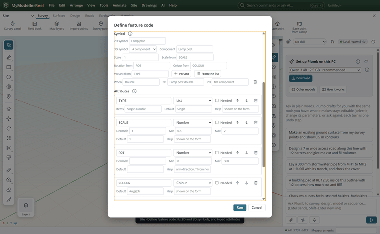
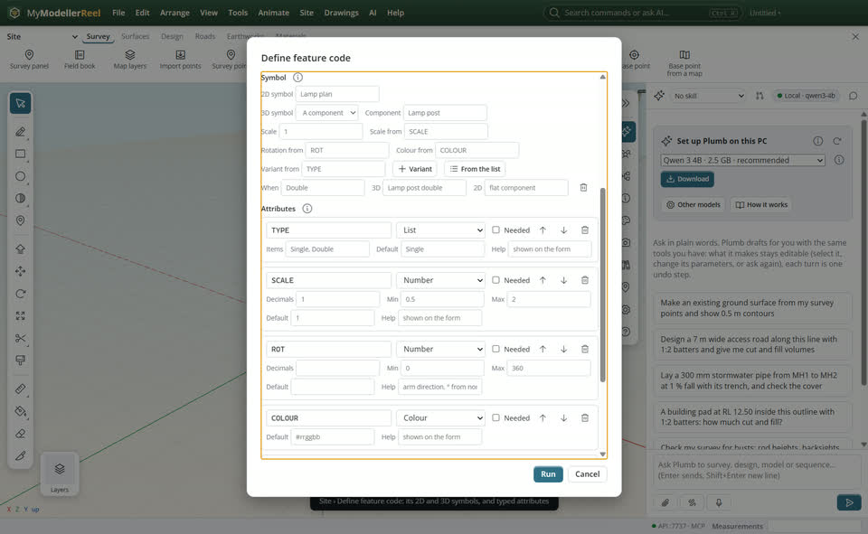
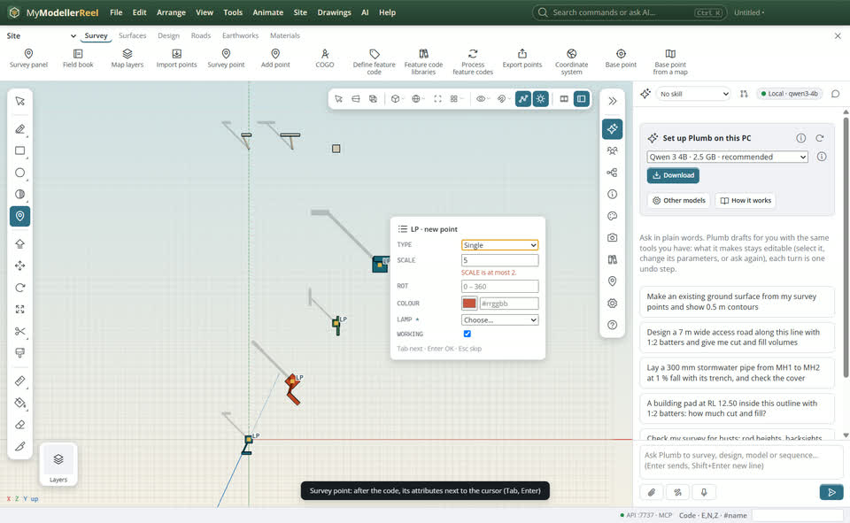
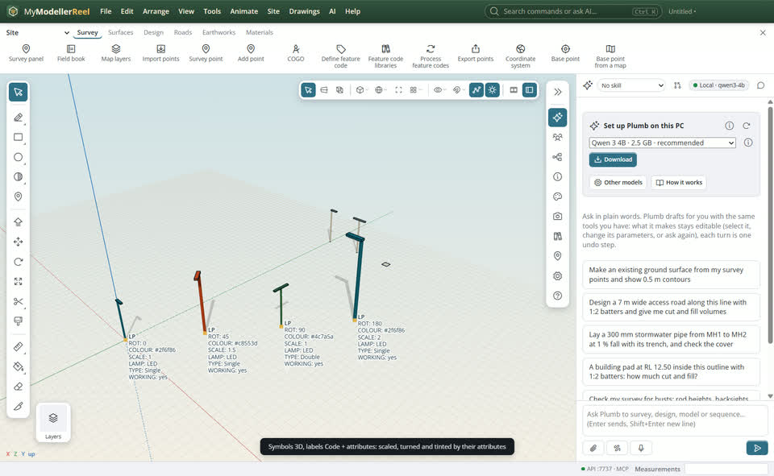
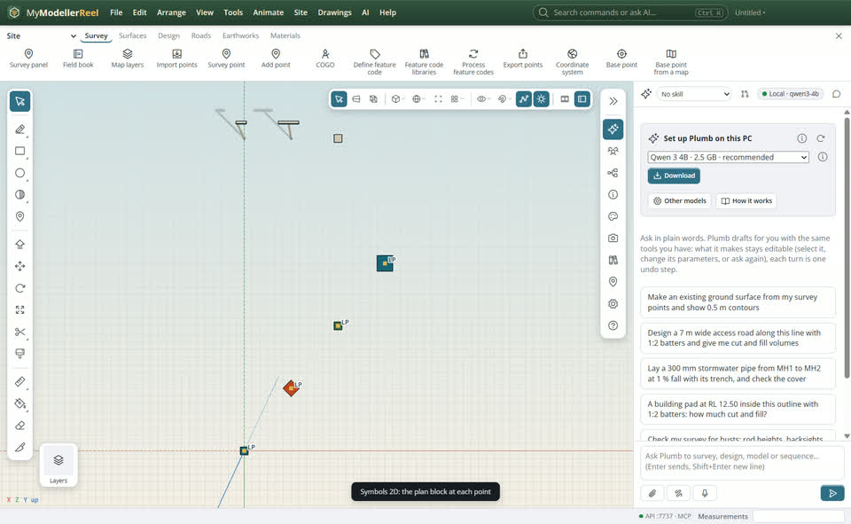
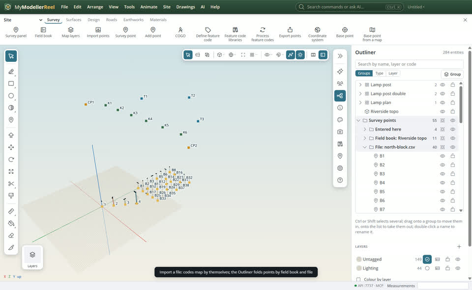

# Give feature codes symbols and typed attributes

Your crew picks up lamp posts, manholes and trees with a code and a few attributes. You want each code to draw its symbol at the point (a plan block for the drawing, a model for the 3D view), sized and turned by what was measured, and the attributes entered quickly and checked when the point is placed.



## In the app

1. Make each symbol once as a component: select its shapes (or linework imported from a CAD block) and **Make component**, then right-click it, [Set component origin](action:componentOrigin), and pick its insertion point (the foot of the pole, the centre of the cover): that point sits on the survey point and the symbol turns about it. **Site › Define feature code…** [Define feature code](action:featureCode): under **Symbol**, choose the **2D symbol** (a flat component) and the **3D symbol** (a component, or a built-in tree, post or manhole), and which attributes give its **Scale**, **Rotation** (degrees clockwise from north) and **Colour**. **Variant from** names an attribute whose value picks other components (a TYPE list with Single and Double arm: **From the list** makes one row per item). Under **Attributes**, add each one with its type (text, number, whole number, list, yes / no, date, time, colour, image, file, link to a point of another code), its default, decimals, min and max, and whether it is needed.
   
2. With the [Survey point](tool:point) tool, click, type the code and press Enter. When the code has attributes, a small card opens next to the cursor: Tab moves to the next value, Enter keeps them, Esc leaves them for later. A value out of range is marked at once. Clicking an existing point edits its code and attributes the same way.
   
3. Every point of the code gets its symbol, a linked copy of the component: edit the component (or any of its copies) and every symbol updates. **Survey panel › Labels › Code + attributes** shows each point's values in the view.
   
4. **Survey panel › Symbols** shows points only, the 2D symbols (for plan drawings), the 3D models (for renders), or both.
   
5. Import a points file or a JobXML: the codes map by themselves (lines, symbols, variants, typed attributes), and the Outliner folds the points by field book and by file.
   

## Ask Plumb

> Make the LP code place the "Lamp post" component, scaled by SCALE and turned by ROT, with a LAMP list (LED, Sodium) that is needed, then show only the 3D symbols.

Plumb runs the same commands as the steps above; with **AI › Propose AI changes for review** on, you accept or reject its changes first.

## From a script, the HTTP API or MCP

```js
await api.make_component({ ids: ['Pole', 'Head'], name: 'Lamp post' });
await api.set_component_origin({ name: 'Lamp post', at: [0, 0, 0] }); // the foot of the pole
await api.define_feature_code({
  code: 'LP', layer: 'Lighting',
  object: { type: 'component', component: 'Lamp post', plan: 'Lamp plan', scale_attr: 'SCALE', rotation_attr: 'ROT', color_attr: 'COLOUR',
            variant_attr: 'TYPE', variants: { Double: { component: 'Lamp post double' } } },
  attrs: [
    { name: 'SCALE', type: 'number', decimals: 1, min: 0.5, max: 2, default: 1 },
    { name: 'ROT', type: 'number', min: 0, max: 360 },
    { name: 'COLOUR', type: 'color' },
    { name: 'LAMP', type: 'list', options: ['LED', 'Sodium'], required: true },
  ],
});
await api.add_point({ n: 5400000, e: 650000, z: 10, code: 'LP', attrs: { ROT: 45, LAMP: 'LED' } });
await api.set_style({ symbols: '3d', point_labels: 'attrs' });
```

## Good to know

- A value that breaks its definition (not a number, above its max, not in its list) is refused by `add_point` and `edit_points`, with the reason. A needed value left empty is not refused: the point is kept and the feature code warnings list it, so you can complete it later.
- Defaults fill the attributes a point does not give.
- The symbol sits at the component's origin. **Make component** puts it at the middle of the shapes' base, which for a lamp post with an arm is beside the pole: **Set component origin** moves it without moving the copies already placed.
- Importing a points file or a JobXML does the mapping by itself: codes join lines and place symbols, attributes are typed ("yes" becomes yes, "led" becomes LED, defaults fill in), and the Outliner folds the points by field book and by file. `query_points` with `source` finds them the same way. Ten thousand coded points import in well under a second.
- Symbols are linked copies: one definition, however many points. Colour by attribute tints a copy without changing the component.
- A Trimble FXL keeps the attribute types it knows (text, number, integer, list, date, time, file, photo); yes / no, colour and link are written as text.

## Related

- [Keep feature code libraries and pick the one a model uses](howto:feature-code-libraries)
- [The component library, selection sets and layer folders](howto:component-library-and-sets)
- [Turn survey points into a surface](howto:survey-points-to-surface)
