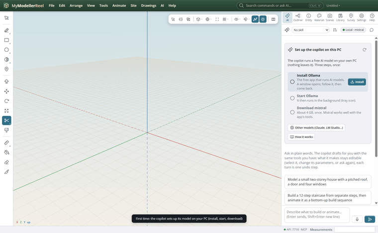
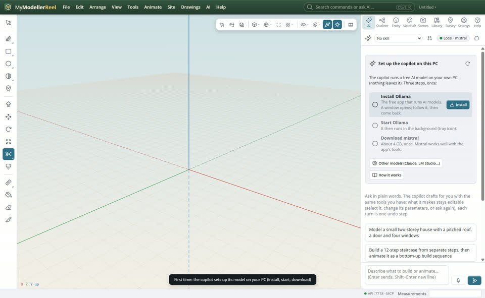
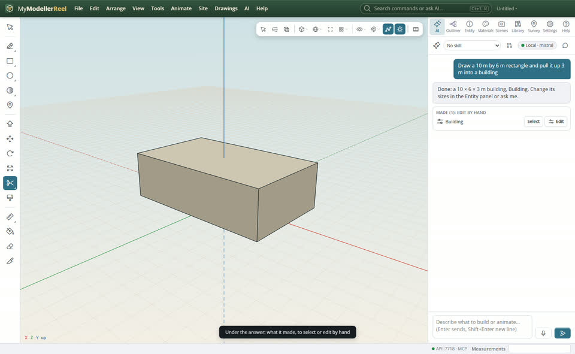
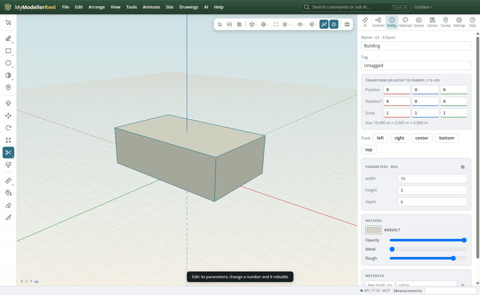

# First steps with the copilot: set it up, ask, then edit by hand

MyModellerReel is AI first: you say what you want and the copilot drafts it with the same tools you have. It works like an assistant at the next desk: it lays things out, you check them and change what you want by hand.



## In the app

1. Open the [AI panel](action:aiPanel). The first time, one step sets up the assistant model on your PC: **Download** (Qwen 3 4B, about 2.5 GB, once). The app runs it itself, on the graphics card when there is one: no other app to install, and it then works offline; nothing you type leaves your PC. **Pause** stops the download; it resumes where it stopped. Prefer Ollama, LM Studio or Claude? **Other models** opens Settings.
   
2. Type what you want in plain words and press Enter, for example "Draw a 10 m by 6 m rectangle and pull it up 3 m into a building". It sees what you selected. Each request is one undo step (Ctrl+Z takes it all back).
   
3. Under its answer, **Made** lists what it drafted. **Select** shows it; **Edit** opens its parameters (width, height, steps, profile…) in the Entity panel: change a number and the shape rebuilds. Anything else you edit by hand like your own work.
   
4. Carry on in words ("make it 12 m long", "add a door on the south wall") or by hand: both work on the same model. Turn on **Propose** (the review button at the top of the panel) to accept or reject its changes before they apply.

## Ask the copilot

> Draw a 10 m by 6 m rectangle and pull it up 3 m into a building, then add a pitched roof.

Then: "Make the building 12 m long instead" changes the parameters rather than drawing it again.

## From a script, the HTTP API or MCP

```js
await api.ai_setup_status();          // next: download | ready (Ollama users: start | pull)
await api.download_ai_model();        // the built-in model, about 2.5 GB once; pause_ai_download stops it
const b = await api.create_box({ width: 10, height: 3, depth: 6, name: 'Building' });
await api.set_params({ id: b.id, params: { width: 12 } });
```

## Good to know

- Small local models do better with short, concrete requests. For long jobs, Claude (Settings › AI) plans further ahead.
- The copilot keeps what it makes parametric on purpose, so you can change it afterwards; **bake** freezes a shape when you want to edit its faces one by one.
- Your achievements count copilot requests too (Help › Your achievements).

## Related

- [Ask the copilot to build or change something](howto:ask-the-copilot)
- [Model a shape with push / pull, then copy it as a component](howto:push-pull-and-components)
