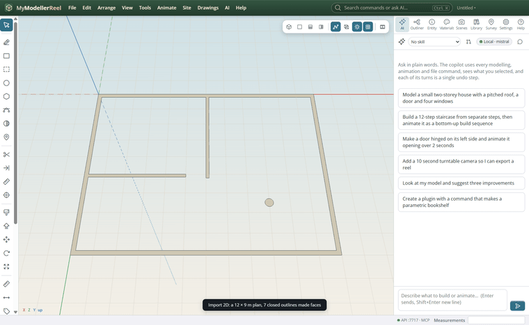
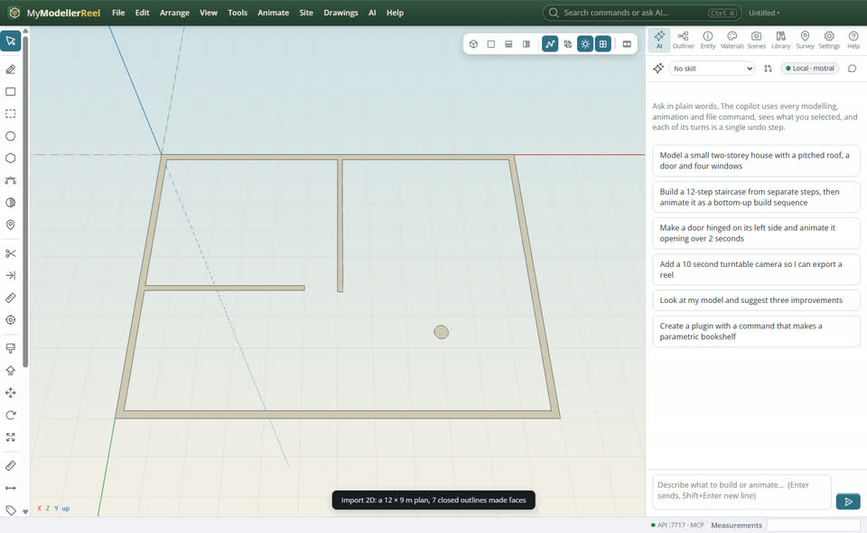
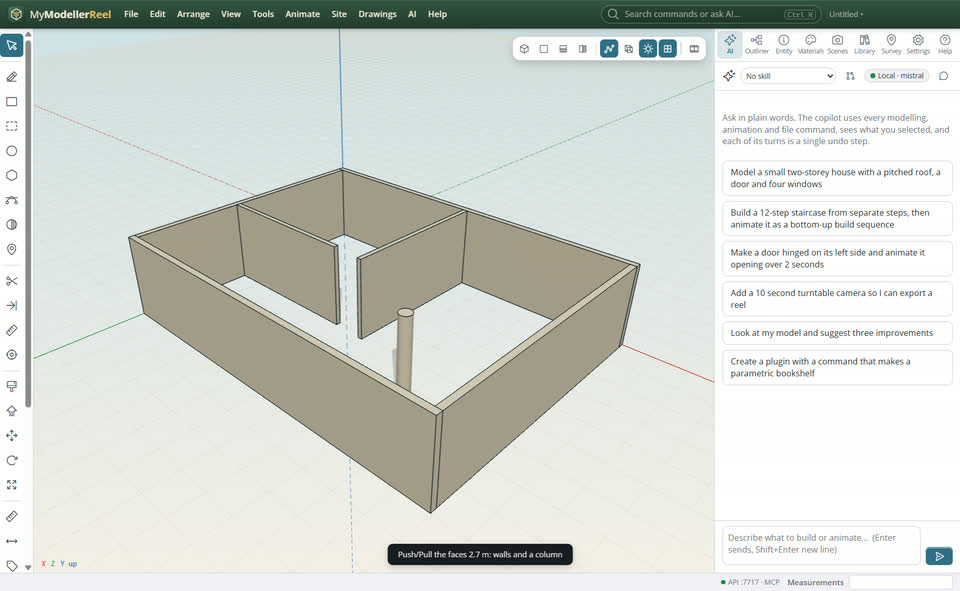
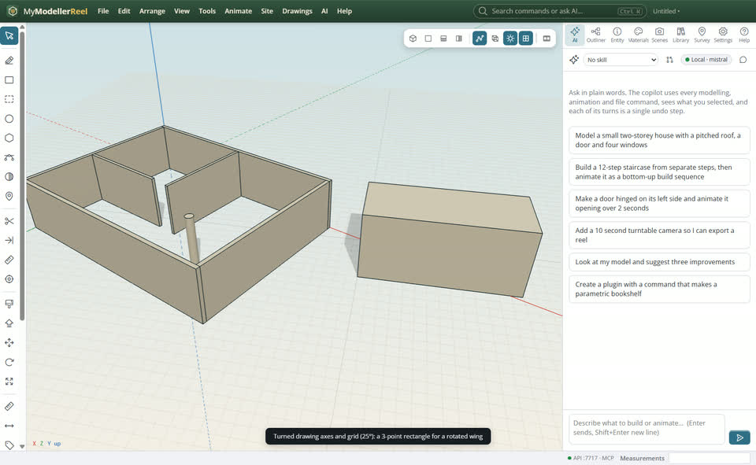
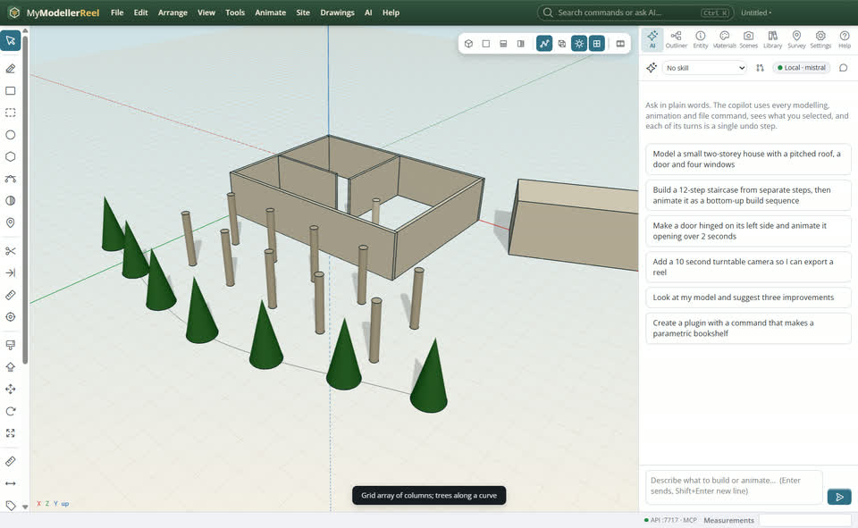

# A floor plan to 3D: 2D import, axes, rotated rectangles and arrays

You have a plan from CAD or a drawing program and want walls in 3D fast, then a column grid and things along a path.



## In the app

1. **Tools › Import a 2D drawing (SVG, DXF)…** [Import 2D](action:import2d): the linework lands on the ground at its real size, closed outlines become faces.
   
2. Push/Pull (P) the wall faces up (or `push_pull` them all from a script).
   
3. **Tools › Drawing axes and grid…** [Axes](action:axes): turn the axes and the grid for a rotated wing, with snap; the Rotated rectangle tool [Rect3](tool:rect3) (F) draws on any angle.
   
4. **Tools › Grid array…** [Grid array](action:arrayGrid) for a column grid; **Array along a curve…** [Path array](action:arrayPath) for lights or trees along a road.
   

## Ask Plumb

> Import C:\plans\ground-floor.svg, raise every wall 2.7 m, then put 0.3 m columns on a 5 × 6 m grid, 4 by 3, east of the building.

Plumb runs the same commands as the steps above; with **AI › Propose AI changes for review** on, you accept or reject its changes first.

## From a script, the HTTP API or MCP

```js
const r = await api.import_2d({ path: 'C:/plans/floor-plan.svg', faces: true });
for (const id of faceIds) await api.push_pull({ id, face: 'top', distance: 2.7 });
await api.set_axes({ angle: 30, grid: 0.5, snap: true });
await api.create_rectangle({ points: [[0, 0, 0], [4, 0, -2.3], [1, 0, 1.7]] });
await api.array_grid({ ids: ['Column'], nx: 4, nz: 3, spacing: [5, 0, 6] });
await api.array_path({ ids: ['Street light'], path: 'Road', count: 8 });
```

## Good to know

- SVG units come from its width (12m, 297mm…); otherwise give scale (m per unit). DXF goes through the DXF importer.
- The top of the drawing is north (−z).

## Related

- [Product modelling](howto:product-modelling)
- [Bring in a LandXML, IFC or DXF file](howto:bring-in-landxml-ifc-dxf)
