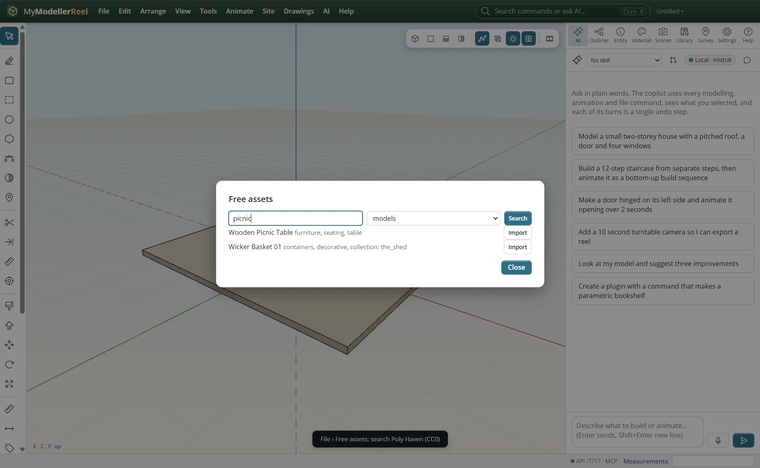
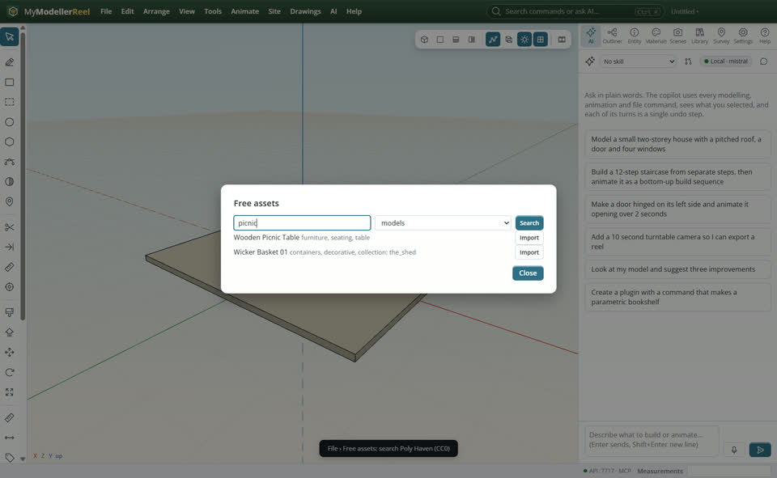
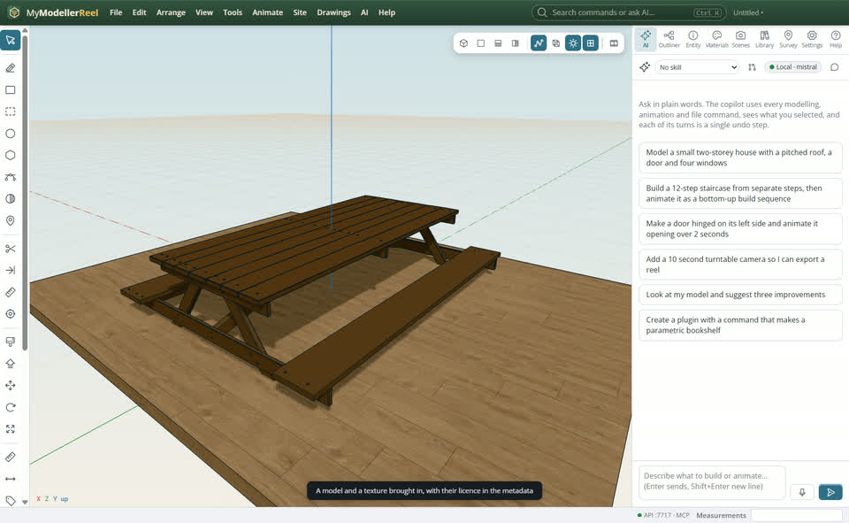
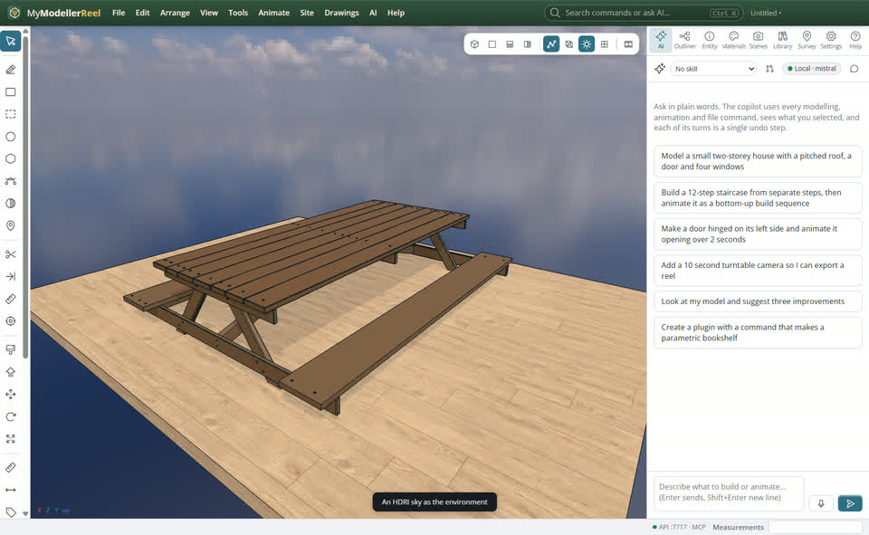

# Find free models, textures and skies, or make a prop from words

You want real furniture, materials and skies without modelling them, free to use in your work.



## In the app

1. **File › [Free assets](action:freeAssets)**: search Poly Haven (all CC0: free for any use, no credit needed) for models, textures or HDRI skies.
   
2. **Import** a model, or a texture onto the selected shapes; the source and licence go into its metadata.
   
3. An HDRI becomes the environment: light, reflections and the sky behind the model.
   
4. **AI › [Generate a 3D model from words](action:generateMesh)** asks a text-to-3D service (Tripo, or your own local server in AI settings) for a prop, and brings it in as a shape.

## Ask Plumb

> Find a free picnic table and put it on the deck, then put a wood floor texture on the deck.

## From a script, the HTTP API or MCP

```js
await api.search_assets({ query: 'picnic', type: 'models' });
await api.import_asset({ id: 'wooden_picnic_table', type: 'models' });
await api.import_asset({ id: 'laminate_floor_02', type: 'textures', size: 2 });
await api.import_asset({ id: 'kloofendal_48d_partly_cloudy_puresky', type: 'hdris' });
await api.generate_mesh({ prompt: 'a wooden garden chair' });
```

## Good to know

- Imported models keep their shape and an average colour per part; their texture images are not kept (the shapes carry no texture coordinates).
- Text to 3D needs a Tripo API key or a local server, set in **Settings › AI**; its result is a mesh to place, not an editable solid.

## Related

- [The component library, selection sets and layer folders](howto:component-library-and-sets)
- [Textures and materials](howto:textures-and-materials)
