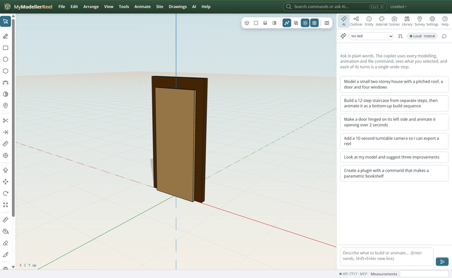
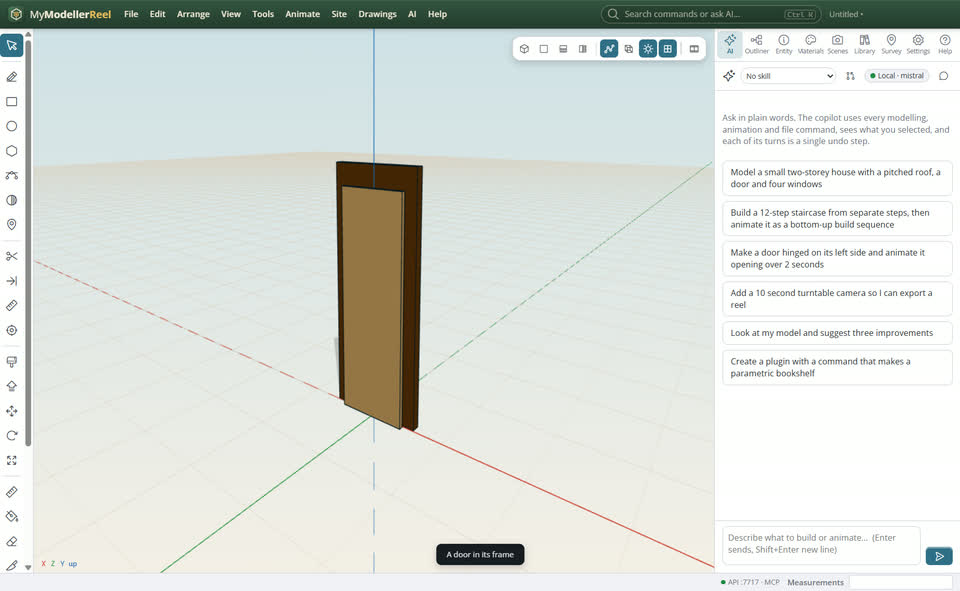
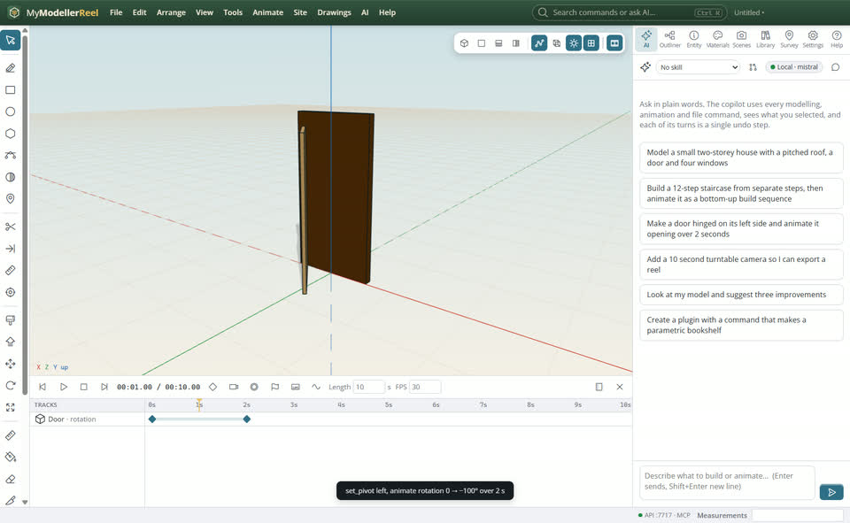
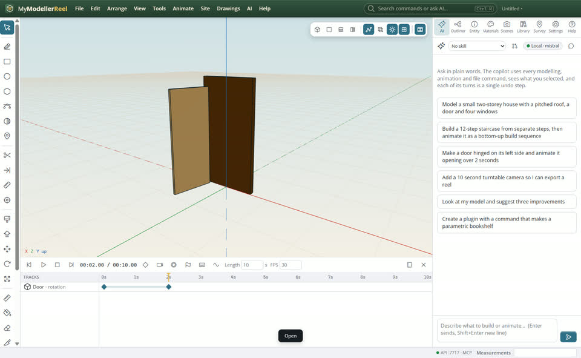

# Hinge a door and animate it opening

You want a door (or a gate, a lid, a window) to swing on its hinge in a presentation video.




## In the app

1. Model the door and its frame (two boxes are enough).
   
2. Select the door, then in the Entity panel set its pivot to **left** (the hinge side).
   
3. **Animate › Sequence** or the timeline: animate its rotation from 0° to −100° over 2 seconds.
   
4. Play it (Shift+Space), then **File › Export video** [Export video](action:exportVideo) for an MP4.
   

## Ask Plumb

> Hinge the front door on its left side and animate it opening 100° over 2 seconds.

Plumb runs the same commands as the steps above; with **AI › Propose AI changes for review** on, you accept or reject its changes first.

## From a script, the HTTP API or MCP

```js
await api.set_pivot({ id: 'Door', pivot: 'left' });
await api.animate({ target: 'Door', property: 'rotation', from: [0, 0, 0], to: [0, -100, 0], start: 0, end: 2, ease: 'ease-in-out' });
await api.render_video({ path: 'C:/videos/door.mp4', width: 1920, height: 1080 });
```

## Related

- [Make a construction sequence video](howto:construction-sequence-video)
