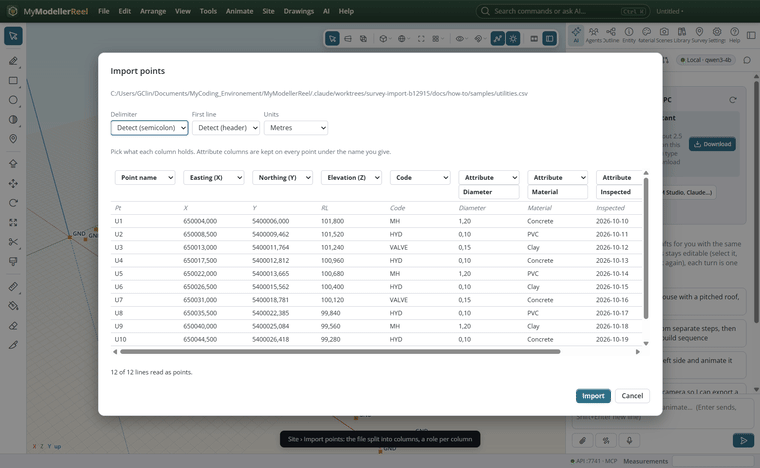
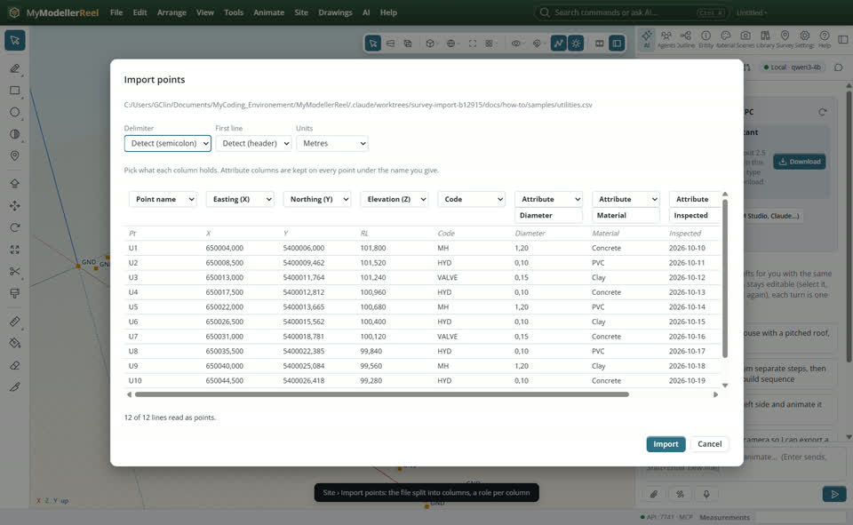
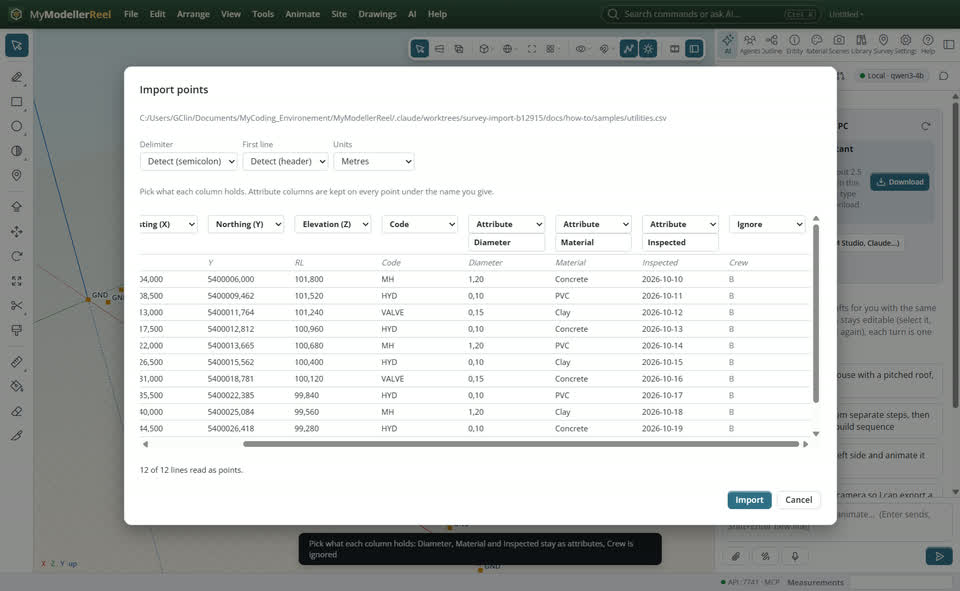
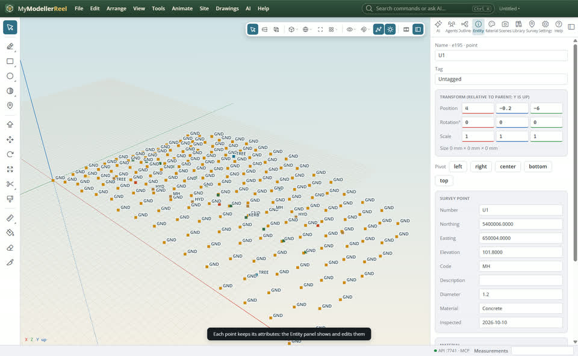
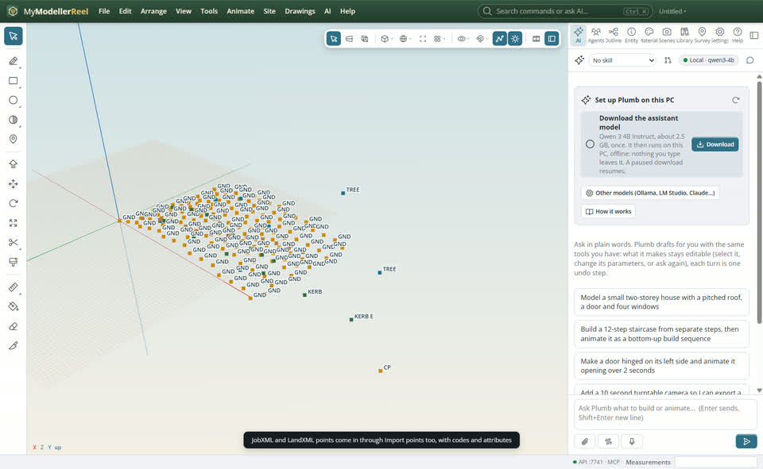

# Import a points file and keep its attributes

You have a points file from a surveyor or another program (CSV, TXT, a controller's JobXML or a LandXML) with more in it than number, northing, easting, elevation and code, and want every column to land in the right place.



## In the app

1. **Site › Import points** [Import points](action:importPoints): pick a CSV or text file. The preview shows the first lines split into columns, with the delimiter and the header line detected; change them from the drop-downs (comma, tab, semicolon, space or your own character) and the table splits again.
   
2. Over each column, pick what it holds: point name, easting, northing, elevation, code, description, an attribute (give it a name) or ignore. Header labels such as *Pt, X, Y, RL, Code* are matched for you; the other labelled columns start as attributes.
   
3. **Import**: every point keeps its attributes. Select one and the Entity panel shows them, ready to edit.
   
4. A JobXML (.jxl) or LandXML file picked here comes in through the importer: points with their codes and feature attributes (and a LandXML's surfaces and breaklines).
   

## Ask Plumb

> Look at C:\survey\utilities.csv, then import it: Pt is the name, X easting, Y northing, RL elevation, keep Diameter and Material as attributes and ignore the rest.

Plumb runs the same commands as the steps above; with **AI › Propose AI changes for review** on, you accept or reject its changes first.

## From a script, the HTTP API or MCP

```js
const p = await api.preview_points({ path: 'C:/survey/utilities.csv' }); // delimiter, header, guessed columns, first lines
await api.import_points({
  path: 'C:/survey/utilities.csv',
  delimiter: 'semicolon',
  header: true,
  columns: ['name', 'e', 'n', 'z', 'code', { role: 'attr', name: 'Diameter' }, { role: 'attr', name: 'Material' }, 'ignore', 'ignore'],
});
await api.edit_points({ points: ['U1'], attrs: { Material: 'PVC' } });
await api.import({ path: 'C:/field/topo.jxl' });
```

## Good to know

- With a semicolon or tab delimiter, decimal commas (`101,80`) are read as numbers.
- Attribute values that are numbers are kept as numbers; the rest as text. Lines without numbers where the northing and easting are are skipped and listed.
- Points live in the model file, so they save, undo and travel with it. Names already in use are given new numbers and listed.
- `format: 'PNEZD'` (or PENZD, NEZ…) still works as a short way to give the column order.

## Related

- [Turn survey points into a surface](howto:survey-points-to-surface)
- [Bring in field and GIS data: JobXML, FXL, GeoJSON, Shapefile, DEM](howto:bring-in-field-and-gis-data)
