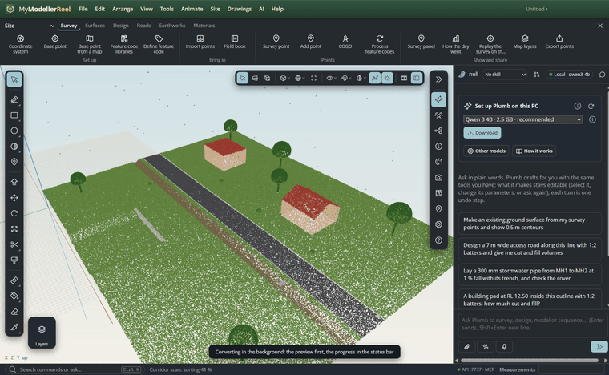
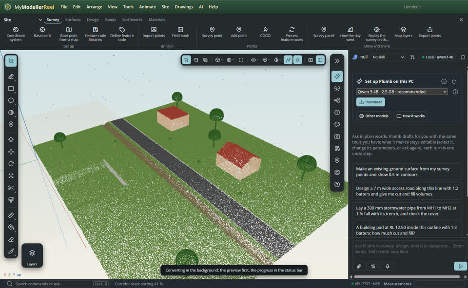
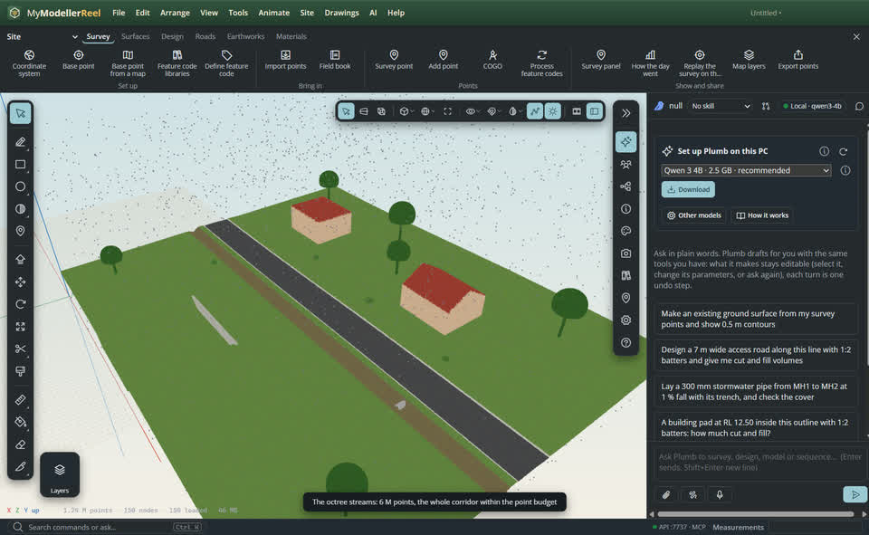
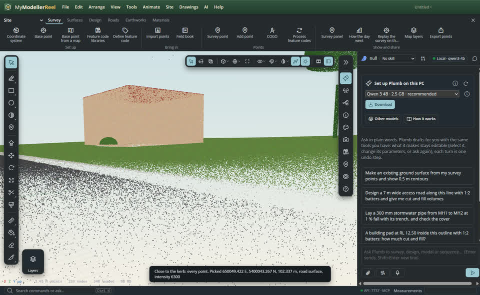
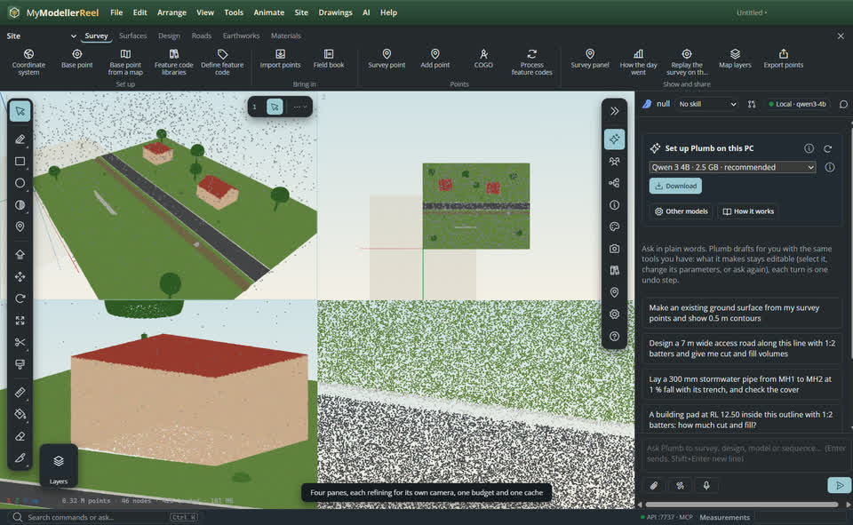
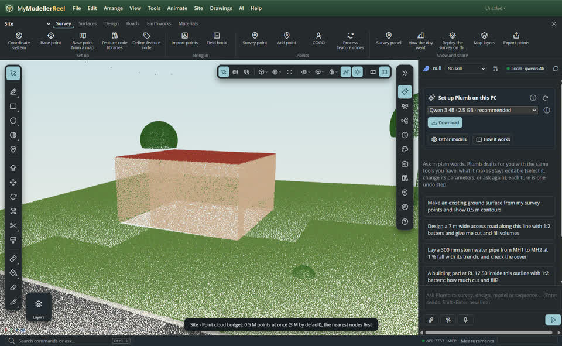

# Work in a large point cloud (LAZ, COPC, octree)

You have a drone or mobile scan of a road corridor with tens or hundreds of millions of points, compressed as LAZ or
already a COPC file, and want to work in all of it: see the whole site at once, every point where you zoom in, and pick
or snap to the exact surveyed coordinates with the class, intensity and GPS time of each point.



## In the app

1. **File › [Import a point cloud](action:importCloud)** and pick a `.las`, `.laz`, `.copc.laz`, `.ply` or `.xyz` file. Anything over 2 million points, and every LAZ, is converted once into an octree in the background; the status bar shows the progress and the thinned preview appears as soon as the points are counted. A COPC file is already an octree: it opens at once, read in place.
   
2. When the octree is ready the cloud streams: coarse far away, full detail close up, never more than the point budget. The corner of the view shows the points drawn, the nodes, the cache and the loads still pending.
   
3. Zoom in on a kerb: every point of the scan is there. The Line, Tape and Dimension tools snap to the nearest point under the cursor, at its surveyed coordinates (not a rounded GPU value).
   
4. Split the view (**View › Panes**): each pane refines for its own camera, sharing one budget and one cache.
   
5. **Site › [Point cloud budget](action:cloudBudget)** sets how many points are drawn (0.5 to 20 million), how much memory the loaded nodes may keep, and whether to draw fewer while the camera moves.
   

## Ask Plumb

> Import C:/scans/corridor.laz, tell me when the octree is ready, then pick the point in the middle of the view and give me its coordinates and class.

Plumb runs the same commands as the steps above; with **AI › Propose AI changes for review** on, you accept or reject its changes first.

## From a script, the HTTP API or MCP

```js
const r = await api.import_point_cloud({ path: 'C:/scans/corridor.laz', name: 'Corridor scan' }); // returns a job at once
await api.point_cloud_job({ id: r.job }); // { status, stage, progress, points }
await api.set_cloud_budget({ points: 5000000, cache_mb: 2048, while_moving: true });
await api.pick_cloud_point({ x: 0.5, y: 0.5 }); // { project: [E, N, Z], classification, intensity, gps_time, … }
await api.rebuild_point_cloud_octree({ id: 'Corridor scan' }); // when the cache folder was deleted
```

## Good to know

- Formats in: LAS 1.0–1.4 (ASPRS, point formats 0–10), LAZ (LASzip, through the open laz-perf library), COPC (copc.io), PLY and XYZ / PTS / CSV text. E57 is not read yet.
- The octree is a Potree 2.0 folder (open spec: `metadata.json`, `hierarchy.bin`, `octree.bin`) in your data folder under `clouds`, one per source file; it keeps every attribute: intensity, classification with its flags, return number and count, scan angle, point source, GPS time and colour. It is not saved in the model file; the thinned preview is, so the model opens anywhere.
- When the octree folder is missing (another machine, a cleaned cache) the preview shows and the app offers to rebuild it from the source file or to locate the folder (`attach_point_cloud_octree` with `folder`).
- A conversion runs in its own thread with flat memory (the file is read in pieces, LAZ chunk by chunk); `cancel_point_cloud_job` stops it. Renders, screenshots and videos wait for the nodes of each frame before capturing.
- `import_point_cloud` with `octree: false` keeps the old behaviour: the cloud thinned to `max_points` and saved in the model.

## Related

- [Model over a scan and make the ground from it](howto:scan-to-ground)
- [Read the terrain](howto:read-the-terrain)
