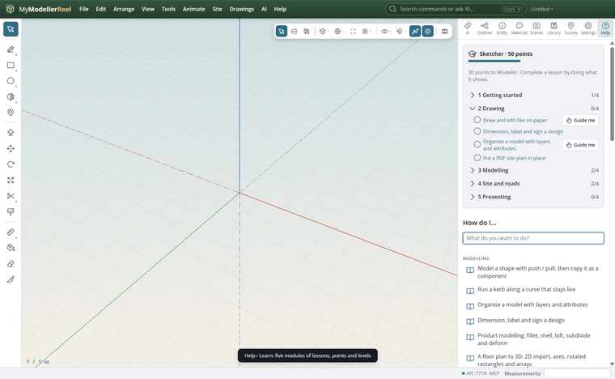
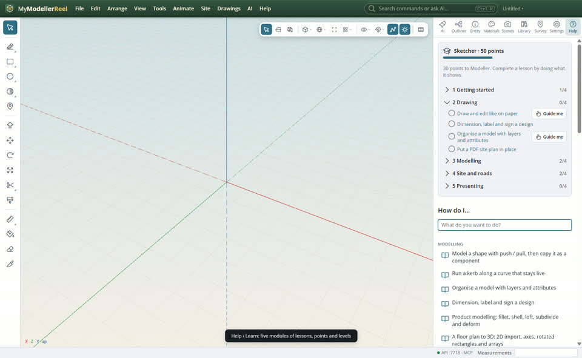
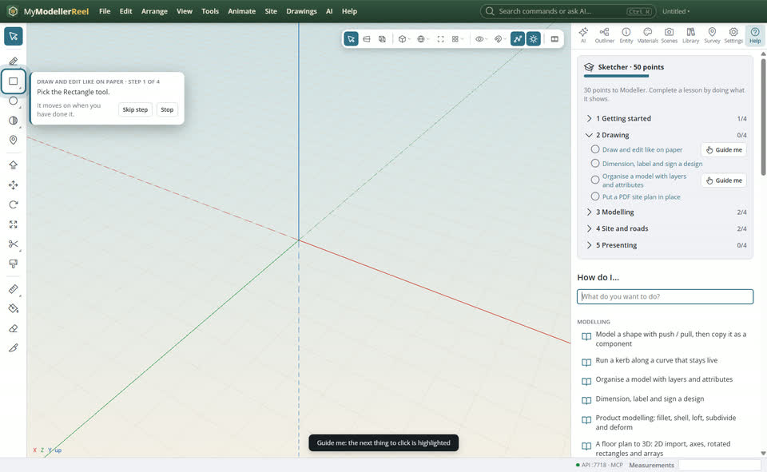
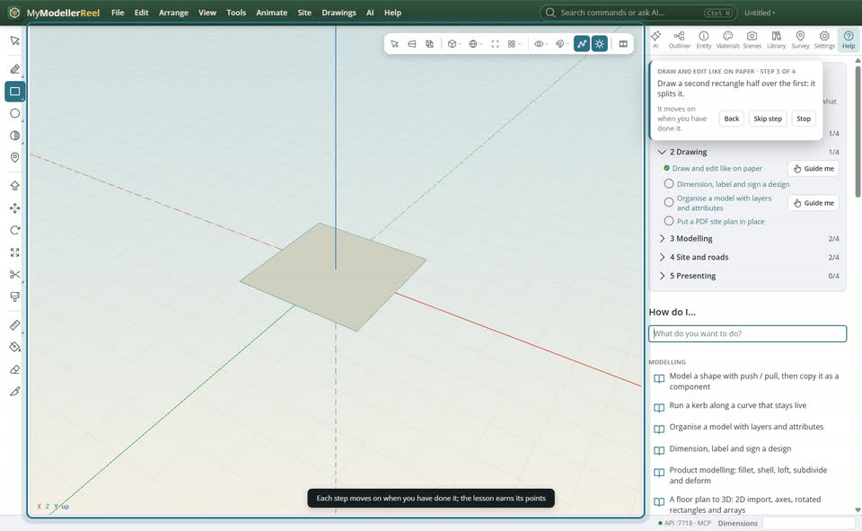

# Learn the app step by step: modules, points and guided lessons

You are new to the app and want a path through it: what to learn first, a sense of progress, and someone showing you where to click.



## In the app

1. **Help › Learn**: five modules (1 Getting started, 2 Drawing, 3 Modelling, 4 Site and roads, 5 Presenting), each a list of lessons. A lesson is the help page; open it to read it.
   
2. A lesson is done when you use what it teaches (draw a face, make a surface, run the road volumes…): it earns 10 points. Points give levels (Newcomer, Sketcher, Modeller, Designer, Engineer, Master builder); finishing a module gives its badge.
3. **Guide me** on a lesson highlights the next thing to click (a tool, a menu, a panel or the view) with a short instruction.
   
4. Each step moves on by itself when you have done it; **Back**, **Skip step** and **Stop** are on the card.
   

## Ask the copilot

> Which lessons have I not done yet in module 4?

## From a script, the HTTP API or MCP

```js
await api.list_lessons();                         // modules, lessons done, points, level, badges
await api.complete_lesson({ id: 'draw-and-edit' }); // or done: false
```

## Good to know

- Progress belongs to you, on this PC, not to the model file.

## Related

- [Find your tools fast](howto:work-faster)
- [Draw and edit like on paper](howto:draw-and-edit)
