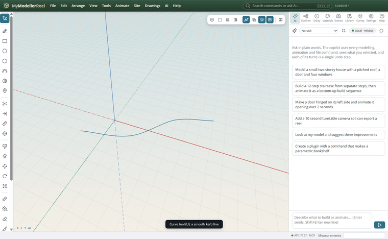
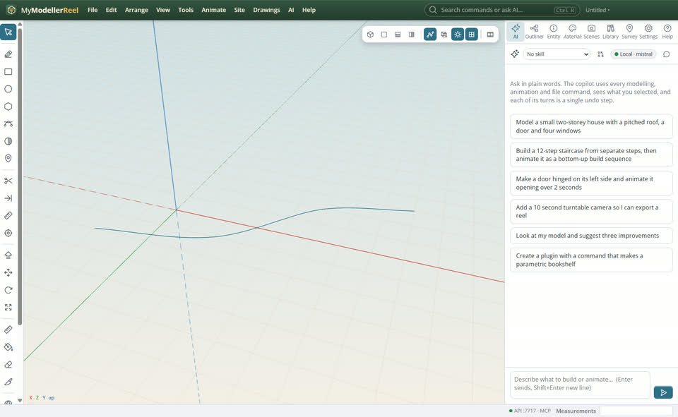
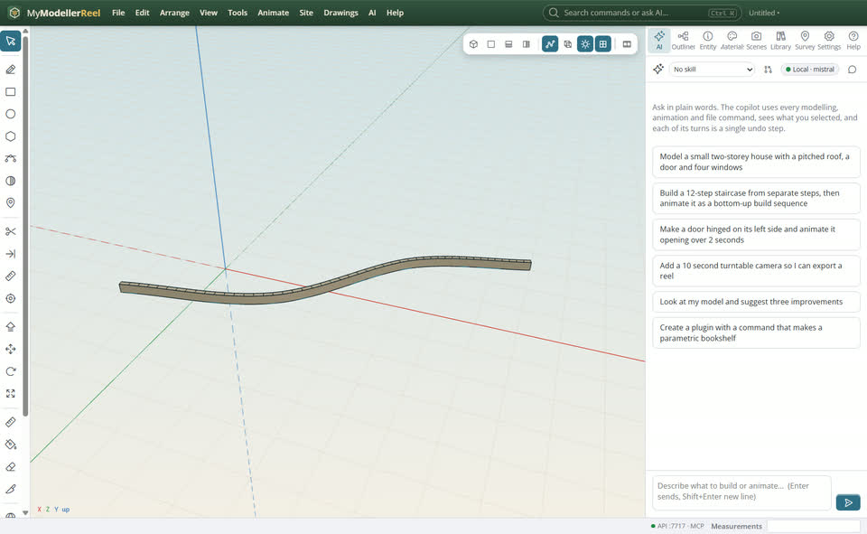
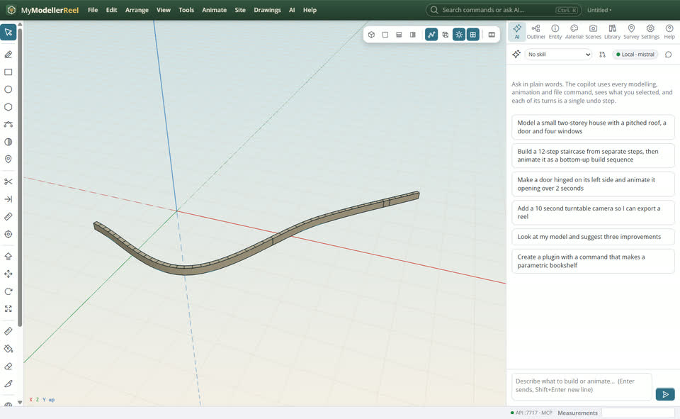

# Run a kerb along a curve that stays live

You want a kerb, a pipe, a handrail or a wall that follows a path, and that updates when the path changes.



## In the app

1. Draw the path with the Curve tool [Curve](tool:curve) (U): click the points, press Enter.
   
2. **Tools › Sweep a profile along a path…** [Sweep](action:sweep), pick a profile from the library (kerb, pipe, gutter, I-beam, retaining wall…).
   
3. Edit the curve (move its points, or `set_curve`): the sweep follows.
   

## Ask the copilot

> Draw a smooth kerb line through (-2,0,2), (2,0,1), (5,0,-2), (8,0,-3) and sweep a kerb along it.

The copilot runs the same commands as the steps above; with **AI › Propose AI changes for review** on, you accept or reject its changes first.

## From a script, the HTTP API or MCP

```js
await api.create_curve({ points: [[-2, 0, 2], [2, 0, 1], [5, 0, -2], [8, 0, -3]], kind: 'spline', name: 'Kerb line' });
await api.sweep({ path: 'Kerb line', profile: 'kerb' });
await api.set_curve({ id: 'Kerb line', points: [[-2, 0, 2], [2, 0, 3], [5, 0, -1], [8, 0, -4]] });
```

## Good to know

- `list_profiles` lists the library; `define_profile` adds your own outline.
- **Tools › Bake** freezes a sweep when you no longer want it to follow.

## Related

- [Turn a PDF plan into a 3D model](howto:pdf-linework-to-3d)
