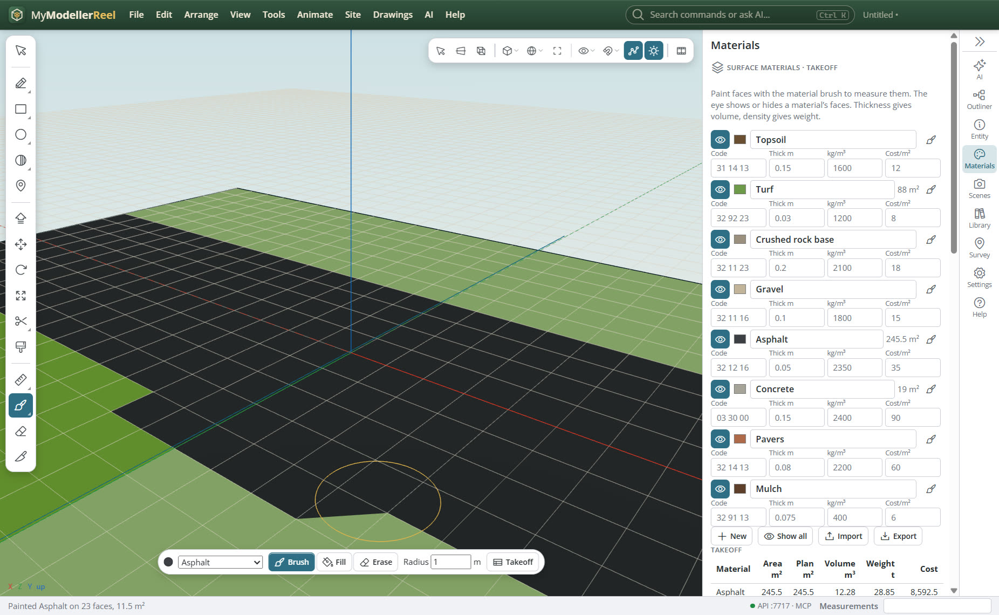
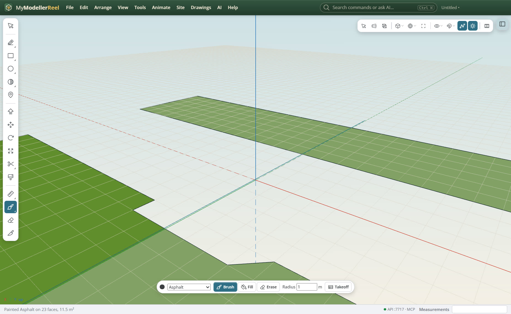

# Paint surface materials and get a takeoff: areas, volumes, weights and costs

You want to say which parts of a surface are asphalt, turf, gravel or concrete, then get a table of how much of each: the true 3D area, the plan area, the volume from the layer thickness, the weight from the density and the cost.



## In the app

1. Pick the [Material brush](tool:matbrush) (it shares a button with the Paint Bucket). A bar appears at the bottom of the view: the material, **Brush**, **Fill** or **Erase**, and the radius in metres. `[` and `]` make the brush smaller or bigger.
2. **Brush**: drag over the surface. The faces under the ring light up in the material's colour; when you let go they are painted, one undo step per stroke.
3. **Fill**: click a face. The fill spreads to its neighbours and stops at sharp bends (the **Bend** angle), at lines and curves (kerbs, edges of seal, boundaries) and where another material starts.
4. **Inside a boundary**: select a closed curve; the bar shows **Inside …**, which paints every face inside it.
5. **Alt-click** a painted face to pick up its material. **Erase** clears paint.
6. The **Materials** panel, **Surface materials · takeoff**: one line per material with its painted area. The eye shows or hides that material's faces, so you can look at one layer at a time; the brush button paints with it. The total area, volume, weight and cost sit underneath.
   
7. **[Material manager](action:materialManager)** (also on the Site ribbon, **Materials** tab) opens a window over the view, which you drag by its title: every material with its colour, name, code (MasterFormat, Uniclass, a Trimble Business Center material code…), thickness, density and cost per m², edited in place, beside the takeoff: area, plan area, volume, weight and cost, with totals. **Export takeoff** writes CSV, JSON, or GeoJSON (each painted face as a polygon with its material, in project coordinates and the model's EPSG system). **Import library** and **Export library** share the materials as JSON or CSV.

## Ask the copilot

> Paint the car park boundary asphalt, everything else on the site turf, and give me the takeoff as a CSV.

## From a script, the HTTP API or MCP

```js
await api.define_surface_material({ name: 'Road base', code: '32 11 23', color: '#9b8f7e', thickness: 0.2, density: 2100, cost: 18 });
await api.paint_surface({ id: 'Site', material: 'Asphalt', inside: 'Car park boundary' });
await api.paint_surface({ id: 'Site', material: 'Turf', seed: 120, fill: true, breaklines: ['Kerb'] });
await api.paint_surface({ id: 'Site', material: 'Concrete', at: [8, 0, 8], radius: 2.5 });
await api.show_surface_materials({ names: ['Asphalt'], only: true });
const t = await api.material_takeoff({ format: 'csv' });
await api.material_takeoff({ path: 'C:/jobs/site/painted.geojson' });
await api.export_surface_materials({ path: 'C:/jobs/materials.csv' });
```

## Good to know

- Volume is area × thickness: one layer per face for now. Stacked layers (a seal over a base over a subbase) and volumes between surfaces come later.
- Paint stays on a live surface when it rebuilds. An edit that changes the number of faces (push / pull, booleans) keeps the paint by face number, so check it afterwards.
- A hidden material is still counted in the takeoff.

## Related

- [Work out cut and fill for a building pad](howto:cut-and-fill-for-a-pad)
- [Turn survey points into a surface](howto:survey-points-to-surface)
