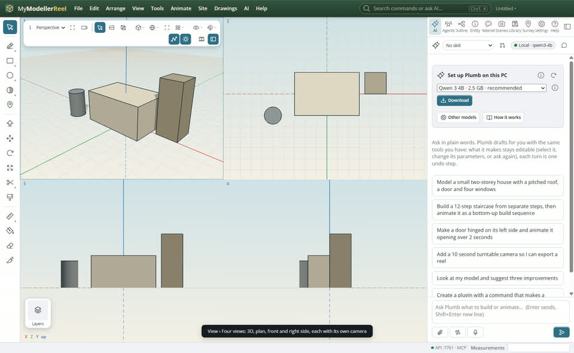
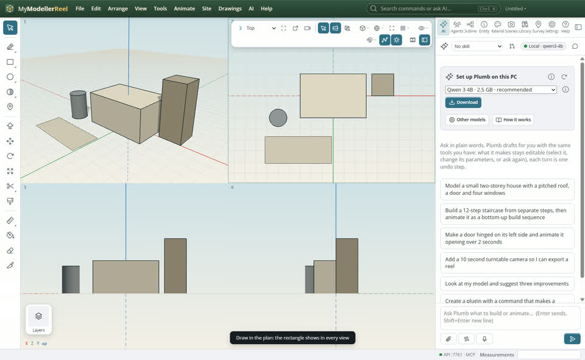
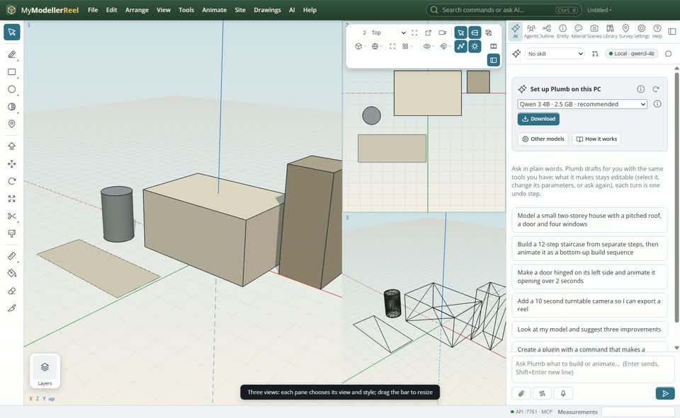
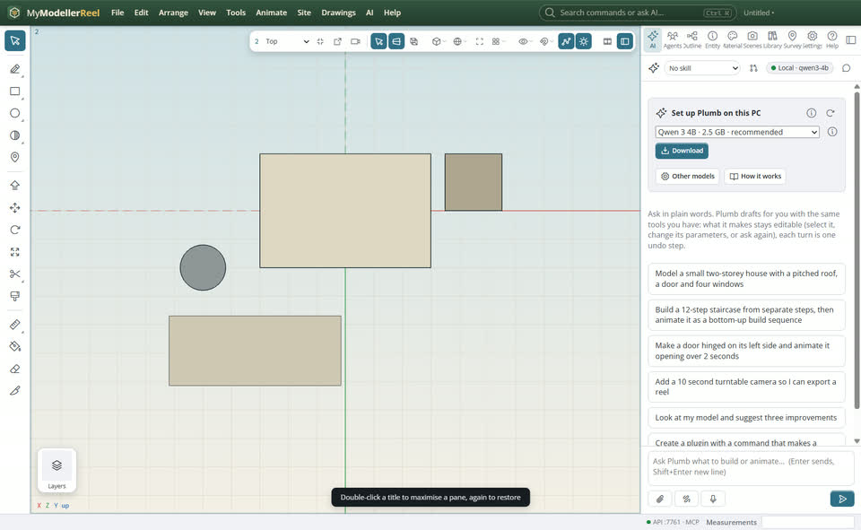
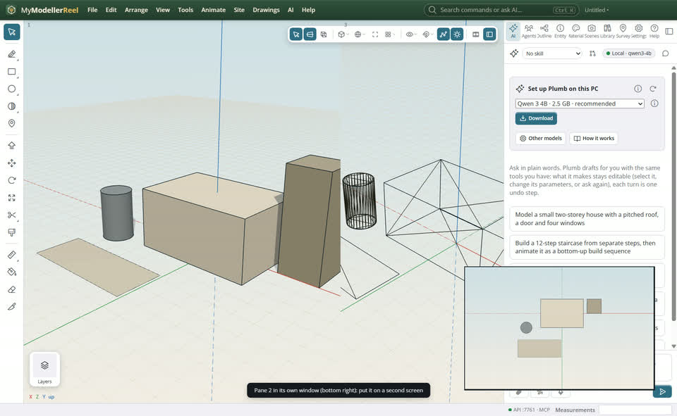

# See the model from several sides at once: split, resize and detach views

You want the 3D view and a plan side by side, or the four classic views (3D, top, front, side), and to draw in whichever one suits you. Maybe you also want one view on a second screen.


## In the app

1. **View › [Four views](action:layout4)** (or [Two views side by side](action:layout2), [Three views](action:layout3)): the view splits into panes. New panes show the plan (top), the front and the right side, in parallel projection.
   
2. Draw in any pane. The tools, snapping and selection work in the pane under the pointer, and what you draw shows in every view. The camera button on the bar shows where the 3D camera stands (a red cone) in the other views; it is off until you turn it on.
   
3. One floating bar sits on the pane under the pointer (it stays there when the pointer leaves the views): the pane's number and view (Perspective, Top, Front… or a saved scene), then the view bar, whose perspective / parallel and wireframe buttons act on that pane. A thin frame marks each pane; the active one is outlined. Drag the bars between panes to resize them.
   
4. Double-click the pane's number on the bar (or click its maximise button) to fill the view with that pane; double-click again to bring the others back.
   
5. The **Move to its own window** button on a pane (2, 3 or 4) puts it in a window of its own, for a second screen. Close that window to put the pane back.
   

The view buttons and **View › Top / Front / Right / Iso / Zoom extents** act on the pane you last worked in. **View › [Zoom extents in every view](action:fitPanes)** frames the model in all of them.

## Ask Plumb

> Split the view in four, put the right side view in wireframe, and fit everything.

## From a script, the HTTP API or MCP

```js
await api.set_layout({ count: 4, arrangement: 'grid' });
await api.set_pane({ pane: 4, view: 'right', style: 'wireframe' });
await api.zoom_extents({ pane: 'all' });
await api.set_view({ preset: 'top', pane: 2 });
await api.set_layout({ count: 3, arrangement: 'main_left', split: [0.65, 0.5] });
await api.set_layout({ max: 2 });   // 0 restores
await api.set_layout({ show_camera: true });  // the main camera drawn in the other views
await api.detach_pane({ pane: 2 });  // detached: false docks it again
await api.get_layout();
```

## Good to know

- The layout (how many panes, how they sit and what each one shows) is saved with the model. Panes in their own windows come back docked when you open it again.
- Post effects, path tracing and the move / rotate / scale handles stay in pane 1; the other panes draw the model and its lines, without point labels.
- Each pane is drawn on its own, so four panes cost more than one on a big model. Go back to one view (View › One view) when you need the speed.

## Related

- [Work your way: handles, document tabs, walking, shortcuts, voice and French](howto:tabs-handles-walk-and-language)
