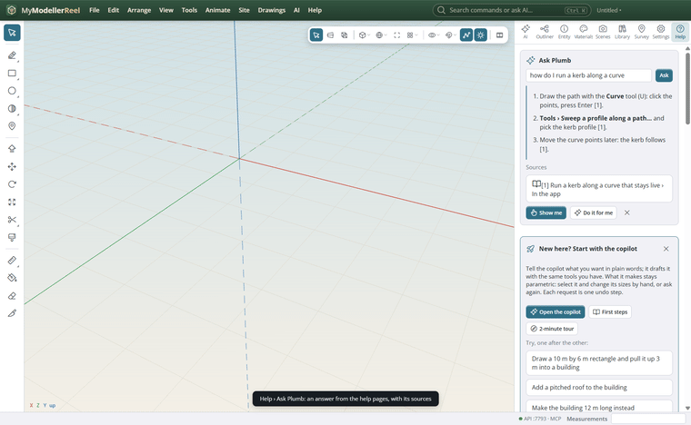
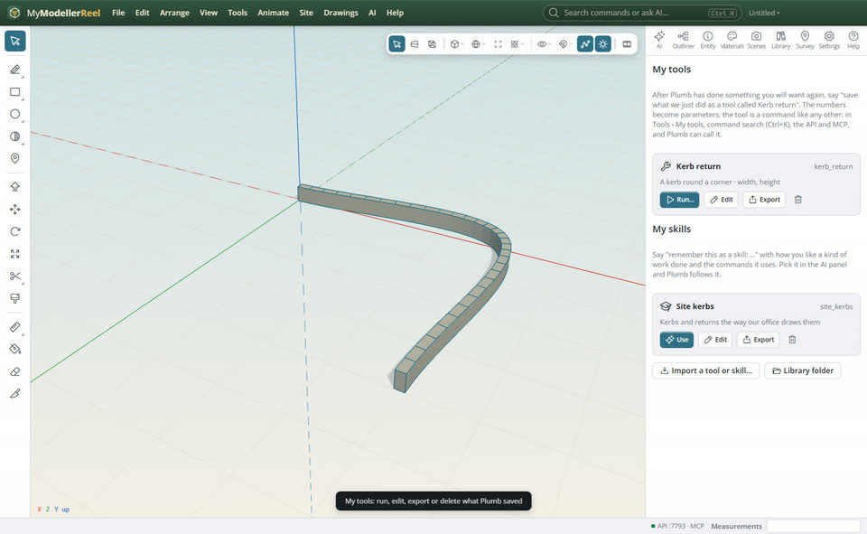
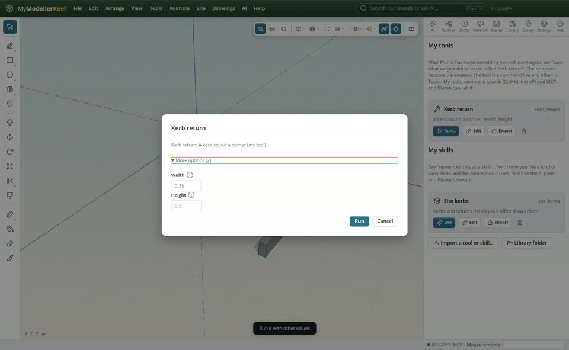

# Ask Help, and keep your own tools and skills

Ask Help a question in your own words and Plumb answers from these pages. When Plumb has done something you will
want again, keep it as your own tool; keep how you like a kind of work done as your own skill.



## In the app

1. In **Help** [How do I…](action:howto), type a question in **Ask Plumb** and press Enter. The answer cites the help
   sections it used: click a source to read the page. **Show me** starts the guided steps, the tool or the command's
   form; **Do it for me** hands the question to Plumb in the AI panel. Press **F1** with the mouse over a tool button
   to ask about that tool.
   
2. After a turn that made something you want again, tell Plumb "save what we just did as a tool called Kerb return".
   The numbers in what it did become the tool's parameters.
3. **Tools › My tools** lists your tools; each opens a form with its parameters. **Manage my tools and skills…**
   [My tools](action:myTools) opens the panel to run, edit, export, import or delete them. Each one is a file in your
   library folder (`library/mytools`), so you can share it.
   
4. Run a tool with other values: its form shows the parameters it found.
   

## Ask Plumb

> Save what we just did as a tool called Kerb return.

> Remember this as a skill called Site kerbs: kerbs are 150 mm upstands, returns have a 6 m radius; use create_curve and sweep.

> What tools have I saved? Run Kerb return with a 0.2 m wide kerb.

## From a script, the HTTP API or MCP

```js
await api.ask_help({ question: 'how do I run a kerb along a curve' });
await api.save_tool({ name: 'Kerb return', description: 'A kerb round a corner', steps: [
  { command: 'create_curve', args: { points: [[0, 0, 0], [4, 0, 0], [4, 0, 4]], kind: 'spline', name: 'Kerb line' }, made: 'e1' },
  { command: 'sweep', args: { path: 'e1', profile: 'rectangle', profile_params: { width: 0.15, height: 0.3 } } },
] });
await api['kerb_return']({ width: 0.2 }); // the saved tool is a command now
await api.save_skill({ name: 'Site kerbs', prompt: 'Kerbs are 150 mm upstands; returns have a 6 m radius.', toolset: ['create_curve', 'sweep'] });
await api.list_my_tools({});
await api.delete_my_tool({ name: 'kerb_return' });
```

## Good to know

- A tool is a command like any other: command search (Ctrl+K), the HTTP API, MCP clients and Plumb all see it.
- Without steps, `save_tool` takes what the last Plumb turn did. A step's `made` is the id it created: when the tool
  runs, later steps use the new one. Shapes picked by hand are left out, so the tool works on what is selected.
- Give `params` with `{{name}}` placeholders in the steps to choose the parameters yourself; edit the JSON in the panel
  for the same.
- A skill is instructions plus the commands it uses. Pick it in the AI panel's skill list, or `use_skill`.
- Without an AI model, Ask still shows the best sections of the help pages.

## Related

- [Ask the copilot to build or change something](howto:ask-the-copilot)
- [Learn the app step by step: modules, points and guided lessons](howto:learn-step-by-step)
