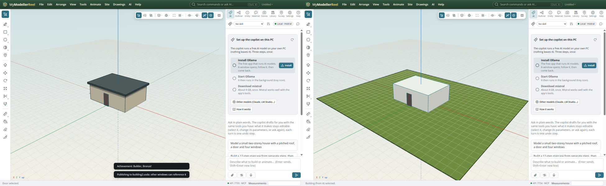
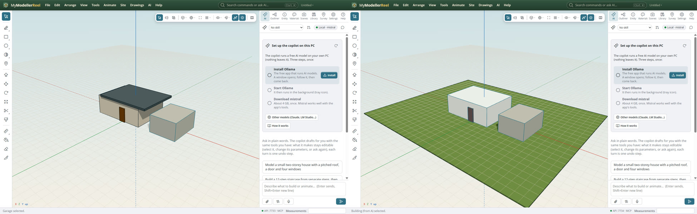

# OpenUSD files, and following another window’s design live

You exchange models with a USD pipeline (Omniverse, Blender, Houdini, Apple AR), or two people work side by side: one designs the building, the other the site around it, and each wants to see the other's latest work without copying files back and forth.

## In the app

1. **File › [Import](action:import)** reads `.usda`, `.usdc` and `.usdz`: meshes, groups, materials and placements come in as shapes.
2. **File › [Export…](action:exportAll)** writes **OpenUSD (.usda text)**: groups as Xforms, shapes as Meshes, colours as UsdPreviewSurface materials, in metres with Y up. **USDZ** packs it for AR on an iPhone.
3. In the first window, **File › [Publish as live reference…](action:publishReference)** and pick a `.usda`. The design is written there now and again after every change.
4. In the second window, **File › [Reference a design (live)…](action:referenceFile)** and pick that file. It shows up as a group you can see and snap to; every change in the first window appears here within a second.
   
   
5. Move, hide or recolour a referenced part here: that is an override kept in this model, never written to the other file. Its shape stays read-only.
6. In the Outliner, a reference has **Reload** (read the file now), **Bind** (make it local: ordinary shapes, no longer followed) and **Remove**.

## Ask the copilot

> Publish this design as a live reference to C:/share/building.usda.

> Reference C:/share/building.usda, hide its roof and paint the walls white.

## From a script, the HTTP API or MCP

```js
await api.export({ format: 'usda', path: 'C:/out/house.usda' });
await api.import({ path: 'C:/in/chair.usdz' });
await api.publish_reference({ path: 'C:/share/building.usda' }); // window A
await api.reference_file({ path: 'C:/share/building.usda' }); // window B
await api.reload_reference({});
await api.bind_reference({ ids: ['building'] });
await api.publish_reference({ stop: true });
```

## Good to know

- Each prim is named after its entity id (`Wall_e12`), so overrides survive renaming and regrouping in the other window.
- A reference can also follow a `.glb`, `.obj` or `.usdz`; only `.usda` can be published.
- Textures in USDZ files come in as their average colour.

## Related

- [Share a model: a web page, AR on a phone, a 3D print, versions](howto:share-viewer-ar-print)
