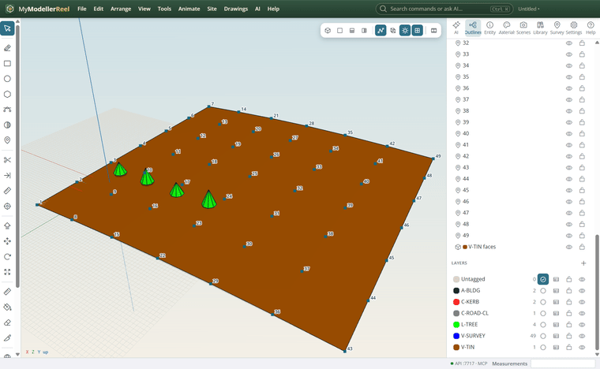
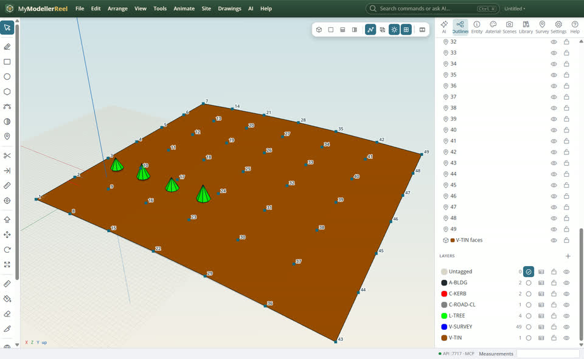
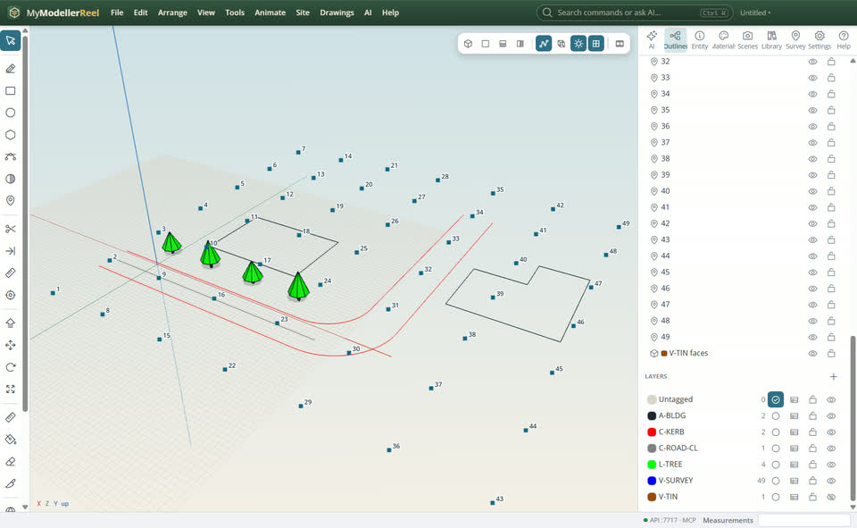
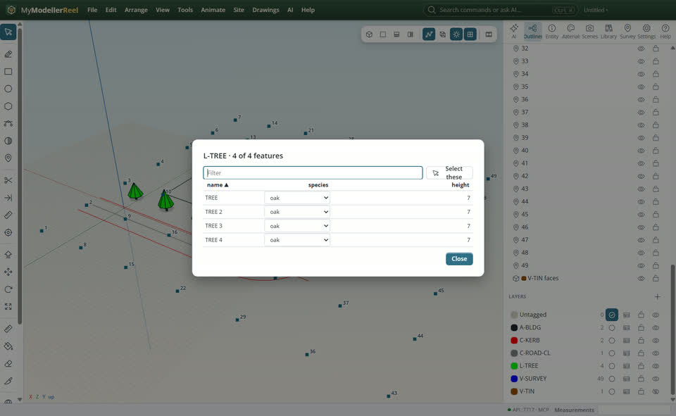

# Organise a model with layers and attributes

You want to show, hide and lock groups of things, draw on the right layer, and keep data (species, height, material) on features.



## In the app

1. **Outliner › Layers**: each layer has a colour, the current-layer mark (new geometry goes there), a lock and an eye. **+** adds one [New layer](action:newLayer).
   
2. Hide a layer, lock another so it cannot be picked; **Drawings › Save layer state** keeps the set to come back to.
   
3. The table icon opens a layer's attribute table: typed fields from the layer's schema, sort, filter, edit in place, select the rows.
   

## Ask Plumb

> Hide the TIN layer, lock the survey points, and set species oak on every tree.

Plumb runs the same commands as the steps above; with **AI › Propose AI changes for review** on, you accept or reject its changes first.

## From a script, the HTTP API or MCP

```js
await api.set_layer({ name: 'V-TIN', visible: false });
await api.set_layer({ name: 'V-SURVEY', locked: true });
await api.set_layer({ name: 'L-TREE', schema: { species: { type: 'string', options: ['oak', 'birch'] } } });
await api.edit_attributes({ layer: 'L-TREE', values: { species: 'oak' } });
await api.query_features({ layer: 'L-TREE', where: { species: 'oak' } });
```

## Good to know

- Layer names with "/" make groups ("C-ROAD/Kerbs"); `set_layer` takes globs ("C-ROAD/*").

## Related

- [Bring in a LandXML, IFC or DXF file](howto:bring-in-landxml-ifc-dxf)
