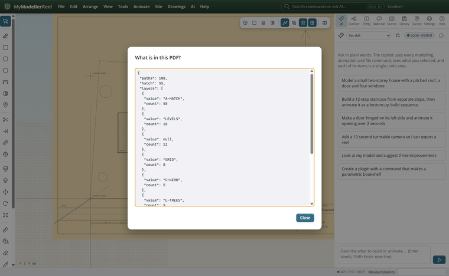
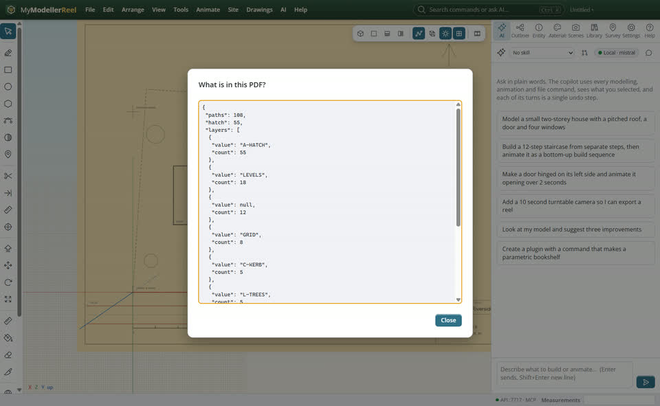
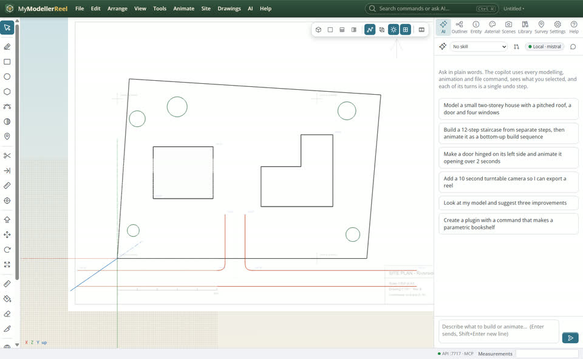
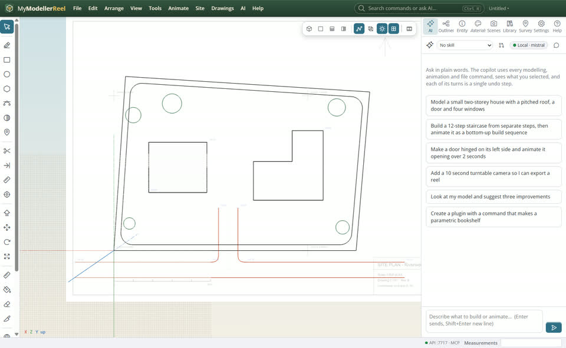
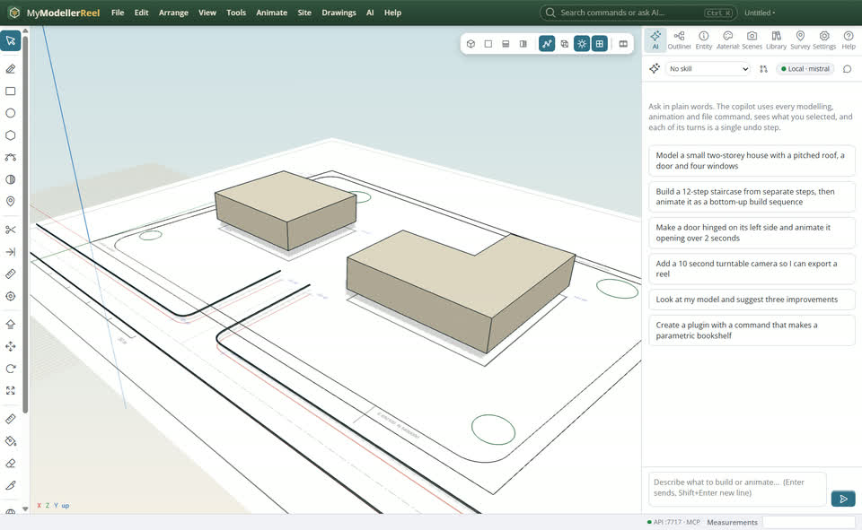

# Turn a PDF plan into a 3D model

Your PDF plan is vector (from CAD): you want its kerbs, buildings and boundary as real lines, then heights, then 3D.



## In the app

1. **Drawings › What is in this PDF?** [Contents](action:pdfStats): paths per PDF layer, colour and width, hatching.
   
2. **Drawings › Extract linework…** [Extract](action:extract): pick layers, colours or a window. Pieces are joined, hatching skipped, and the lines land on layers named after the PDF layers.
   
3. Draft on them: offset, fillet, trim [Trim](tool:trim) (W), extend (Y), join, break.
   
4. **Drawings › Elevate linework** (constant, on a surface, a grade, or the spot levels printed on the PDF), **Extrude closed linework** for buildings, **Sweep a profile along linework** for kerbs.
   

## Ask the copilot

> Extract the kerbs and buildings from the site plan, grade the kerbs from the spot levels, make the buildings 8 m high at 103.00 and sweep kerbs along the kerb lines.

The copilot runs the same commands as the steps above; with **AI › Propose AI changes for review** on, you accept or reject its changes first.

## From a script, the HTTP API or MCP

```js
await api.extract_linework({ id: 'Site plan', layers: ['C-KERB', 'A-BLDG'] });
await api.elevate_linework({ layer: 'PDF C-KERB', mode: 'text', underlay: 'Site plan' });
await api.elevate_linework({ layer: 'PDF A-BLDG', mode: 'constant', elevation: 103 });
await api.extrude_linework({ layer: 'PDF A-BLDG', height: 8 });
await api.sweep_linework({ layer: 'PDF C-KERB', profile: 'kerb' });
```

## Good to know

- Buildings and sweeps stay live on their lines: move a line and the 3D follows.
- `linework_to_breaklines` turns lines into breaklines for a surface.

## Related

- [Put a PDF site plan in place](howto:put-a-pdf-in-place)
- [Run a kerb along a curve that stays live](howto:live-sweep-along-a-curve)
