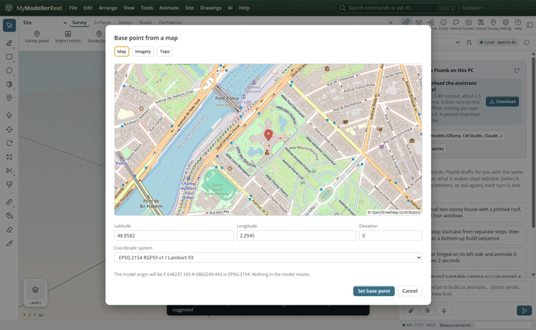
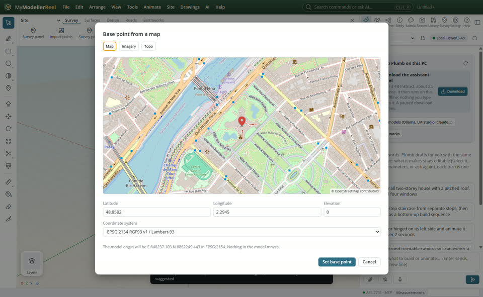
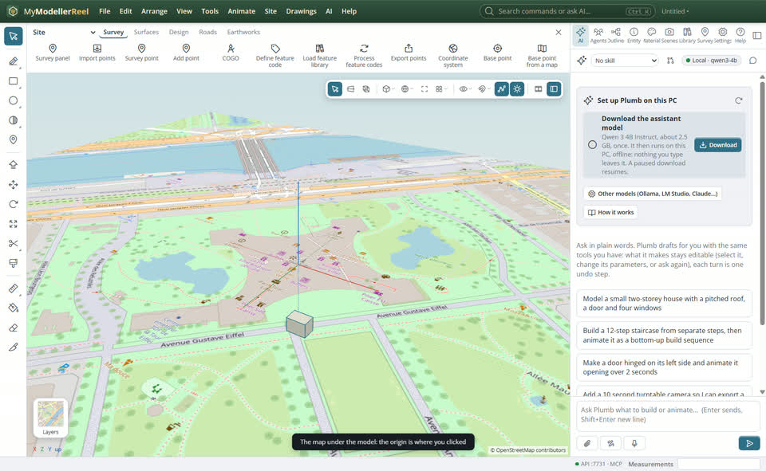
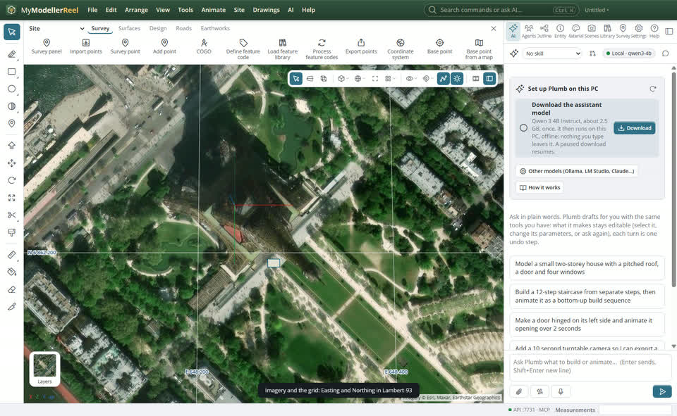
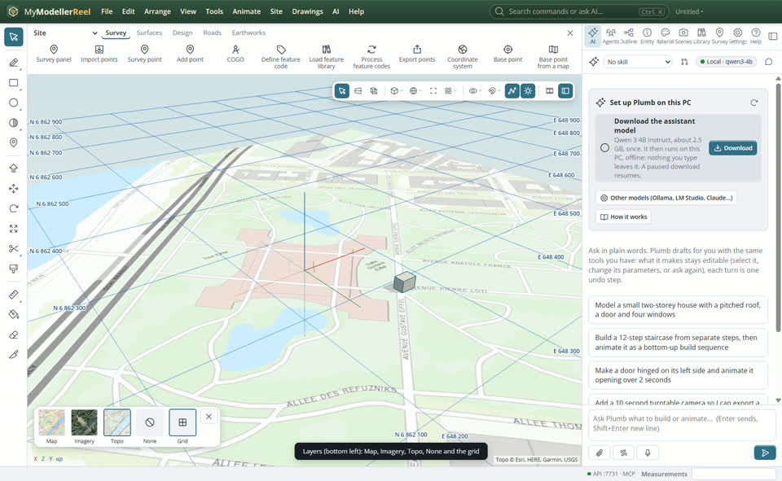

# Place the model on a map: base point, background map and coordinate grid

You know where the project is but not its coordinates. Click the place on a map: the model origin takes its latitude and longitude, converted to the project's coordinate system. Then see the map or the aerial photo under the model, and a grid with the real Eastings and Northings.



## In the app

1. **Site › [Base point from a map…](action:mapPick)** (also in the Survey tab of the Site ribbon, and **Pick on a map…** in the Coordinate system dialog). Drag to pan, turn the wheel to zoom, click where the model origin is, or type the latitude and longitude. Choose the coordinate system from the ones used there (the national grid first, then the UTM zone) and give the elevation. **Set base point**: nothing in the model moves; the origin takes those coordinates.
   
2. The map now lies on the ground under the model, about 300 m around the origin.
   
3. **Layers**, the small button at the bottom left of the view, opens the choice of background: **Map** (OpenStreetMap), **Imagery** (aerial photos), **Topo**, **None**, and **Grid**: lines every round distance with their Easting and Northing, finer as you zoom in.
   
   

## Ask Plumb

> The site is at 48.8582 N, 2.2945 E: put the model there in Lambert-93 at 35 m, and show the aerial photo with the grid.

## From a script, the HTTP API or MCP

```js
await api.set_coordinate_system({ epsg: 2154, name: 'RGF93 v1 / Lambert-93' });   // optional: without it, the UTM zone of the place
await api.set_base_point({ latitude: 48.8582, longitude: 2.2945, z: 35 });       // the model origin is that place
await api.convert_coordinates({ latitude: 48.86, longitude: 2.30 });             // → e, n in the project system
await api.set_view_overlay({ map: 'imagery', grid: true, radius: 500 });         // map: map | imagery | topo | none
```

## Good to know

- The tiles come from OpenStreetMap and Esri over the internet, so the map needs a connection; their credits stay at the bottom right of the view.
- Latitude and longitude convert to UTM zones (WGS 84, ETRS89, NAD83), Lambert-93, Belgian Lambert 2008, NZTM, MGA, Irish TM, SWEREF99, TM35FIN, Portugal TM06 and SVY21. For other systems, such as the British National Grid, type the coordinates with **Base point** instead.
- The conversion has no datum shift (ETRS89, NAD83 and GDA2020 are taken as WGS 84): right to about a metre, which is enough to place the model and the map, not for survey control.
- The map and the grid are kept with the model, and hide the plain drawing grid while they show.

## Related

- [Set up a site: the Site and Drawings ribbons, the coordinate system and the base point](howto:site-setup)
- [Turn survey points into a surface](howto:survey-points-to-surface)
