# See a scan clearly: colours, depth and which points show

You have a laser or drone scan of a street and want to read it before you draft over it: the paint lines, what the classifier called ground or building, where the walls are, what is in front of what. Each cloud carries its own display style and filter, a view pane can override them, and nothing is ever deleted: hiding points only changes what you see and snap to.

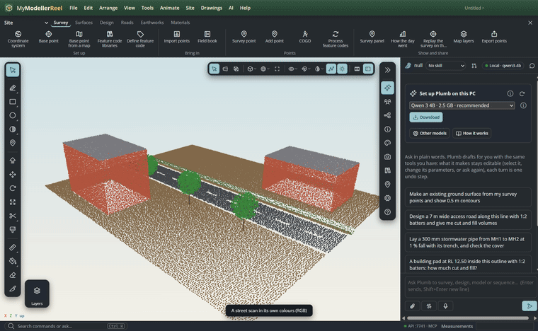

## In the app

Select the cloud: the **Entity** panel has a **Point cloud** card with every setting below, its legend and the class list. The same legend sits in the bottom-right corner of each view.

### Colour, size and shape

1. Import the scan (**File › Import › [Import a point cloud](action:importCloud)**). LAS files keep their intensity, classification, returns, GPS time and point source; it opens in its own colours (RGB).
   
2. **Colour by › intensity**: road markings, kerbs and signs stand out. The range is fitted to the 2nd–98th percentile; type your own in **Range**, and pick a ramp.
   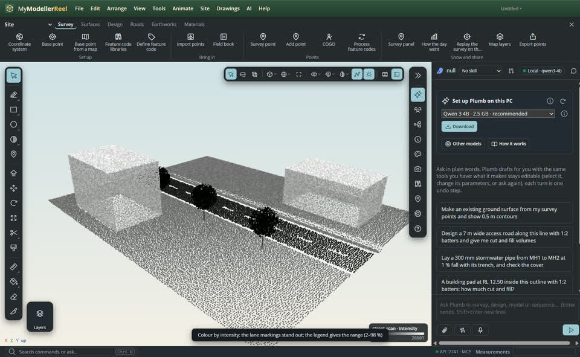
3. **Colour by › elevation** with the terrain ramp: from the ditch to the roofs. Tick **above the ground** in the filter to measure heights over the ground class instead.
   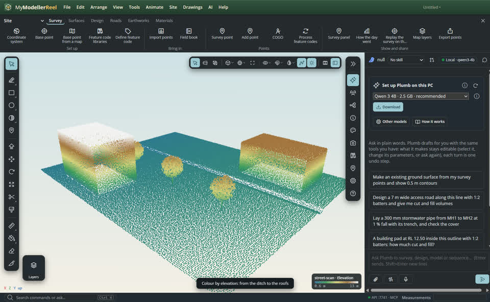
4. **Colour by › classification**: the ASPRS LAS 1.4 classes in their usual colours (change one with `class_colors`).
   
5. A cloud in one colour is hard to read. Tick **Eye-dome lighting**: points are shaded where a neighbour is nearer, so edges and depth show without normals.
   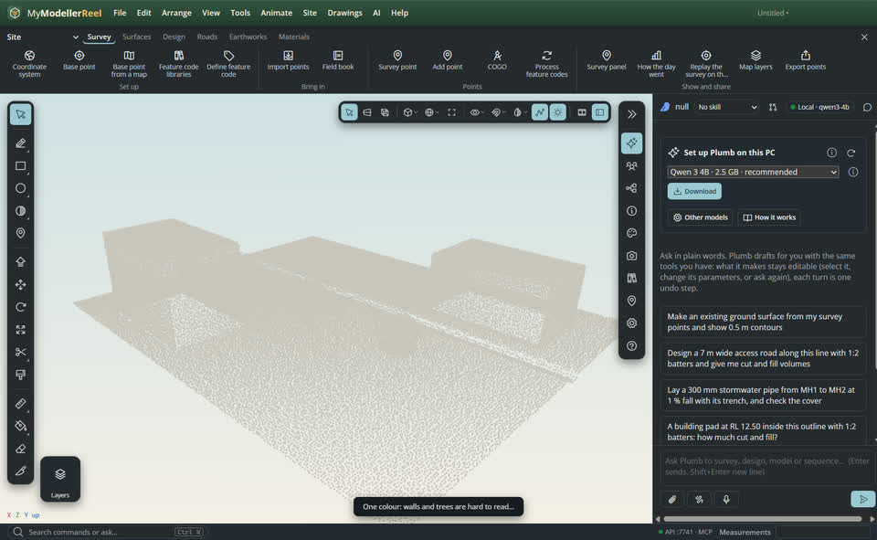
   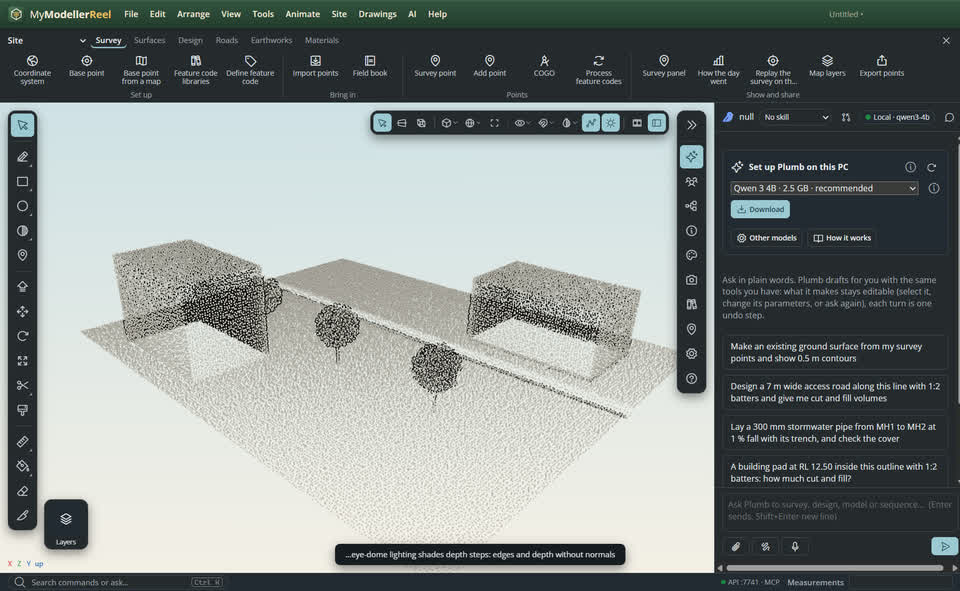
6. **Size**: fixed pixels, *attenuated* (metres in the world, so a 3 cm point stays 3 cm) or *adaptive* (grows with the spacing so gaps close at any zoom). **Shape**: square (fastest), round, or paraboloid (shaded like a small sphere).
   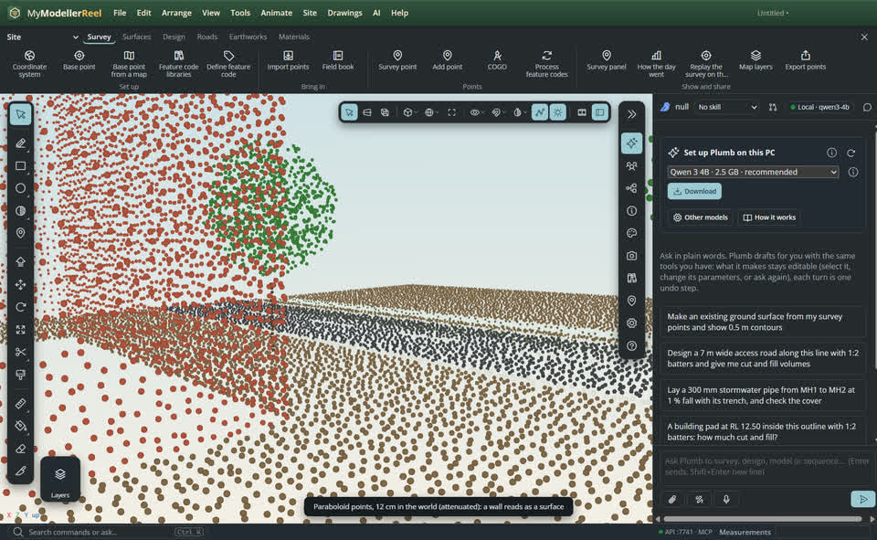
7. With two or more views, **Applies to › Pane 2 only** gives one pane its own style and filter: intensity and ground only in the plan, everything in RGB in 3D.
   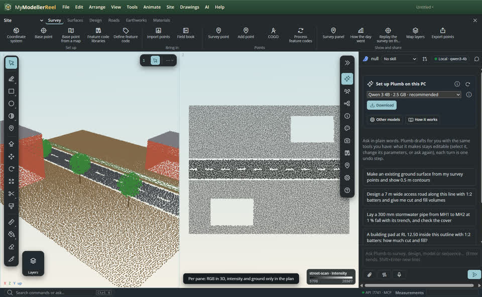

### Reading depth

The view bar's [Depth](action:cloudDepth) button (Shift+D cycles it) or the card's **Depth** list:

8. **X-ray**: every point darkens the view a little, so walls seen edge on, kerbs and poles build up into dark lines and roofs and open ground stay light. In a top view it is a density map to draft walls from.
   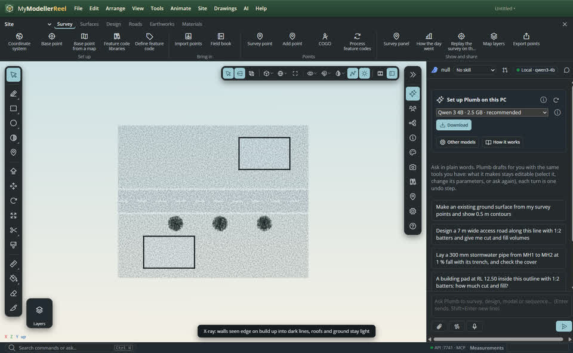
9. **Depth colour**: near warm, far cool, fitted to the cloud as seen from the eye: the near façade and the one across the street no longer merge.
   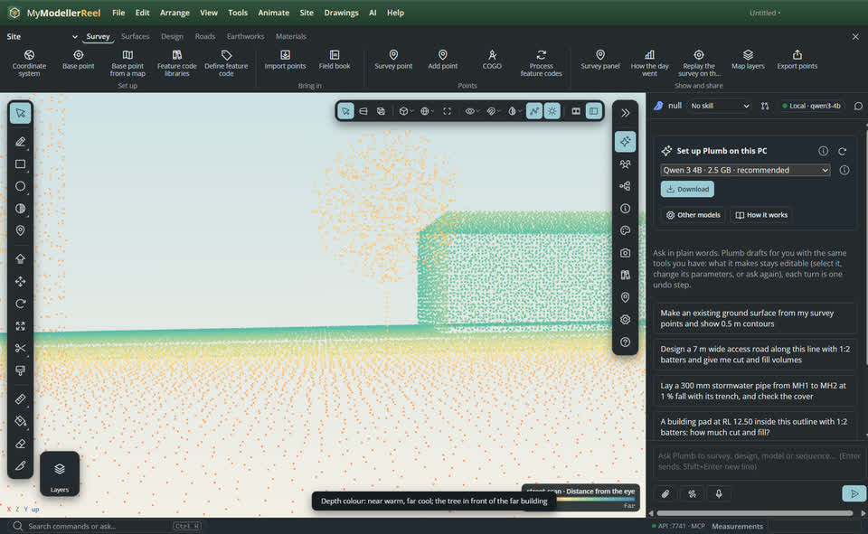
10. **Fog**: points past the focus fade out (`fog_near` to `fog_far` metres beyond it). Hold **Alt** over a point to focus there.
    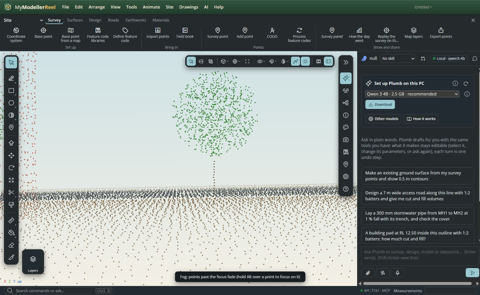
11. **Outside the cut › Ghost**: with a [section plane](action:sectionPlanes) on, what is cut away draws as a faint ghost instead of disappearing. Snapping and picking only see the points that are not cut away.
    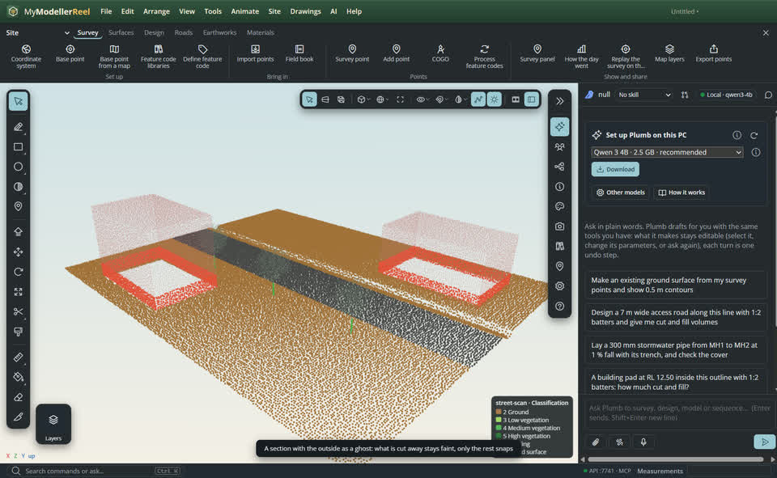

### Show and hide points

12. In the class list, untick a class, **Only** keeps one, **All** brings them back. Hiding classes 3–5 takes the trees out of the view, out of snapping and out of `classify_ground`.
    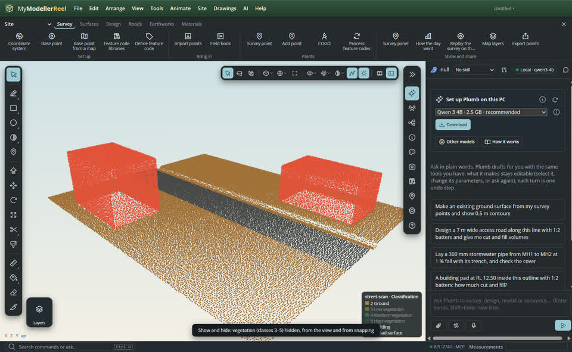
13. **Returns › last**: the ground under the canopy; **first**: the canopy and roofs. **Intensity** and **Elevation** bands keep a range.
    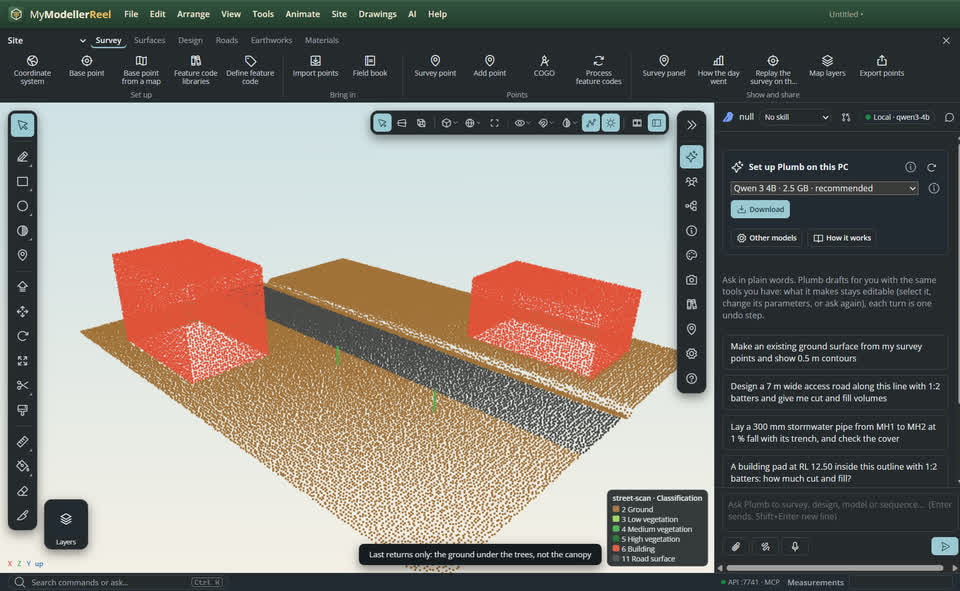
14. **Density** draws a percentage of the points (the same ones every frame, no shimmer); **Spacing** keeps at most one point per so many metres, for a clean plan.
    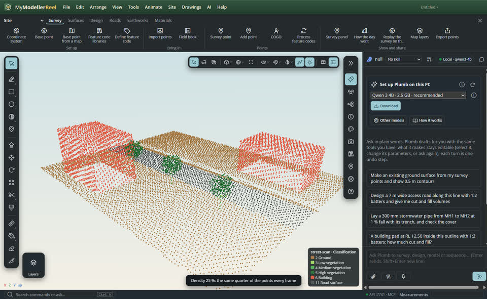
15. The card counts each class and how many of its points are shown.
    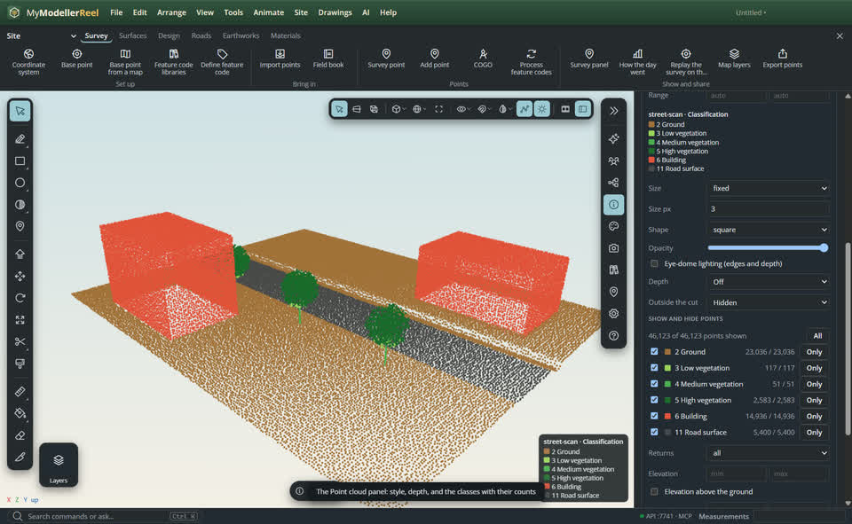

## Ask Plumb

> Show the street scan by intensity with eye-dome lighting, hide the vegetation, and give me an x-ray plan in pane 2 so I can trace the walls.

Plumb uses the same commands, and can take a `screenshot` after switching a depth mode to read the scan itself.

## From a script, the HTTP API or MCP

```js
await api.set_cloud_style({ id: 'street-scan', color_by: 'intensity', edl: true });
await api.set_cloud_style({ id: 'street-scan', pane: 2, depth: 'xray' });
await api.set_cloud_filter({ id: 'street-scan', classes: { hide: [3, 4, 5] }, returns: 'last' });
await api.set_cloud_filter({ id: 'street-scan', pane: 2, classes: { show: [2, 11] }, density: 50 });
const { classes } = await api.list_cloud_classes({ id: 'street-scan' }); // code, name, count, visible, shown
```

## Good to know

- Classes follow ASPRS LAS 1.4 (R14): 2 ground, 3–5 vegetation, 6 building, 9 water, 11 road surface, 17 bridge deck; 64–255 are user classes.
- Clouds imported before this version have positions and colours only: import them again from the LAS to get intensity, classes and returns.
- Styles and filters are saved with the model; `null` clears a field (`{ range: null }` goes back to the fitted range).
- X-ray adds light instead of taking it away under the night environment.

## Related

- [Model over a scan and make the ground from it](howto:scan-to-ground)
- [Look at the model from several sides at once](howto:multiple-views)
