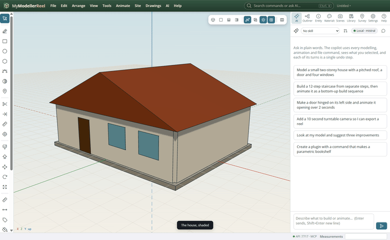
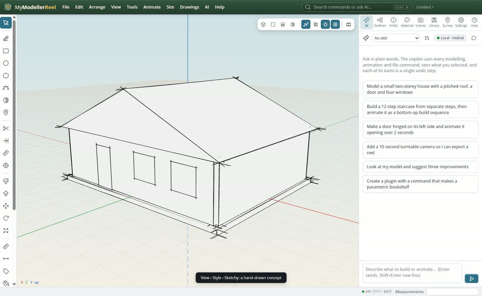
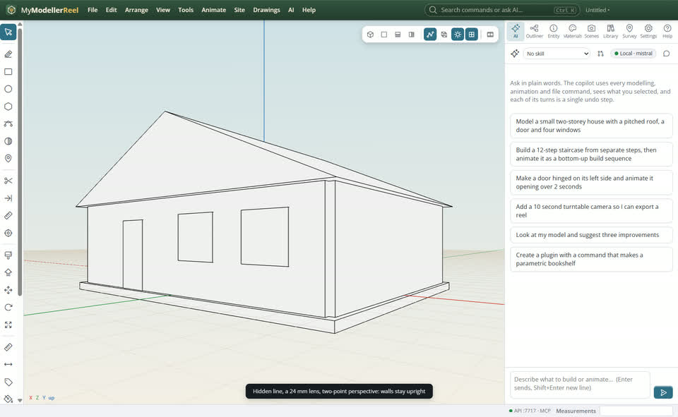
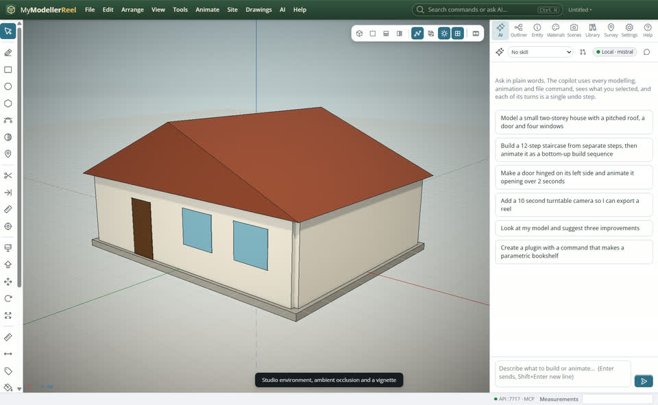
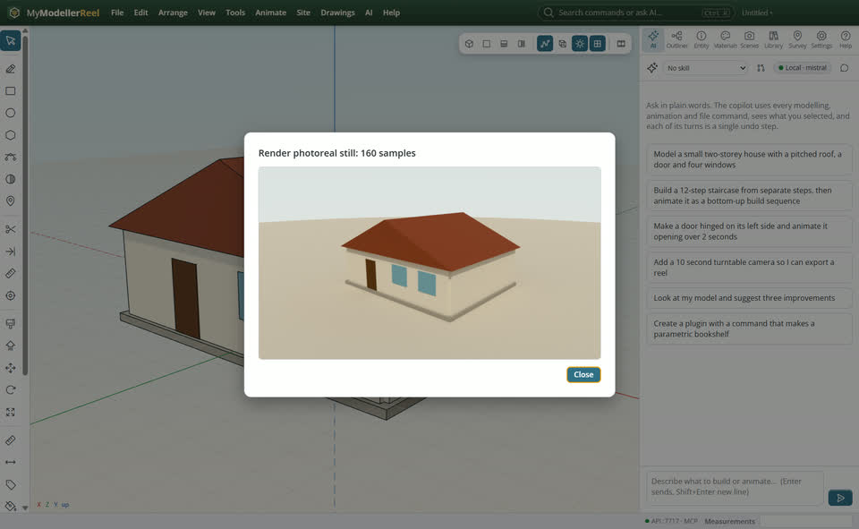

# Present a design: styles, lenses, effects and a photoreal still

You want the model to look its best for a client: a drawing-like style or a soft studio look, the right lens, and a photoreal still.



## In the app

1. **View › Style**: [Hidden line](action:styleHidden) for a clean drawing, [Sketchy](action:styleSketchy) for a hand-drawn concept, [Monochrome](action:styleMono) for massing, [Shaded](action:styleShaded) back.
   
2. **View › Camera lens…** [Lens](action:lens) (24, 35, 50, 85 mm), [Parallel projection](action:parallel) for no vanishing points, [Two-point perspective](action:twoPoint) to keep walls upright.
   
3. **View › Environment lighting…** [Environment](action:environment): studio, sky, sunset, night, or your own HDRI panorama. **View › Effects…** [Effects](action:effects): ambient occlusion, bloom, depth of field, vignette.
   
4. **View › Render photoreal still…** [Render](action:renderImage): the view path-traced (real reflections, glass, soft shadows), saved as PNG.
   

## Ask Plumb

> Show the house in a sketchy style with a 24 mm lens and two-point perspective, then switch to a studio environment with soft shadows and render a 1920 × 1080 photoreal still.

Plumb runs the same commands as the steps above; with **AI › Propose AI changes for review** on, you accept or reject its changes first.

## From a script, the HTTP API or MCP

```js
await api.set_style({ render_style: 'sketchy' });
await api.set_camera({ lens: 24, two_point: true });
await api.set_environment({ preset: 'studio' });
await api.set_effects({ ao: 0.7, vignette: 0.3 });
await api.render_image({ path: 'C:/out/house.png', width: 1920, height: 1080, samples: 256 });
```

## Good to know

- Effects and styles also go into `render_video`.
- The path tracer runs on the graphics card: more samples, cleaner and slower.

## Related

- [Textures, glass and AI materials](howto:textures-and-materials)
- [A sun study and night lighting](howto:sun-study-and-night-lights)
