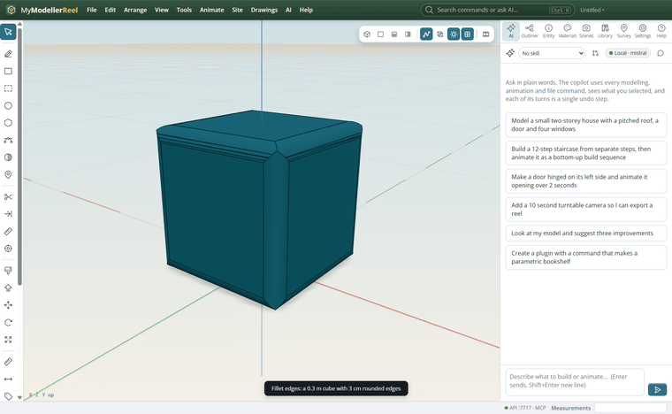
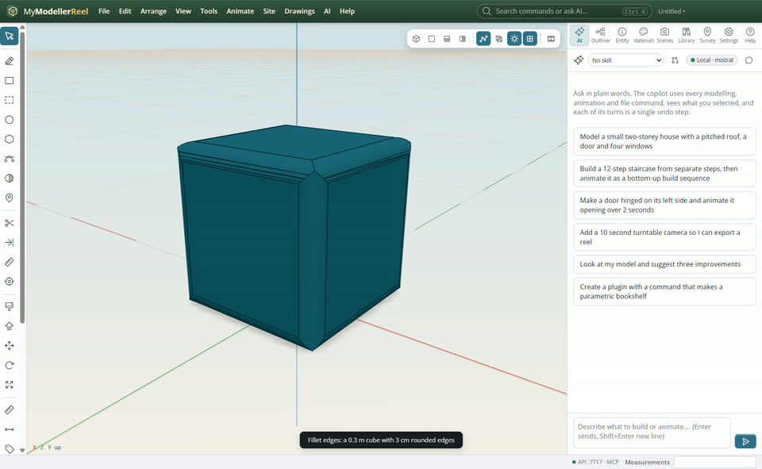
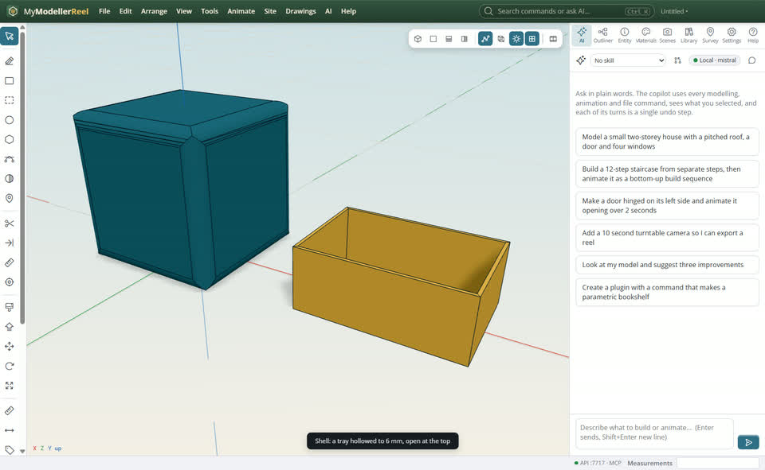
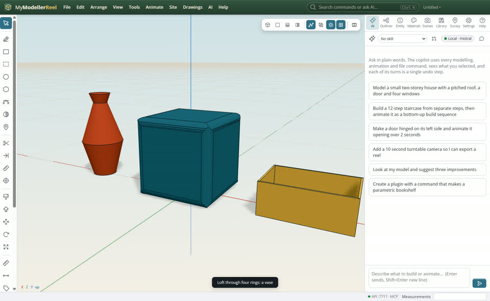
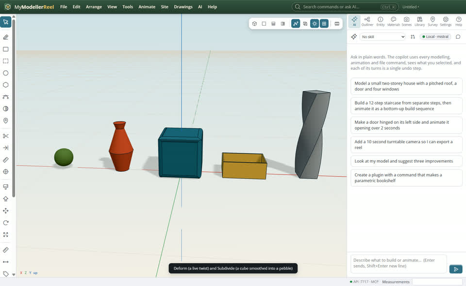

# Product modelling: fillet, shell, loft, subdivide and deform

You are shaping an object rather than a building: rounded edges, a hollow case, a vase through a few sections, a soft organic form, a twisted tower.



## In the app

1. Select a shape, **Tools › Fillet edges…** [Fillet](action:filletEdges) (all, vertical, top, bottom, or chosen edges) or **Chamfer edges…** [Chamfer](action:chamferEdges).
   
2. **Tools › Shell (hollow)…** [Shell](action:shell): a wall thickness, with the faces to open (top for a box or a tray).
   
3. Draw closed curves at different heights, select them in order, **Tools › Loft through the selected curves** [Loft](action:loft).
   
4. **Tools › Subdivide (smooth)** [Subdivide](action:subdivide) rounds a low-poly cage; **Deform…** [Deform](action:deform) tapers, twists or bends it and stays live.
   

## Ask the copilot

> Make a 0.3 m cube with 3 cm rounded edges, hollow it to a 4 mm wall open at the top, then loft a vase through a 10 cm circle, a 16 cm circle and a 6 cm circle.

The copilot runs the same commands as the steps above; with **AI › Propose AI changes for review** on, you accept or reject its changes first.

## From a script, the HTTP API or MCP

```js
await api.create_box({ width: 0.3, height: 0.3, depth: 0.3, name: 'Case' });
await api.fillet_edges({ id: 'Case', edges: 'all', radius: 0.03 });
await api.shell({ id: 'Case', thickness: 0.004, open: 'top' });
await api.loft({ profiles: ['Ring 1', 'Ring 2', 'Ring 3'] });
await api.deform({ id: 'Tower', type: 'twist', amount: 90 });
await api.subdivide({ id: 'Blob', levels: 2 });
```

## Good to know

- Fillets and chamfers work on sharp convex edges between flat faces; the corners where three edges meet are cut by both.
- A deformed shape keeps the original hidden: set_params changes the twist or taper later.
- `thicken` gives a lone face or a surface a thickness; `extrude_faces` raises faces along their normals.

## Related

- [Model a shape with push / pull](howto:push-pull-and-components)
- [A floor plan to 3D](howto:floor-plan-to-3d)
