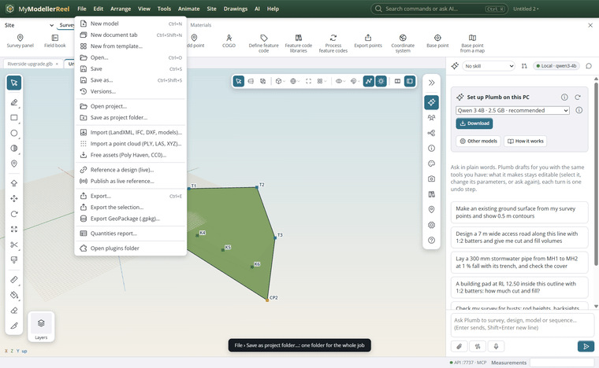
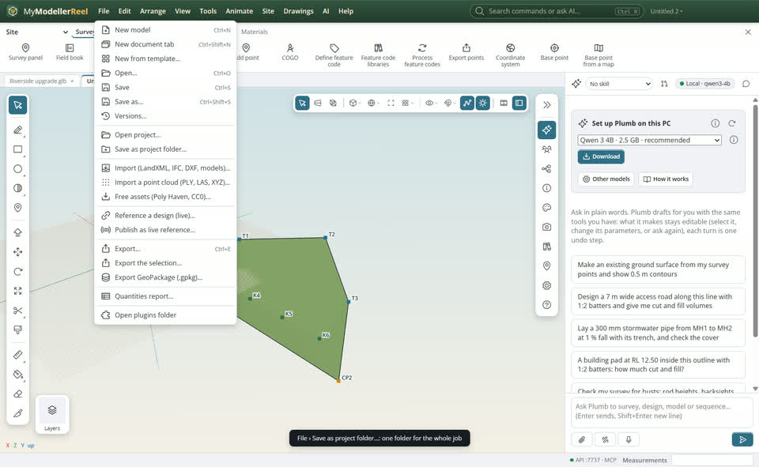
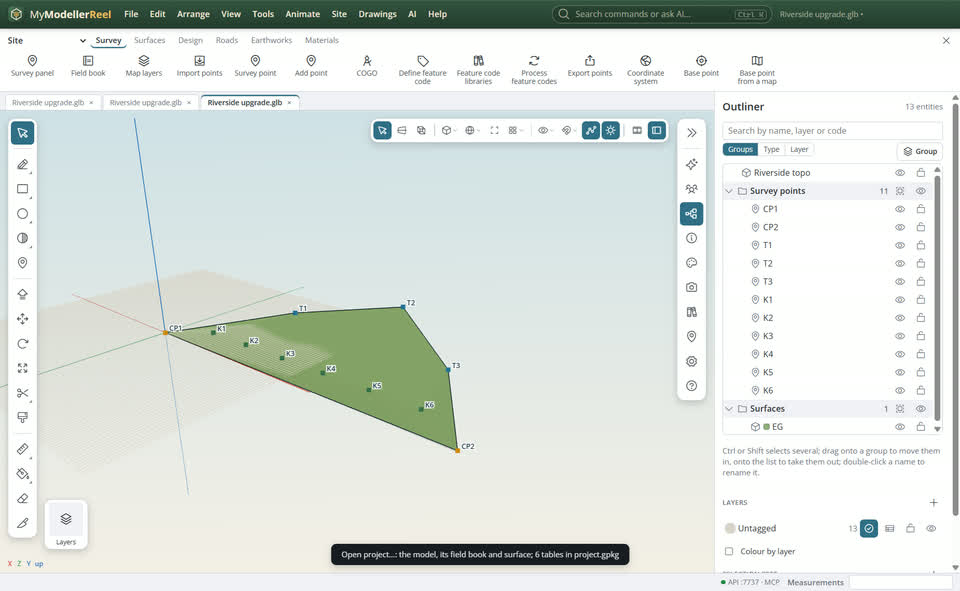

# Keep a whole job as a project folder

A job collects a lot: field books, point files, a feature library, surfaces, drawings, the coordinate system and the 3D model. You want it all in one folder, sorted by kind, with one database you can open in a GIS, and a scene other 3D tools can read.



## In the app

1. Import as usual (field books, point files, drawings, a feature library). **File › Save as project folder…** [Save as project folder](action:saveProject), then pick or make an empty folder. Every file you imported is copied in, sorted by kind, and the database and scene are written beside the model.
   
2. From then on **Save** (Ctrl+S) saves the project. **File › Open project…** [Open project](action:openProject) opens it again, on this computer or another: pick the folder, or its `project.gpkg`.
   

The folder:

```
Riverside upgrade/
  project.gpkg        the project database (OGC GeoPackage)
  scene.usda          the 3D scene (OpenUSD)
  README.txt          this layout, in words
  models/             the editable model (.glb)
  survey/             field books and point files, as imported
  surfaces/           each surface (LandXML 1.2)
  codes/              the feature library (Trimble FXL)
  drawings/           CAD, BIM and other source files, as imported
  assets/             the PDFs, images and media the model shows
```

## Ask Plumb

> Save this job as a project in C:\Jobs\Riverside upgrade, then tell me which source files it holds.

Plumb runs the same commands as the steps above; with **AI › Propose AI changes for review** on, you accept or reject its changes first.

## From a script, the HTTP API or MCP

```js
await api.import({ path: 'C:/field/Riverside topo.jxl' });
await api.save_project({ path: 'C:/Jobs/Riverside upgrade' });
await api.project_info({});
await api.open_project({ path: 'C:/Jobs/Riverside upgrade' });
await api.save({}); // in a project: saves the project
```

## Good to know

- **project.gpkg** is a GeoPackage: QGIS and ArcGIS open it as is. `survey_points` (with name, code, description, source and one column per attribute) and `linework` are in the project's coordinate system (its EPSG code). `mmr_project` holds the settings as key / value rows: coordinate system, site grid, units, feature codes, feature library, display settings. `mmr_files`, `mmr_field_books` and `mmr_assets` list what the folders hold.
- Change the coordinate system, a feature code or a setting in `mmr_project` (in a GIS or with SQL) and the project follows when it opens; the reply of `open_project` says which ones it took (`from_database`). Geometry and points come from the model; edits to the `survey_points` table are not read back.
- **scene.usda** is rewritten on every save for Omniverse, Blender or Houdini; the app does not read it back.
- Source files are copied once. Two different files with the same name are both kept (`points.csv`, `points (2).csv`). A source file that has gone missing since it was imported is listed in `mmr_files`, not copied, and the save warns about it.
- The PDFs and images the model shows are files in `assets/`, not packed into the model file, so a project folder stays readable and the model file stays small. Point clouds keep their own format inside the model file.
- Save as… (a .glb) still works for a single file to send.

## Related

- [Import a points file and keep its attributes](howto:import-survey-points)
- [Give feature codes symbols and typed attributes](howto:feature-code-symbols)
- [Keep feature code libraries and pick the one a model uses](howto:feature-code-libraries)
