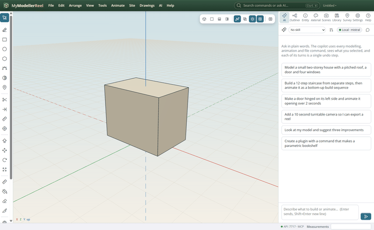
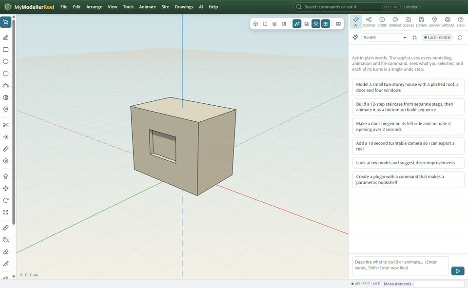
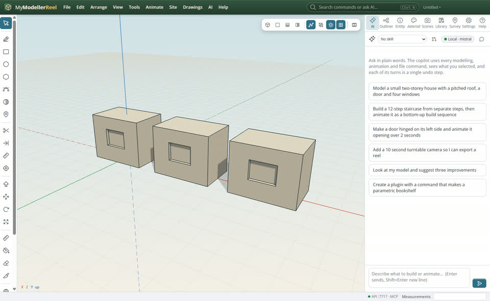
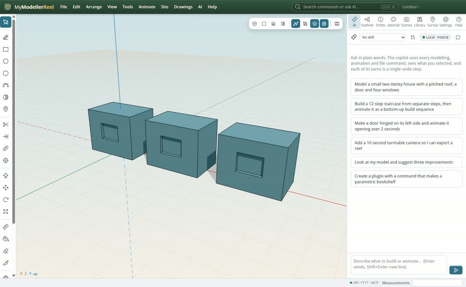

# Model a shape with push / pull, then copy it as a component

You want a simple building block (a cabin, a kiosk, a shelf unit), with openings cut into it, and several copies that change together.



## In the app

1. Pick the Rectangle tool [Rectangle](tool:rectangle) (R), click two corners on the ground; then Push/Pull [Push/Pull](tool:pushpull) (P) and lift the face. Type an exact height in the Measurements box, e.g. `2.4`.
   
2. Draw a rectangle on a face: it is imprinted on that face, ready to push.
   
3. Push the new face in (a negative distance) for a recess, or all the way through for a hole.
   
4. Select the shape, **Edit › Make component** [Make component](action:makeComponent), then copy it (Move with Ctrl, or **Edit › Duplicate**).
   
5. Change any copy (paint it, push a face): every copy follows. **Edit › Make unique** lets one go its own way.
   

## Ask the copilot

> Make a 3 × 2 m cabin, 2.4 m high, with a window recess on the front, then two linked copies 4 m apart.

The copilot runs the same commands as the steps above; with **AI › Propose AI changes for review** on, you accept or reject its changes first.

## From a script, the HTTP API or MCP

```js
await api.create_box({ width: 3, height: 2.4, depth: 2, name: 'Cabin' });
const r = await api.imprint({ id: 'Cabin', face: 'front', shape: 'rectangle', size: [1.2, 0.9], center: [0, 1.3, 1] });
await api.push_pull({ id: 'Cabin', face: r.face, distance: -0.15 });
const c = await api.make_component({ ids: ['Cabin'], name: 'Cabin' });
await api.duplicate({ ids: [c.id], offset: [4, 0, 0], count: 2 });
```

## Good to know

- Components share their geometry, so files stay small and edits happen once.
- `imprint` takes rectangles, circles, polygons or any outline of points.

## Related

- [Organise a model with layers and attributes](howto:organise-with-layers)
