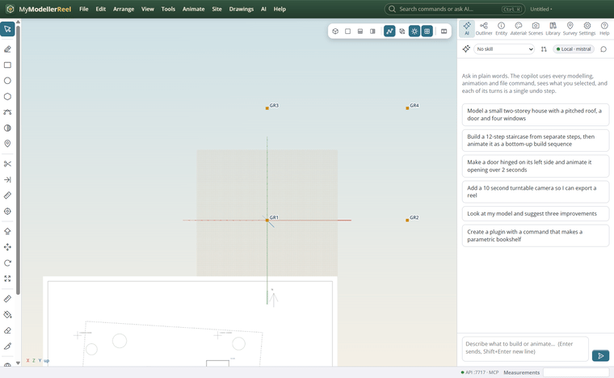
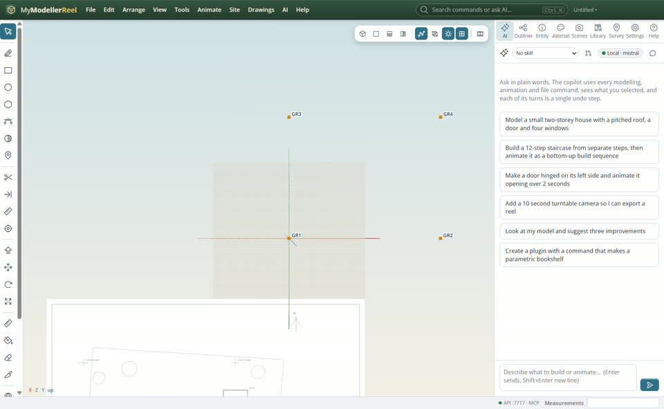
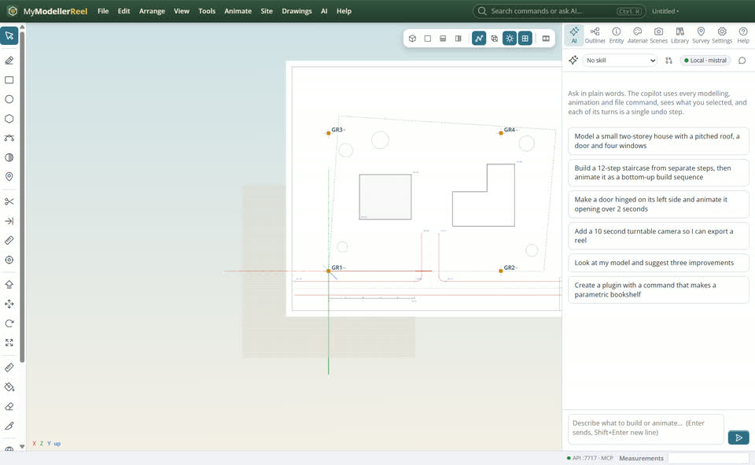
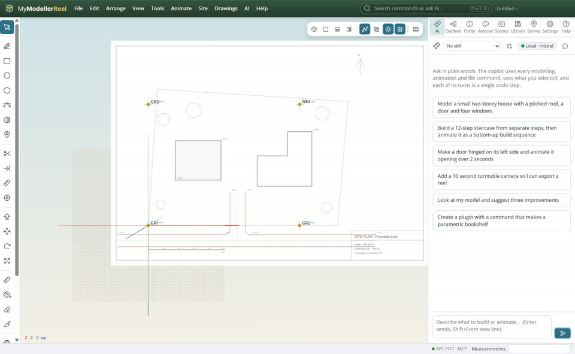
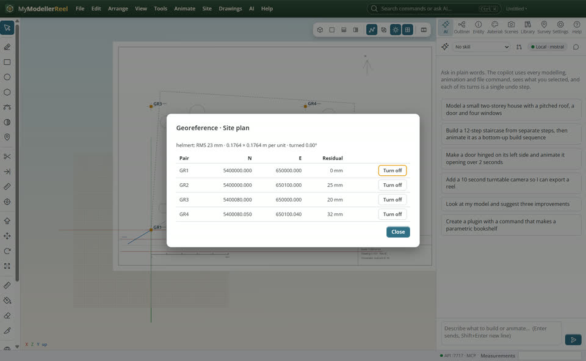

# Put a PDF site plan in place

You have a PDF plan and want it lying in the model at the right scale and in the right place, in your project coordinates.



## In the app

1. **Drawings › Import PDF drawing…** [Import PDF](action:importPdf) at its drawing scale (`1:500`): the sheet is at true size.
   
2. Control points tool [Control points](tool:control) (J): click a spot on the sheet (a grid cross, a corner), then where it really is: a survey point, or type its N, E. The first point moves the sheet onto it.
   
3. Add two or more: the sheet is fitted by least squares (scale, rotation, shift).
   
4. **Drawings › Georeference report** [Report](action:georefReport): the residual of each point and the RMS; turn a bad point off and it refits.
   

## Ask the copilot

> Import C:\plans\site.pdf at 1:500 and georeference it: the grid crosses at its corners are E 650000 / 650100, N 5400000 / 5400080.

The copilot runs the same commands as the steps above; with **AI › Propose AI changes for review** on, you accept or reject its changes first.

## From a script, the HTTP API or MCP

```js
const r = await api.import_pdf({ path: 'C:/plans/site.pdf', scale: '1:500' });
const id = r.underlays[0].id;
await api.add_control_pair({ id, from: { u: 140, v: 692 }, to: { n: 5400000, e: 650000 } });
await api.add_control_pair({ id, from: { u: 707, v: 692 }, to: { n: 5400000, e: 650100 } });
await api.georeference_underlay({ id });
```

## Good to know

- No coordinates? The Calibrate tool [Calibrate](tool:calibrate) (I): click two points and type their real distance, or a bearing.
- Images with a world file (.pgw, .jgw, .tfw) place themselves: **Drawings › Import image** [Import image](action:importImage).

## Related

- [Turn a PDF plan into a 3D model](howto:pdf-linework-to-3d)
