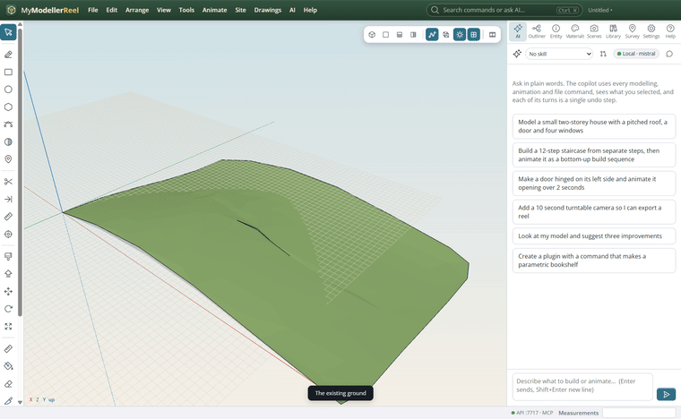
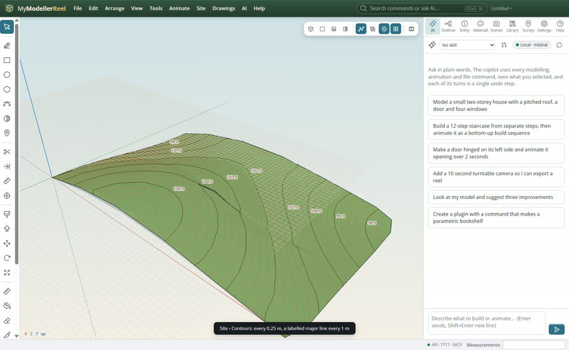
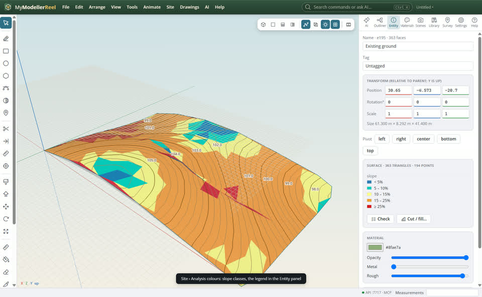
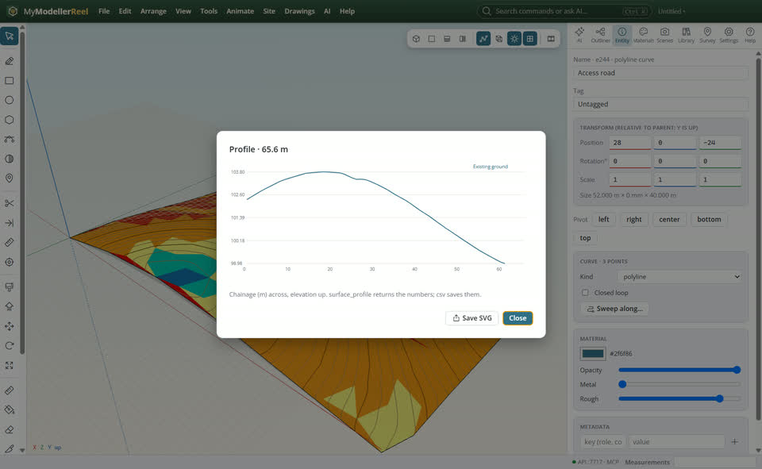

# Read the terrain: contours, slopes, profiles and sections

You have a ground surface and want to read it: contour lines with their heights, where it is steep, and what it looks like along a line.



## In the app

1. **Site › Contours…** [Contours](action:contours): an interval and a major line every n. They follow the surface: move a point and they are drawn again.
   
2. **Site › Analysis colours…** [Analysis](action:analyze): slope classes (your limits, in % or degrees), elevation bands, the way faces look (aspect), or the difference to another surface. The legend is in the Entity panel.
   
3. Select the surface: the bar at the bottom of the view switches **Triangles**, **Elevation**, **Slope** and **Facing** colours, **Arrows** (downhill, longer where steeper, each named by its grade) and **Contours** on and off.

4. Hover the surface with the Select tool: its elevation and slope under the cursor show in the status bar.
5. Select a line, **Site › Profile along the selected line** [Profile](action:profile): every surface it crosses, chainage across, elevation up; save it as SVG.
   
6. **Site › Cross-sections along the selected line** [Sections](action:sections): sections square to it at an interval; step through them.

## Ask Plumb

> Draw 0.5 m contours of the existing ground with a major line every 2 m, colour it by slope (5, 10 and 20 %), and show me the long section along the access road.

Plumb runs the same commands as the steps above; with **AI › Propose AI changes for review** on, you accept or reject its changes first.

## From a script, the HTTP API or MCP

```js
await api.surface_contours({ id: 'Existing ground', interval: 0.5, major_every: 4 });
await api.analyze_surface({ id: 'Existing ground', kind: 'slope', thresholds: [5, 10, 20] });
await api.slope_arrows({ id: 'Existing ground', spacing: 5 });
const p = await api.surface_profile({ path: 'Access road', interval: 5, csv: 'C:/out/profile.csv' });
await api.cross_sections({ path: 'Access road', interval: 20, left: 15, right: 15 });
await api.export_contours({ id: 'Existing ground contours', path: 'C:/out/contours.dxf' });
```

## Good to know

- `export_contours` writes the lines as DXF polylines at their elevations.
- Water rising over the ground on the timeline: `water_level`.

## Related

- [Turn survey points into a surface](howto:survey-points-to-surface)
- [Design a building pad with batter slopes](howto:design-a-pad)
