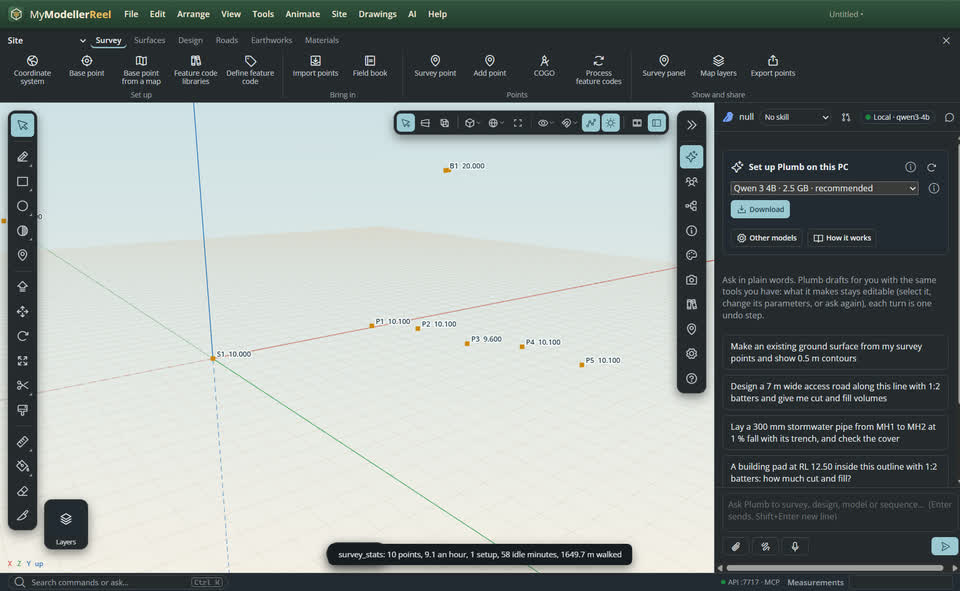
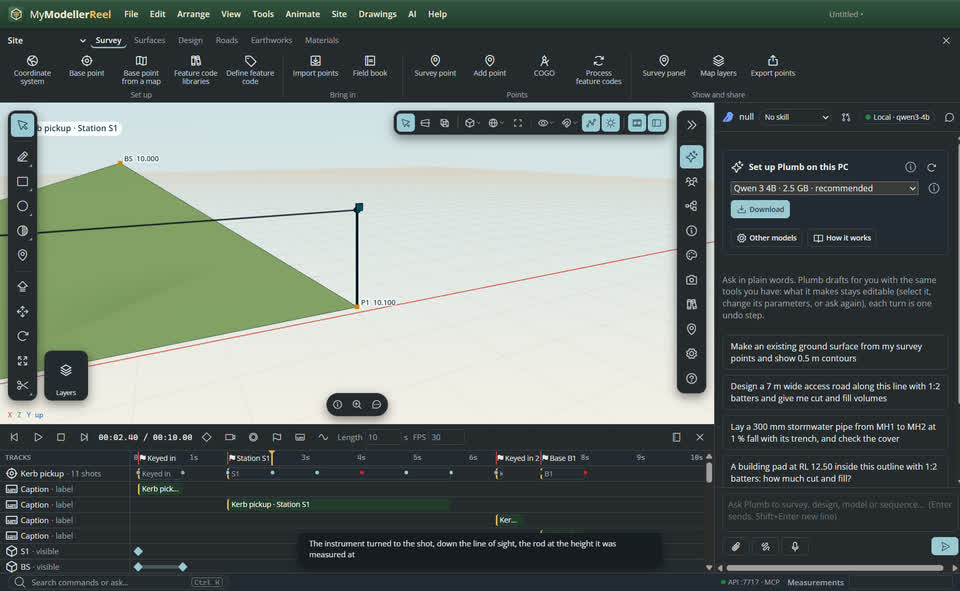
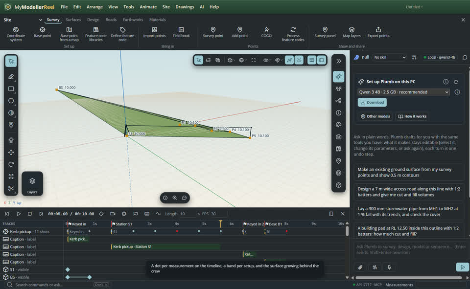

# Replay a survey: watch the field work, and see how the day went

A field book is a record of a day's work, not only a bag of coordinates. Every shot carries the time it was taken, the setup it came from, the instrument and rod heights, and the angles and distance the instrument read. Play it back and the job tells its own story: where the crew stood, what they shot, where the day went — and a rod left at the wrong height stands out because the rod itself stands in the wrong place.


## In the app

1. [Import](action:import) a Trimble JobXML (.jxl) job. The points come in with their **field book** (see [Fix field mistakes in a survey](howto:edit-survey-measurements)).
2. Run [survey_stats](do:survey_stats) for the day in numbers: time on site, points per hour, the idle gaps, a row per station setup with its shots, minutes and sight distances, how many shots were prism, reflectorless or GNSS, the GNSS precision and PDOP, the rod and antenna heights used, and how far the rod travelled.
   
3. Run [replay_survey](do:replay_survey). The timeline fills: the points vanish and come back in the order they were stored, a **total station** stands on its setup and turns to each shot down the line of sight the circle readings describe, the **prism rod** and the **GNSS rover** stand at the heights that were measured, and a band and a marker mark each setup.
   
4. The replay row on the timeline shows **a dot per measurement** — prism, reflectorless, GNSS or keyed in, and red for anything `review_survey` flagged. Click a dot to go to that moment and select the point.
   
5. Press play. Set `mode` to **clock** to keep the real time stamps, so travel and waiting show as they happened, or **event** to space the shots evenly and fit a day into a minute. `speed` multiplies either one. Pass several surveys and they play on one clock, so two crews interleave the way they actually worked.
6. `grow: true` grows a TIN of the points measured so far, so the surface forms behind the crew.
7. [Render a video](do:render_video) of it for a client, a dealer or a tailgate meeting. `replay_survey` with `clear: true` takes the replay, its instruments and its keys back out.

## What is accurate, and what is not

The instrument is placed from the field book, not from the stored coordinate: its trunnion axis sits at the setup's **instrument height** above the station point, the alidade turns to the **horizontal circle** oriented by the backsight, the telescope tilts to the **zenith angle**, and the beam is the **slope distance** long. The prism sits at the shot's **target height** above the foot of the rod, and the GNSS antenna at its phase centre above the point. So a rod height bust shows as a rod sunk into the ground or floating above it — and when you fix it with `edit_survey_observations`, rebuild the replay and the rod stands properly.

The grid scale factor is left out of the drawing (it is well under a millimetre over a sight; it stays in the reduction, which is what the points are computed from).

## Ask Plumb

> How did yesterday's survey go? Points per hour, and where did the time go?

> Replay the survey four times faster, evenly spaced, and grow the surface as the points come in.

> Play both crews' jobs together on the real clock.

## From a script, the HTTP API or MCP

```js
await api.import({ path: 'C:/jobs/kerb pickup.jxl' });
await api.survey_stats({});                                        // the day in numbers
await api.replay_survey({ mode: 'clock', seconds_per_hour: 90 });  // the day as it happened
await api.replay_survey({ mode: 'event', speed: 4, grow: true });  // a day in a minute
await api.replay_survey({ surveys: ['Crew A', 'Crew B'] });        // one clock, two crews
await api.render_video({ path: 'C:/jobs/field day.mp4', width: 1280, height: 720, fps: 30 });
await api.replay_survey({ clear: true });
```

## Related

- [Fix field mistakes in a survey](howto:edit-survey-measurements)
- [Turn survey points into a surface](howto:survey-points-to-surface)
- [Make a construction sequence video](howto:construction-sequence-video)
