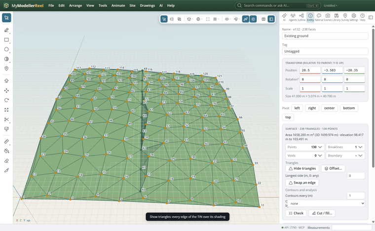
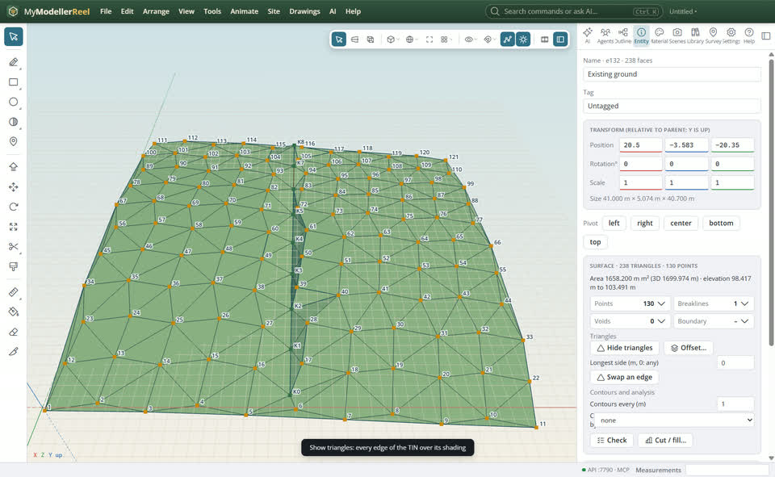
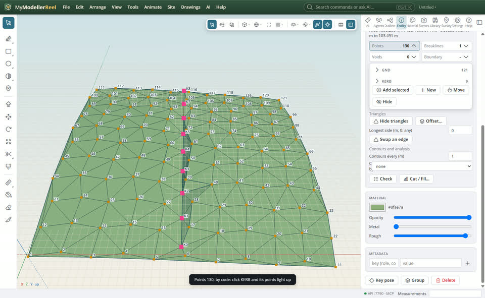
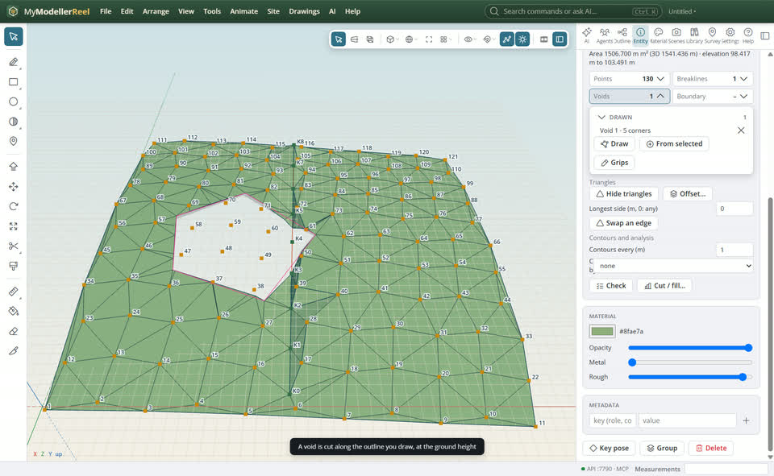
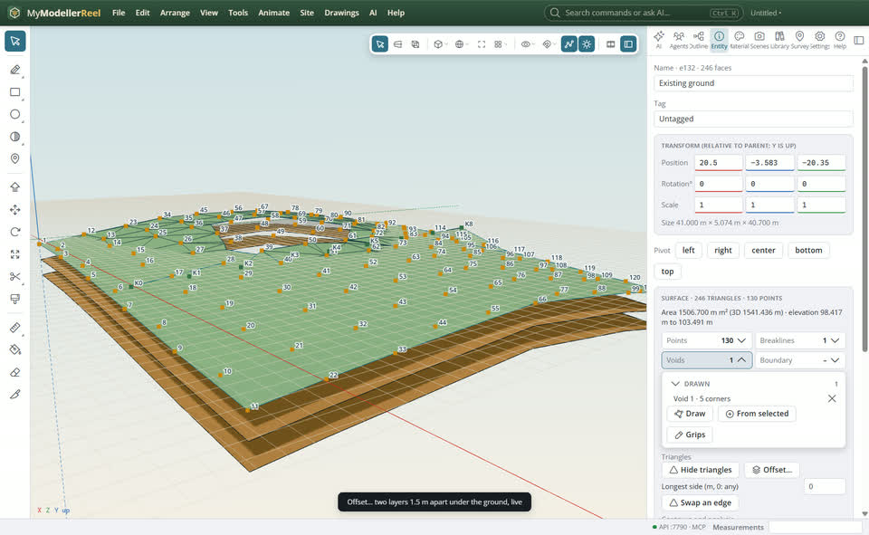
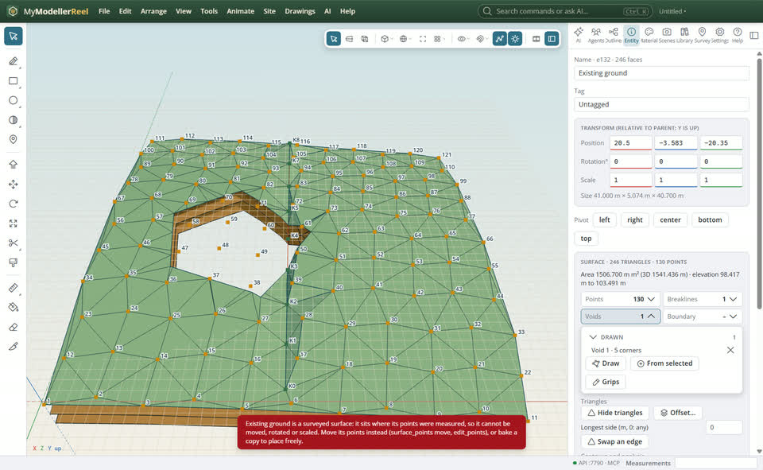

# Review a surface and build layers: triangles, members, voids, offsets and LandXML

A surface from survey points is only as good as its triangles. Show them to check the geometry, see at a glance what the surface is made of (points, breaklines, voids, boundary) and light any part up in the view, cut voids along the outline you draw, then build the layers under it (topsoil, subgrade) as live offset surfaces and send it all out as LandXML.



## In the app

1. Select the surface. In the **Entity** panel, **Show triangles** draws every triangle edge over the shading ([Do it](do:show_triangles)); click it again to hide them.
   
2. What the surface is made of shows as counts: **Points**, **Breaklines**, **Voids**, **Boundary**. Click a count to open its list, grouped by feature code (points) or layer (lines). Click a group or an item to light it up in the view; the **×** takes it out of the surface. Open a group with its arrow to list its items.
   
3. Add members later: select points or lines in the view and click **Add selected** in the Points or Breaklines list; select lines and points together and right-click › **Create a surface from these points and lines** to start one.
4. A void: in the **Voids** list click **Draw** and click the corners of the area to leave out (or select a closed curve and click **From selected**). The surface is cut along the outline you drew, with new points on its edge at the ground's height, not along whole triangles. The **Boundary** list does the same for the outline the surface stays inside.
   
5. To tidy a ragged edge instead, delete whole triangles: [Edit surface](action:editSurface), **D** and click a triangle, or remove every triangle inside a few corners with `edit_triangles` `delete_inside`.
6. **Offset…** makes surfaces that follow this one: a number of copies a distance apart (straight down for a topsoil strip, or along the surface normals for an even thickness on slopes), or layers spaced evenly between this surface and another ([Do it](do:offset_surfaces)). Change the ground and they follow.
   
7. A surface made from survey points stays where the points were measured: Move, Rotate and Scale refuse it. Move its points instead, or bake a copy to place freely.
   
8. [Export LandXML](action:exportLandxml): every surface (its points and triangles) and its offsets, with the survey points (or without them: `points: false`).

## Ask Plumb

> Show the triangles of Existing ground, cut a void around the pond, and make two layers 0.3 m apart under it. Then export it to LandXML without the points.

## From a script, the HTTP API or MCP

```js
await api.show_triangles({ ids: ['Existing ground'] });
await api.surface_definition({ id: 'Existing ground' });
await api.surface_points({ id: 'Existing ground', action: 'include', points: ['K1', 'K2'] });
await api.surface_breaklines({ id: 'Existing ground', action: 'add', line: 'Kerb line' });
await api.surface_boundary({ id: 'Existing ground', action: 'add_void', points: [[8, -14], [17, -11], [22, -20], [14, -27], [7, -22]] });
await api.edit_triangles({ id: 'Existing ground', action: 'delete_inside', points: [[30, -30], [40, -30], [40, -40], [30, -40]] });
await api.offset_surfaces({ surface: 'Existing ground', distance: -0.3, count: 2 });
await api.offset_surfaces({ surface: 'Existing ground', distance: 0.5, normal: true });
await api.offset_surfaces({ surface: 'Existing ground', to: 'Rock', count: 3 });
await api.export({ format: 'landxml', path: 'C:/Projects/site.xml', points: false });
```

## Good to know

- `include` on a surface made from chosen points adds those points to its list; on one made from every point it brings back points left out.
- A layer between two surfaces keeps the triangles of the first one; where the other surface is missing, there is no layer.
- Offsets along the normals move points sideways on slopes: use them for an even thickness, straight offsets for levels.

## Related

- [Edit a surface by hand](howto:edit-a-surface-by-hand)
- [Turn survey points into a surface](howto:survey-points-to-surface)
